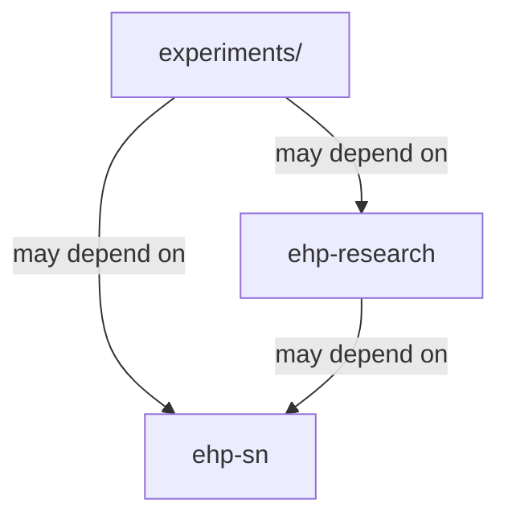
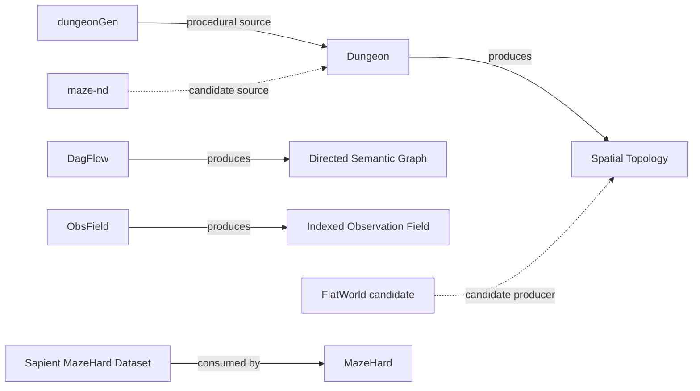
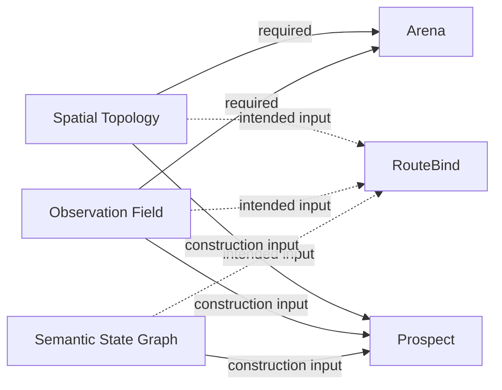
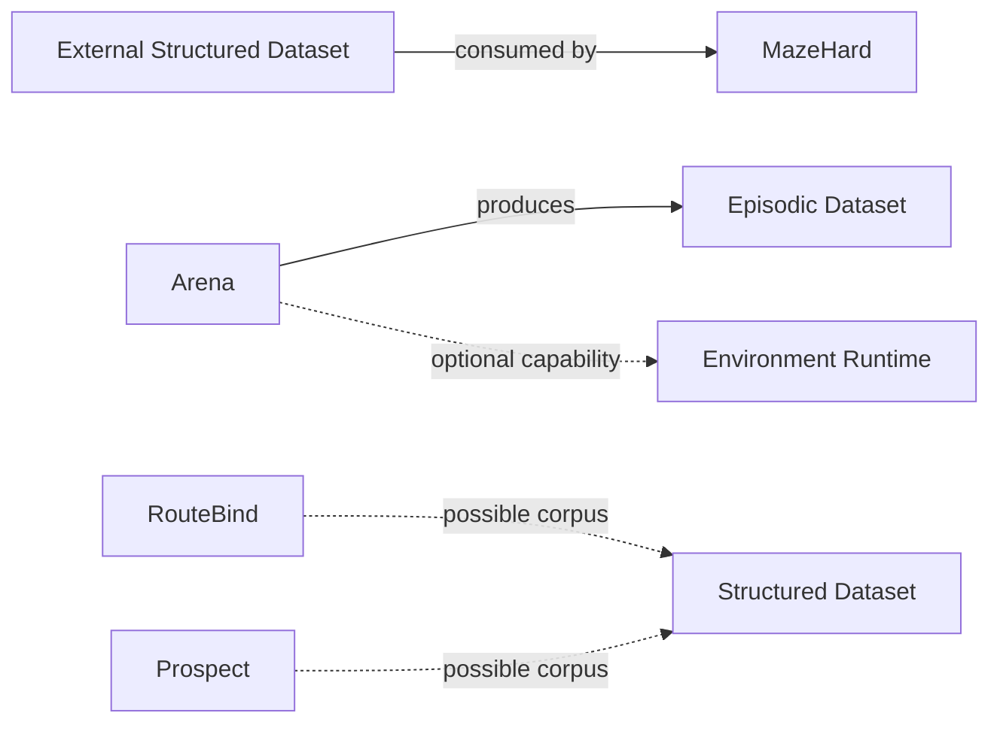
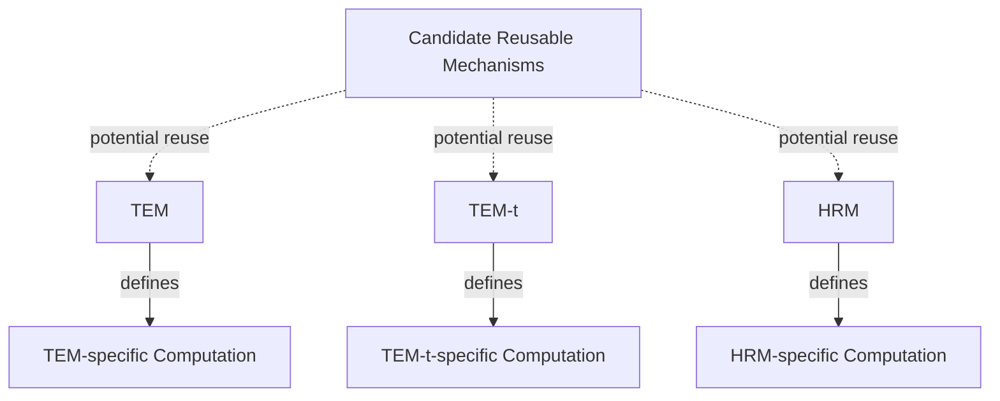
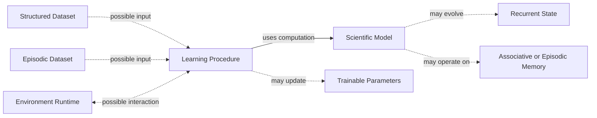
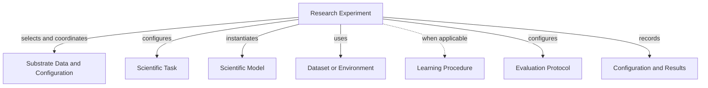

# EHP — Scientific and Software Architecture

**Architecture baseline:** 25 October 2026  
**Status:** Current working specification; scientific and implementation verification ongoing  
**Scope:** Scientific components, reusable computation, interoperability contracts, learning capabilities, experimental composition, and outstanding requirements

---

## 1. Purpose and architectural principles

EHP is a computational research ecosystem for investigating relational memory, cognitive maps, spatial navigation, semantic and spatial relationships, hierarchical reasoning, prospective reasoning, and computational neuroscience learning models.

Its principal objective is to make independently developed scientific information and computational capabilities reusable across compatible research tasks and experiments.

EHP adopts established scientific representations, numerical libraries, machine-learning frameworks, and interchange formats wherever they satisfy the applicable scientific and technical requirements.

The governing architectural principle is:

**Substrates produce scientific information; tasks interpret and validate that information; experiments configure and compose compatible scientific capabilities.**

### 1.1 Responsibility model

| Responsibility                                                  | Owner                                  |
| --------------------------------------------------------------- | -------------------------------------- |
| Define scientific data-generation behavior                      | Substrate                              |
| Interpret generation configuration                              | Substrate                              |
| Generate and represent scientific information                   | Substrate                              |
| Validate generated scientific information                       | Substrate                              |
| Define a scientific problem                                     | Task                                   |
| Specify required inputs and applicable scientific constraints   | Task                                   |
| Validate compatibility among task inputs                        | Task                                   |
| Determine the meaning and use of supplied information           | Task                                   |
| Define model-visible information, targets, and evaluation truth | Task and applicable task–model binding |
| Select substrate configurations and realizations                | Experiment                             |
| Coordinate compatible substrate generation                      | Experiment                             |
| Instantiate models and learning procedures                      | Experiment                             |
| Execute scientific investigations and record results            | Experiment                             |

A substrate may use scientific structure during generation without requiring that structure to appear in its output representation.

For example, an observation-field generator may use a spatial layout to determine region-dependent observation probabilities. Its resulting observation-assignment artifact can remain an indexed collection of observation identities.

Conversely, a task may consume indexed observations without requiring spatial topology.

### 1.2 Independence and interoperability

EHP distinguishes three architectural properties.

**Package independence.** Reusable Python packages do not import applications that depend on them.

**Implementation independence.** Consumers use scientific information through shared representations without depending on the producer's implementation.

**Scientific interoperability.** Independently produced information has the identities, properties, and scientific meaning required by the consuming task.

A shared representation may support more structures than an individual task accepts.

For example, NetworkX supports arbitrary graph connectivity, while Arena admits specified spatial-topology families. Likewise, an indexed observation assignment may describe arbitrary finite domains, while a spatial task may require a particular geometric interpretation.

The shared contract establishes how information is represented. The task determines whether that information is scientifically applicable.

### 1.3 Information boundaries

EHP distinguishes the following information classes:

| Information class             | Meaning                                                          |
| ----------------------------- | ---------------------------------------------------------------- |
| Substrate information         | Scientific information independently generated by substrates     |
| Task-construction information | Information used to construct valid task instances               |
| Model-visible information     | Information explicitly permitted as model input                  |
| Acquisition experience        | Information encountered during learning or exploration           |
| Acquired memory               | Environment-specific information retained through experience     |
| Evaluation truth              | Privileged information used for validation, targets, and metrics |
| Model-internal information    | Latent representations, recurrent state, and associative memory  |
| Learning state                | Trainable parameters and optimizer-associated information        |

Information available during task construction is not automatically model-visible.

Task–model bindings preserve the information regime defined by their tasks.

### 1.4 Scientific and computational state

Four state categories are distinguished:

1. **Substrate-represented state:** Scientific states, positions, or other entities described by generated information.
2. **Task state:** State defining an instance, its progression, and correctness conditions.
3. **Model state:** Internal activations, recurrent representations, and model-specific memory.
4. **Learning state:** Trainable parameters and optimizer-associated values.

These state categories have different scientific meanings and need not share software representations.

### 1.5 Architectural status

The specification uses five maturity classifications.

| Status      | Meaning                                                                                       |
| ----------- | --------------------------------------------------------------------------------------------- |
| Established | Accepted scientific responsibility, relationship, constraint, or architectural decision       |
| Selected    | Technology, representation, or convention chosen for the current design                       |
| Recommended | Evidence-supported implementation choice pending project approval or conformance verification |
| Provisional | Intended relationship or placement requiring scientific verification                          |
| Open        | Concrete requirement or contract requiring further resolution                                 |

These statuses describe design maturity rather than implementation completion.

---

## 2. Software architecture and package boundaries

### 2.1 Repository organization

EHP comprises two reusable Python packages and an experiment layer.

```text
ehp/
├── packages/
│   ├── ehp-sn/
│   │   ├── pyproject.toml
│   │   └── src/
│   │       └── ehp_sn/
│   │
│   └── ehp-research/
│       ├── pyproject.toml
│       └── src/
│           └── ehp_research/
│
├── experiments/
│   ├── arena-tem/
│   ├── arena-tem-t/
│   ├── mazehard-hrm/
│   └── mazehard-hrm-rl/
│
├── config/
└── data/
```

The packages are independently defined Python distributions.

Experiments compose the scientific capabilities provided by these packages and applicable external libraries.

### 2.2 Package responsibilities

| Boundary       | Responsibility                                                                        | Status                                            |
| -------------- | ------------------------------------------------------------------------------------- | ------------------------------------------------- |
| `ehp-sn`       | Independently reusable scientific and computational mechanisms                        | Established                                       |
| `ehp-research` | Reusable scientific substrates and tasks; provisionally, complete model definitions   | Established boundary; model placement provisional |
| `experiments/` | Scientific configuration, composition, execution, training, evaluation, and recording | Established                                       |

#### `ehp-sn`

`ehp-sn` provides computational mechanisms that are independently reusable across scientific models or research procedures.

Candidate capabilities include:

- Attention mechanisms.
- Recurrent computation.
- Associative storage and retrieval.
- Neural-population operations.
- Trainable representation transformations.
- Reusable entorhinal–hippocampal computational mechanisms.
- Reusable learning mechanisms where independently applicable.

A mechanism belongs in `ehp-sn` when analysis of scientific formulations and implementations establishes meaningful independent reuse.

The package may depend directly on established numerical, scientific, and machine-learning libraries.

#### `ehp-research`

`ehp-research` contains reusable scientific definitions.

Its principal responsibilities are:

- Substrate generation.
- Scientific substrate representations and validation.
- Task definitions and scientific constraints.
- Task-instance construction.
- Input applicability and compatibility validation.
- Task-specific evaluation semantics.

Complete scientific model architectures, including TEM, TEM-t, and HRM, are provisionally assigned to this package.

These architectures may consume reusable mechanisms from `ehp-sn` while retaining their model-specific computation.

#### `experiments/`

Experiments configure and execute scientific investigations.

An experiment selects applicable scientific realizations, constructs tasks, instantiates models, configures learning conditions, executes procedures, evaluates results, and records the investigation.

Experiment-specific comparisons and research hypotheses belong to this layer.

### 2.3 Dependency rules

Permitted Python dependency directions are:

```text
experiments → ehp-research
experiments → ehp-sn
ehp-research → ehp-sn
```

All three dependencies are optional.

`ehp-sn` is independent of `ehp-research`.

Neither reusable package depends on experiments.

Experiments do not serve as reusable implementation dependencies for other experiments.

Both reusable packages may depend directly on established external libraries.

### 2.4 Configuration

The root-level `config/` directory contains reusable TOML presets.

The identified configuration inventory is:

```text
config/
├── README.md
├── data/
│   └── obsfield/
│       ├── grid30x30-04-weighted.toml
│       └── grid30x30-45-uniform.toml
├── evaluation/
│   ├── replay_memory_reset.toml
│   └── replay_metrics_only.toml
├── models/
│   ├── hrm_pfc.toml
│   ├── hrm_pfc_str.toml
│   ├── tem_attention.toml
│   └── tem_attractor.toml
└── training/
    ├── act_supervised.toml
    ├── actor_critic.toml
    └── replay_tbptt25.toml
```

Configuration interpretation follows scientific ownership.

| Configuration concern                          | Interpreter             |
| ---------------------------------------------- | ----------------------- |
| Substrate generation                           | Corresponding substrate |
| Task construction and scientific constraints   | Corresponding task      |
| Model architecture and parameters              | Model implementation    |
| Learning objective and optimization conditions | Learning procedure      |
| Experiment composition                         | Experiment              |

Experiments coordinate generation configurations to obtain scientifically compatible realizations.

Tasks validate compatibility using the actual resulting information.

### 2.5 Persistent scientific data

EHP organizes persistent scientific information according to the following lifecycle:

| Directory         | Purpose                                        | Examples                                                |
| ----------------- | ---------------------------------------------- | ------------------------------------------------------- |
| `data/external/`  | Original externally maintained datasets        | Sapient MazeHard                                        |
| `data/raw/`       | Original EHP-generated substrate information   | DagFlow graphs, Dungeon topology, ObsField realizations |
| `data/interim/`   | Intermediate or derived scientific information | Task construction and acquisition intermediates         |
| `data/processed/` | Prepared task datasets                         | Arena replay episodes, task corpora                     |

These categories describe scientific data lifecycle rather than mandatory processing stages.

Persisted artifacts remain independently usable without executing their originating generators.

### 2.6 Artifact organization and provenance

A scientific realization retains sufficient information to identify:

- Its scientific content.
- Its realization identity.
- Applicable domain and vocabulary references.
- Generation configuration.
- Source input identities.
- Randomness conditions.
- Relevant implementation or source revisions.

For realizations comprising multiple resources, **realization-level metadata and resource references are maintained in a package descriptor**.

Individual resources retain their native representations, such as GraphML or Parquet.

The descriptor associates the resources with their realization and applicable scientific declarations. **Data Package 2.0 is the selected descriptor specification** for multi-resource scientific artifacts, using local relative resource paths and an explicitly versioned EHP scientific metadata profile. Runtime conformance remains pending. A package identity, domain identity, vocabulary identity, and realization identity remain distinct.

The Section 15.1 interoperability profile specifies minimum resource-role and identity-reference metadata. Concrete validation against the selected Data Package implementation remains pending.

---

## 3. Scientific component classification

EHP distinguishes information producers, scientific tasks, computational models, learning procedures, and experiments.

| Category                       | Components                                                    | Responsibility                                                                                  |
| ------------------------------ | ------------------------------------------------------------- | ----------------------------------------------------------------------------------------------- |
| External procedural generators | `dungeonGen`, `maze-nd`                                       | Supply externally maintained generation capabilities                                            |
| External structured datasets   | Sapient `maze-30x30-hard-1k`                                  | Supply benchmark information                                                                    |
| Scientific substrates          | DagFlow, Dungeon, ObsField                                    | Generate reusable scientific information                                                        |
| Future substrate candidate     | FlatWorld                                                     | Potential independent spatial-topology generation                                               |
| Scientific tasks               | Arena, RouteBind, Prospect, MazeHard                          | Define scientific problems, construct instances, validate applicability, and evaluate solutions |
| Scientific models              | TEM, TEM-t, HRM                                               | Define complete computational architectures                                                     |
| Model/learning investigation   | HRM-RL                                                        | Investigate a learning hypothesis                                                               |
| Computational mechanisms       | Identified through reference-model analysis                   | Provide independently reusable computations                                                     |
| Learning procedures            | Predictive, supervised, reinforcement, DFA, hybrid            | Define learning objectives and update behavior                                                  |
| Experiments                    | `arena-tem`, `arena-tem-t`, `mazehard-hrm`, `mazehard-hrm-rl` | Compose and evaluate investigations                                                             |

### 3.1 Substrate information

A substrate produces scientific information that remains interpretable independently of the generator.

Its generation behavior determines which realizations are produced.

Its output conforms to an applicable information representation and scientific declaration.

### 3.2 Task interpretation

A task defines a scientific problem using compatible information.

It determines:

- Required inputs.
- Scientific applicability.
- Construction of task instances.
- Permitted model information.
- Expected outputs.
- Correctness conditions.
- Evaluation procedures.

### 3.3 Scientific computation

Models perform scientific computation using information supplied through applicable task–model bindings.

Computational mechanisms may be reused between models when their semantics and interfaces are compatible.

### 3.4 Learning

Learning procedures define how model parameters and other learning-related state are updated.

A task's dataset or environment capabilities determine which learning procedures can consume its information.

### 3.5 Experimental composition

Experiments select, configure, and coordinate compatible scientific capabilities.

They establish the concrete research procedure and reproducibility conditions for an investigation.

---

## 4. External resources

### 4.1 `dungeonGen`

**Repository:** https://github.com/slycrel/dungeonGen

`dungeonGen` is the identified initial procedural source for Dungeon.

It generates dungeon layouts with structural features including:

- Rooms.
- Corridors.
- Walls.
- Passages.
- Spatially connected regions.

Dungeon interprets these layouts and constructs the required spatial information.

The exact upstream revision and conversion behavior must be verified for the first reproducible integration.

### 4.2 `maze-nd`

**Repository:** https://github.com/dthuff/maze-nd

`maze-nd` is an identified candidate for generating higher-dimensional maze structures.

Its applicability depends on the scientific requirements of a corresponding topology substrate.

The specific integration and supported domain requirements remain open.

### 4.3 Sapient MazeHard

**Dataset:** https://huggingface.co/datasets/sapientinc/maze-30x30-hard-1k

The Sapient MazeHard dataset supplies structured maze problems used in HRM-related research.

Identified fields include:

- `question`
- `answer`
- `rating`
- `source`

MazeHard interprets these records according to the dataset's scientific problem and solution semantics.

The selected revision, splits, exact record encoding, and evaluation criteria require verification.

---

## 5. Scientific substrates

A substrate is an independent scientific information producer.

Each substrate defines its generation procedures, scientific parameters, output representation, and applicable validation.

Its persistent outputs remain usable by compatible tasks independently of the original generation procedure.

### 5.1 DagFlow — semantic state-graph generation

#### Scientific purpose

DagFlow generates abstract directed semantic-state graphs for prospective reasoning.

These graphs represent admissible transitions between semantic states.

A state can represent the semantic condition of an agent, including the consequences of satisfying prerequisites or acquiring relevant information.

For example, acquiring a key can permit semantic progress to a state in which a corresponding door may be unlocked.

The consuming task defines the exact meaning of graph vertices and transitions.

#### Generation behavior

DagFlow generates finite directed acyclic graphs satisfying:

- Identifiable vertices.
- Directed transitions.
- No self-loops.
- No parallel edges.
- Exactly one terminal vertex.
- Terminal reachability from every vertex.

The generation procedure is intended to be reproducible.

Identified generation controls include:

- Vertex count.
- Extra-edge probability.
- Random seed.

The exact sampling distributions and generation algorithm require verification.

#### Information representation

| Concern                | Representation                        |
| ---------------------- | ------------------------------------- |
| In-memory graph        | NetworkX `DiGraph`                    |
| Persistent interchange | GraphML                               |
| Vertex identity        | Persisted graph-node identifiers      |
| Directed transitions   | Graph edges                           |
| Scientific attributes  | Applicable graph/node/edge attributes |

DagFlow's generation constraints define its scientific output family.

The general directed-graph representation also supports other independent graph producers.

#### Semantic interpretation

For Prospect, the semantic graph is:

\[
D*{\mathrm{obs}}=(Obs,E*{\mathrm{obs}})
\]

where:

- \(Obs\) is the task-interpreted set of semantic observation identities.
- \(E\_{\mathrm{obs}}\) is the admissible semantic-transition relation.

An edge:

\[
(o*i,o_j)\in E*{\mathrm{obs}}
\]

means that \(o_j\) is an admissible semantic successor of \(o_i\).

Multiple incoming edges represent alternative admissible predecessors.

The task validates that graph vertices correspond to the observation vocabulary used in its composed environment.

#### Consumers

RouteBind and Prospect consume semantic-state graph information.

### 5.2 Dungeon — spatial-topology generation

#### Scientific purpose

Dungeon produces reusable spatial topology from procedural dungeon layouts.

Its initial scope is irregular two-dimensional environments.

#### Inputs

Dungeon consumes procedural layouts and applicable generation or conversion configuration.

Relevant source information includes:

- Rooms.
- Corridors.
- Passages.
- Walls and blocked regions.
- Spatial connectivity.

The first integration uses `dungeonGen`.

#### Output

Dungeon produces identifiable traversable positions and their connections.

Let:

\[
G'\_{\mathrm{free}}
\]

denote the traversable-position set.

Let:

\[
E'_{\mathrm{spatial}}
\subseteq
G'_{\mathrm{free}}\times G'\_{\mathrm{free}}
\]

denote the admissible spatial transition relation.

The resulting topology provides the structural information required for task-specific spatial reasoning.

A source realization may additionally contain ambient layout information, including blocked positions and region information.

#### Interoperability

| Concern                         | Representation                                      |
| ------------------------------- | --------------------------------------------------- |
| Spatial connectivity            | NetworkX `Graph` or `DiGraph`                       |
| Persistent graph                | GraphML                                             |
| Interoperable position identity | String identifiers scoped by a declared domain      |
| Ambient irregular domain        | Explicit finite position set                        |
| Geometry                        | Optional spatial coordinates and attributes         |
| Realization metadata            | Applicable artifact metadata and package descriptor |

Dungeon's spatial graph identifies traversable positions.

The ambient domain can contain additional positions, including blocked positions.

A task selects which information is relevant and validates the resulting topology against its scientific requirements.

#### Generation and conversion

Dungeon is responsible for converting procedural source information into scientifically meaningful spatial topology.

Important conversion concerns include:

- Position identification.
- Traversability classification.
- Adjacency construction.
- Region interpretation.
- Connected-component handling.
- Preservation of relevant spatial attributes.

The precise conversion procedures require verification against the selected generator revision and the needs of consuming tasks.

#### Consumers

Dungeon provides spatial information for Arena, RouteBind, and Prospect.

### 5.3 ObsField — indexed observation-assignment generation

#### Scientific purpose

ObsField generates reusable observation assignments over identifiable finite location domains.

The general categorical observation field is:

\[
\Phi:I\rightarrow Obs
\]

where:

- \(I\) is a finite indexed location domain.
- \(Obs\) is an identifiable observation vocabulary.
- \(\Phi(i)\) is the observation assigned to location \(i\).

The observation field represents assignments, not connectivity.

Its domain may be regular, irregular, spatially interpreted, or purely indexed.

#### Generation responsibilities

ObsField owns:

- Observation-assignment algorithms.
- Assignment distributions and constraints.
- Observation vocabulary selection or resolution.
- Generation parameters.
- Scientific randomness.
- Reproducibility.
- Realization identity.
- Validation of generated assignments.

Generation procedures may use different scientific information.

| Assignment protocol               | Generation information                                          |
| --------------------------------- | --------------------------------------------------------------- |
| Uniform categorical assignment    | Index domain, vocabulary, random seed                           |
| Nonuniform categorical assignment | Index domain, vocabulary, probability distribution              |
| Balanced assignment               | Index domain, vocabulary, frequency constraints                 |
| Region-dependent assignment       | Region or spatial information and corresponding distributions   |
| Structure-conditioned assignment  | Relevant topology/layout information and assignment constraints |

The information required for generation is independent of the common assignment representation.

If a generation procedure uses another scientific artifact, provenance records the applicable source identity.

#### Initial categorical capability

The initial ObsField capability is a persistent categorical field assigning exactly one observation identity to every declared position.

\[
\forall i\in I,\quad \Phi(i)\in Obs
\]

Observation identities may repeat:

\[
\Phi(i)=\Phi(j)
\quad\text{for }i\neq j
\]

Therefore, observation identity does not uniquely determine position identity.

Assignments remain fixed within a realization.

A spatially interpreted observation field may assign observations to positions that an independently selected topology classifies as blocked.

#### Shared assignment representation

The selected in-memory representation is an Apache Arrow `Table`.

The initial logical schema contains:

| Field            | Meaning                                          | Requirement                                    |
| ---------------- | ------------------------------------------------ | ---------------------------------------------- |
| `position_id`    | Interoperable identifier of an indexed location  | Non-null string; unique within one realization |
| `observation_id` | Identity of the assigned categorical observation | Non-null; member of the declared vocabulary    |

Example using the selected stable string encoding of observation IDs:

| `position_id` | `observation_id` |
| ------------- | ---------------- |
| `"0"`         | `"7"`            |
| `"1"`         | `"2"`            |
| `"2"`         | `"7"`            |
| `"3"`         | `"11"`           |
| `"4"`         | `"4"`            |

The assignment table contains no intrinsic adjacency relation.

A realization is associated with a domain reference and observation-vocabulary declaration sufficient to interpret its values. **The selected physical schema uses non-nullable `pa.string()` fields for both IDs**, and retains `domain_id` and `vocabulary_id` in Arrow schema metadata. The exact EHP metadata keys and consistency rules are specified in Section 15.1; serialization tests remain pending.

#### Technology

| Concern                                   | Technology           |
| ----------------------------------------- | -------------------- |
| In-memory interchange                     | Apache Arrow `Table` |
| Persistent interchange                    | Apache Parquet       |
| Python implementation                     | PyArrow              |
| Numerical generation                      | NumPy                |
| Optional spatial/n-dimensional processing | Xarray               |

The common interoperability contract consists of the assignment data and applicable identity declarations.

ObsField generation algorithms can use internal numerical representations without changing the common output format.

#### Indexed domain

Every realization refers to an identifiable finite domain.

Position identities are persisted as strings.

The domain reference establishes the scope and meaning of those identifiers.

Geometry is supplied when applicable to the domain and consuming task.

The supported domain descriptions include:

**Count-only or abstract indexed domain**

A finite indexed set with stable position identities and an explicit domain reference. Canonical decimal string indices `"0"` through `"N-1"` are the selected initial addressing convention.

**Regular rectangular domain**

A finite rectangular domain whose shape and indexing convention establish the correspondence between indices and coordinates. The initial profile uses zero-based row-major indexing with a declared origin and rightward `x` / downward `y` orientation.

**Finite hexagonal-cell domain**

A finite set of cells described using axial coordinates and explicit boundaries. Explicit `(position_id, q, r)` membership is selected for finite hexagonal domains.

**Irregular ambient domain**

An explicitly enumerated finite position set, optionally accompanied by coordinates.

The index domain does not itself determine traversability.

#### Observation vocabulary

Each categorical field identifies its observation vocabulary.

Vocabulary identity defines the interpretation of `observation_id`.

Two realizations containing equal observation ID values are semantically compatible only if their vocabulary identities or an explicitly accepted correspondence establish that meaning.

Vocabulary cardinality alone does not establish compatibility.

#### Assignment protocols

The initial identified assignment protocol is:

`categorical-random/v1`

It independently samples one categorical observation identity for each declared location.

Its scientific parameters include:

- Categorical probability distribution.
- Base random seed.
- Realization index.
- Applicable domain identity.
- Applicable vocabulary identity.

For a uniform categorical vocabulary of cardinality \(K\):

\[
P(\Phi(i)=o)=\frac{1}{K}
\]

for each observation identity \(o\).

Other assignment procedures can impose scientific constraints such as balance, uniqueness, regional distributions, or landmark-dependent sampling.

These procedures share the categorical assignment representation.

#### Reproducibility

ObsField generation is intended to be record-addressable and deterministic.

A realization's identity and reproducibility conditions include:

- Generation specification.
- Domain identity.
- Vocabulary identity.
- Assignment protocol and parameters.
- Randomness policy.
- Base seed.
- Realization index.
- Scientific inputs used by generation.

For fixed scientific inputs and the same supported generation implementation, realization content must be invariant under operational scheduling changes, including worker count, generation order, and temporary storage location.

Increasing the requested number of realizations must preserve previously defined realization identities and content.

A referenced domain identity is a persistent generation input. Reconstructing the same identified domain preserves that identity; independently issuing a new UUID for an otherwise identical position universe creates a different identified domain.

#### Consumers

ObsField information can be consumed by:

- Arena.
- RouteBind.
- Prospect.
- Other scientifically applicable tasks.

For a spatial task, a compatible position correspondence yields the task-specific observation assignment:

\[
\phi(v)=\Phi(m(v))
\]

for relevant traversable positions \(v\).

The task determines observation encodings, episode construction, targets, and evaluation semantics.

### 5.4 FlatWorld — spatial-topology generation candidate

FlatWorld is a candidate substrate for generating spatial topology independently of Dungeon.

Potential families include:

- Regular rectangular grids.
- Hexagonal-cell grids.

Its generated topology is intended to use the shared NetworkX-based spatial representation and the established position-identity contract.

The exact scientific generation procedures, supported domain families, and configuration parameters remain open.

---

## 6. Scientific tasks

A task defines a scientific problem over compatible substrate information or external datasets.

It determines construction inputs, scientific applicability, instance semantics, permitted model information, expected outputs, and evaluation.

### 6.1 Task input applicability

| Task      | Spatial topology   | Observation field  | Semantic graph     | External dataset |
| --------- | ------------------ | ------------------ | ------------------ | ---------------- |
| Arena     | Required           | Required           | —                  | —                |
| RouteBind | Intended           | Intended           | Intended           | —                |
| Prospect  | Construction input | Construction input | Construction input | —                |
| MazeHard  | —                  | —                  | —                  | Required         |

Scientific inputs are validated according to the requirements of each task.

### 6.2 Arena — sequential spatial experience

#### Scientific purpose

Arena constructs sequential spatial experiences for investigating environment-specific relational acquisition, observation prediction, and memory-based recovery.

Its initial model applications include TEM and TEM-t.

#### Inputs

Arena consumes:

1. A spatial-topology realization.
2. A compatible categorical observation-field realization.
3. Task configuration defining experience-generation conditions.

The topology supplies traversable positions and valid spatial transitions.

ObsField supplies observation assignments.

Arena establishes the required position correspondence and validates scientific compatibility.

#### Spatial applicability

Arena's intended initial spatial families are:

- Two-dimensional square grids with four-neighbor connectivity (`grid4`).
- Two-dimensional hexagonal-cell grids with six-neighbor connectivity (`grid6`).

Applicable configurations may impose more specific restrictions.

The supported domains can contain irregular blocked regions, passages, rooms, and corridors, provided their movement relations satisfy the configured spatial family.

A `grid6` environment uses hexagonal-cell adjacency. Its finite domain is represented using axial coordinates and explicit boundaries.

The exact action vocabulary and topology applicability conditions remain to be specified.

#### Trajectory generation

Arena generates trajectories:

\[
(g'_0,\ldots,g'_{T-1})
\]

over traversable positions.

The experienced observation at time \(t\) is:

\[
o_t=\phi(g'\_t)
\]

Movement actions or transition signals describe progression through the spatial topology.

Arena determines:

- Start selection.
- Walk protocol.
- Episode length.
- Episode termination.
- Applicable randomness.
- Experience-generation constraints.

#### Revisit semantics

A physical revisit occurs when the current position has previously appeared in the trajectory:

\[
\operatorname{revisit}(t)
\iff
\exists j<t:\;g'\_j=g'\_t
\]

Observation equality is insufficient to establish a physical revisit because observation identities can repeat at different positions.

#### Episode information

Arena produces persistent episodic experience.

One logical episode represents one complete generated trajectory.

| Information                   | Purpose                                         | Visibility             |
| ----------------------------- | ----------------------------------------------- | ---------------------- |
| Episode identity              | Identifies the experience                       | Metadata               |
| Environment identity          | Associates the episode with its environment     | Metadata               |
| Observation sequence          | Experienced observations                        | Public replay / target |
| Action or transition sequence | Movement information                            | Public replay          |
| Episode boundary              | Controls episode initialization and state reset | Public control         |
| Position trajectory           | Verifies physical experience                    | Privileged             |
| Revisit truth                 | Supports physical-revisit evaluation            | Privileged             |

A trajectory containing \(T\) visited positions contains \(T\) observations and \(T-1\) inter-position movements.

The representation of an initialization action and its sequence alignment remain binding-specific requirements.

The persisted corpus may retain shared environment information to allow independent episode validation and replay.

#### Information regime

Ordinary model-facing Arena replay provides permitted observations, movement information, and episode-control information.

Decoded physical positions, complete topology, wall maps, and physical-revisit truth are retained for construction, validation, and evaluation.

The current observation also serves as a task-level prediction target.

Bindings define the exact temporal information available to each model prediction pathway, including whether the current observation is withheld from a particular prediction.

#### Evaluation

The primary behavioral metric is revisit-conditioned observation-prediction accuracy:

\[
A*{\mathrm{obs}}^{\mathrm{rev}}
=
\frac{N*{\mathrm{correct,rev}}}{N\_{\mathrm{rev}}}
\]

The result is undefined when no revisit targets are available.

Additional behavioral metrics include:

- Observation-prediction accuracy across all steps.
- First-visit observation-prediction accuracy.

Model-specific posterior, sensory-recall, and path-integration metrics are defined by applicable TEM or TEM-t evaluations.

### 6.3 RouteBind — explicit-structure semantic–spatial reasoning

#### Scientific purpose

RouteBind evaluates semantic–spatial route construction when spatial topology and observation–position bindings are explicitly available.

It isolates route computation from the acquisition and retrieval of environment-specific spatial memory.

#### Construction inputs

RouteBind combines:

- Spatial topology.
- Indexed observation assignments.
- Semantic-state graph.
- Start and goal specifications.
- Task configuration.

The task validates identity correspondence, topology applicability, observation vocabulary compatibility, and semantic constraints.

#### Model-visible information

The model receives:

- Explicit spatial structure.
- Observation–position bindings.
- Applicable start and goal information.

The semantic-state graph remains hidden while constraining valid solutions.

#### Scientific behavior

RouteBind requires joint reasoning over:

- Spatial connectivity.
- Semantic admissibility.
- Multiple locations carrying the same observation.
- Alternative semantic waypoint sequences.
- Candidate physical trajectories.
- Complete valid routes.

A valid solution must satisfy both physical reachability and admissible semantic progression.

#### Outputs and evaluation

The reference problem includes prospective trajectory and waypoint fields over the decoded spatial domain.

The task defines valid route support and correspondence between predicted fields and acceptable solutions.

The exact EHP corpus schema, first supported semantic and spatial graph families, target construction, and full route-evaluation procedure remain to be finalized.

### 6.4 Prospect — memory-conditioned prospective navigation

#### Scientific purpose

Prospect evaluates prospective semantic–spatial navigation using acquired environment-specific relational memory.

The task couples an acquisition phase with subsequent prospective route queries.

#### Construction inputs

Prospect uses:

- Spatial topology.
- Observation assignments.
- Hidden semantic DAG.
- Acquisition conditions.
- Start and goal queries.

The ambient decoded domain is:

\[
G'
\]

Its traversable positions are:

\[
G'\_{\mathrm{free}}\subseteq G'
\]

The physical transition relation is:

\[
E'_{\mathrm{spatial}}
\subseteq
G'_{\mathrm{free}}\times G'\_{\mathrm{free}}
\]

The hidden semantic graph is:

\[
D*{\mathrm{obs}}=(Obs,E*{\mathrm{obs}})
\]

The composed observation assignment is:

\[
\phi:G'\_{\mathrm{free}}\rightarrow Obs
\]

The task validates correspondence among these scientific inputs.

#### Acquisition phase

The acquisition phase generates or provides sequential experience from an environment.

An acquisition process produces environment-specific memory:

\[
M_e=A(\xi_e)
\]

where \(A\) denotes the abstract acquisition procedure and \(\xi_e\) represents the environment information available to that procedure under its acquisition protocol.

The task–model binding determines the actual model-visible experience used to acquire memory.

Acquired memory may use model-specific recurrent, associative, or learned representations.

Each memory resource is associated with its originating environment.

Memory is frozen for its corresponding prospective queries.

#### Query phase

A decoded query identifies:

\[
q'=(g'_{\mathrm{start}},o_{\mathrm{goal}})
\]

where:

- \(g'\_{\mathrm{start}}\) is a traversable start position.
- \(o\_{\mathrm{goal}}\) is the requested observation identity.

A model-facing query has architecture-specific representation:

\[
q=(g*{\mathrm{start}},x*{\mathrm{goal}},M\_{\mathrm{spatial}})
\]

The model receives the permitted start/goal cues and acquired memory.

The query information regime withholds direct access to:

- Complete spatial topology.
- Observation–position assignments.
- Hidden semantic constraints.
- Oracle routes.
- Evaluation target fields.

#### Joint semantic–spatial state

Prospect defines an oracle route state:

\[
\xi=(g',o)
\in G'\_{\mathrm{free}}\times Obs
\]

The state combines:

- Current decoded physical position.
- Currently accepted semantic observation.

The accepted semantic observation can differ from the observation currently present at the physical position.

#### Physical transitions

A physical transition changes location while preserving semantic state:

\[
((g',o),(\tilde g',o))\in R*{\mathrm{phys}}
\iff
(g',\tilde g')\in E'*{\mathrm{spatial}}
\]

#### Semantic transitions

Semantic acceptance changes semantic state while preserving location:

\[
((g',o),(g',\tilde o))\in R*{\mathrm{sem}}
\iff
\tilde o=\phi(g')
\land
(o,\tilde o)\in E*{\mathrm{obs}}
\]

#### Combined transition relation

The joint route relation is:

\[
E*{\mathrm{route}}
=
R*{\mathrm{phys}}\cup R\_{\mathrm{sem}}
\]

A successful route follows admissible physical and semantic transitions.

Multiple semantic predecessors represent alternative admissible progression paths.

#### Solution and target semantics

Prospect evaluates valid accepting routes over the joint semantic–spatial state space.

The reference target construction produces:

- A trajectory field \(f\_{\mathrm{traj}}^\*\).
- A waypoint field \(f\_{\mathrm{wp}}^\*\).

Both assign route-related values over decoded spatial positions.

Eligible routes contribute according to the selected cost and support semantics.

The reference formulation uses:

- Unit physical-transition cost.
- Zero semantic-acceptance cost.
- Cost-dependent route weighting.
- Spatial and semantic depth attenuation.

Target values lie in:

\[
[0,1]
\]

Zero indicates positions receiving no valid-route support under the selected target-construction parameters.

#### Corpus validity

Standard Prospect instances require at least one valid accepting route.

Topology, observation assignment, semantic constraints, and query conditions must jointly satisfy this requirement.

All queries associated with one environment belong to the same dataset split.

Each query uses memory acquired from its corresponding environment.

#### Evaluation

Evaluation concerns:

- Field-prediction quality.
- Physical route validity.
- Semantic route validity.
- Joint route success.
- Route costs and quality.
- Dependence on acquired memory.
- Information leakage.
- Oracle and target consistency.

The complete implementation of target generation, acquisition, and evaluation requires verification against the reference scientific formulation.

### 6.5 MazeHard — structured maze reasoning

#### Scientific purpose

MazeHard evaluates structured maze-solving capability using Sapient's published benchmark.

#### Inputs

MazeHard consumes structured maze-problem records.

Identified fields include:

- `question`
- `answer`
- `rating`
- `source`

#### Behavior

MazeHard interprets maze representations and required solutions using the published benchmark semantics.

The model receives the permitted question representation and produces an applicable answer.

The evaluator checks correctness according to the benchmark's solution criteria.

#### Open requirements

The following remain subject to reference verification:

- Exact question and answer encoding.
- Dataset revision.
- Dataset partitioning.
- Solution equivalence.
- Multiple valid solutions.
- Path validity and optimality.
- Evaluation implementation.

---

## 7. Scientific models and computational components

### 7.1 Model and mechanism distinctions

| Concept                       | Meaning                                                             |
| ----------------------------- | ------------------------------------------------------------------- |
| Computational mechanism       | Independently applicable scientific or numerical operation          |
| Scientific model architecture | Complete computational system implementing a scientific formulation |
| Configured model instance     | Model architecture with particular configuration and parameters     |
| Recurrent state               | Activations evolving during sequential or iterative computation     |
| Associative memory            | Model-specific stored and retrieved information                     |
| Trainable parameters          | Values modified through learning                                    |
| Learning procedure            | Objectives, feedback, and update operations                         |
| Optimizer state               | Auxiliary state associated with parameter optimization              |
| Trained model artifact        | Persisted learned values and reconstruction information             |

Complete scientific architectures can reuse computational mechanisms while retaining model-specific scientific behavior.

### 7.2 TEM — Tolman–Eichenbaum Machine

TEM investigates relational memory, structural generalization, and cognitive-map-like representations.

Its scientific computation involves:

- Sensory representations.
- Action-conditioned structural transitions.
- Entorhinal-like structural codes.
- Hippocampal-like conjunctive representations.
- Associative memory.
- Recurrent computation.
- Observation prediction.
- Predictive and variational learning.

Identified model-specific variables include:

- Sensory representation \(x\).
- Structural representation \(g\).
- Conjunctive representation \(p\).

These are model-internal scientific quantities rather than universal EHP data contracts.

TEM uses associative memory to support environment-specific structural–sensory binding.

Relevant prediction pathways include:

- Posterior reconstruction.
- Sensory-cued recall.
- Structural-prior/path-integration prediction.

The precise implementation, learning equations, state lifetimes, and reusable mechanism boundaries require verification from the scientific reference and implementation.

### 7.3 TEM-t

TEM-t is a Transformer-related analogue of TEM for investigating relational and episodic memory mechanisms.

Its scientific architecture includes attention-related and memory-related computation associated with structured representations.

The precise:

- Attention operations.
- Recurrent computation.
- Memory access.
- State representation.
- Learning objectives.
- Training behavior.

must be established from its reference publication and implementation.

Mechanism reuse with TEM is determined by actual computational equivalence.

### 7.4 HRM — Hierarchical Reasoning Model

HRM investigates hierarchical recurrent reasoning through computations operating at different timescales.

Its scientific formulation includes:

- Hierarchical recurrent dynamics.
- Internal iterative refinement.
- Distinct computational timescales.
- Adaptive computation and halting.
- Learning associated with computation control.

Reinforcement learning governing internal computation or halting is conceptually distinct from reinforcement learning controlling actions in an external navigation environment.

HRM is the principal reference model for MazeHard and the RouteBind investigation.

The exact recurrence, supervision, adaptive computation, and training behavior require reference implementation verification.

### 7.5 HRM-RL

HRM-RL denotes an experiment-level investigation of an additional reinforcement-learning hypothesis involving HRM.

The hypothesis, reward or learning signals, possible environment interaction, and controlled comparison conditions remain to be defined.

Its current designation does not establish a separate model architecture.

### 7.6 Reusable mechanisms in `ehp-sn`

Potentially reusable computational mechanisms include:

| Mechanism                         | Scientific or computational concern                  |
| --------------------------------- | ---------------------------------------------------- |
| Attention                         | Selection and integration of represented information |
| Recurrent computation             | Iterative and state-dependent processing             |
| Associative storage and retrieval | Content-addressable and cue-driven memory            |
| Learned transformations           | Trainable mappings between representations           |
| MEC-associated mechanisms         | Structural and spatial coding                        |
| LEC-associated mechanisms         | Sensory and contextual representations               |
| HPC-associated mechanisms         | Conjunctive and episodic memory computations         |

Biological labels and computational operations describe different abstraction levels.

A mechanism is assigned to `ehp-sn` when it has established independent computational semantics and demonstrable reuse.

PyTorch and suitable existing library implementations remain the computational foundations.

---

## 8. Learning data and environment capabilities

EHP distinguishes persistent datasets from executable interaction environments.

A task may produce an offline dataset, provide an interactive environment, or support both capabilities.

### 8.1 Capability catalogue

| Capability          | Meaning                                               | Identified consumers                          | Candidate technology                  |
| ------------------- | ----------------------------------------------------- | --------------------------------------------- | ------------------------------------- |
| Structured Dataset  | Persistent examples, targets, and metadata            | MazeHard; possible RouteBind/Prospect corpora | Hugging Face Datasets, Arrow, PyTorch |
| Episodic Dataset    | Temporally ordered experience with episode boundaries | Arena and applicable sequential models        | Minari, RLDS                          |
| Environment Runtime | Executable interaction with task dynamics             | Applicable online-learning tasks              | Gymnasium                             |

These capabilities have distinct information and execution semantics.

### 8.2 Structured datasets

A structured dataset stores scientific examples and their associated information.

Records may contain:

- Problem representation.
- Target representation.
- Example identity.
- Metadata.
- References to shared scientific context.

The task determines the logical schema and validity conditions.

Apache Arrow and Hugging Face Datasets provide candidate established implementations.

### 8.3 Episodic datasets

An episodic dataset stores temporally ordered experience.

A logical episode contains:

- Observation sequence.
- Movement actions or transitions.
- Episode identity.
- Episode boundaries.
- Applicable termination information.
- Additional task-defined information.

Rewards and privileged evaluation truth are included when scientifically applicable.

Arena's persistent output belongs to this category.

The data remains usable without re-executing the original generator.

Minari and RLDS are candidate conventions to evaluate against Arena's actual temporal and information semantics.

### 8.4 Environment Runtime

An Environment Runtime supports online interaction with task dynamics.

Applicable capabilities include:

- Reset or initialization.
- Action submission.
- Observation generation.
- Transition execution.
- Reward or feedback.
- Termination and truncation.

Gymnasium is the candidate interface.

Interactive runtime capability is introduced where a scientific learning or evaluation procedure requires environment interaction.

### 8.5 Task–model data exchange

Tasks define scientifically meaningful information.

Task–model bindings convert this information into applicable computational representations.

Examples include:

- Observation identities to one-hot vectors or embeddings.
- Discrete actions to action encodings.
- Sequences to temporal tensors.
- Variable-length episodes to batched and masked tensors.
- Model output tensors to task-evaluable predictions.

Bindings preserve the task-defined information regime.

### 8.6 Dataset partitioning

Tasks and experiments define scientifically relevant novelty conditions.

Potential split dimensions include:

- Topology realization.
- Observation-field realization.
- Topology–observation combination.
- Episode.
- Query.
- Semantic graph.
- Composed environment.

The grouping policy must preserve the intended independence of evaluation examples.

For Prospect, all queries from one environment remain in the same dataset split.

---

## 9. Learning procedures

A learning procedure defines how a scientific model learns from applicable information.

It specifies objectives, learning signals, parameter-update behavior, and relevant optimization conditions.

### 9.1 Learning families

| Learning family                | Scientific role                                           |
| ------------------------------ | --------------------------------------------------------- |
| Predictive learning            | Learn to predict future or withheld information           |
| Supervised learning            | Learn from explicit targets                               |
| Reinforcement learning         | Learn behavior or computation from reward-related signals |
| Offline reinforcement learning | Learn from recorded interaction data                      |
| Direct Feedback Alignment      | Apply alternative feedback pathways for parameter updates |
| Hybrid learning                | Combine multiple objectives or update mechanisms          |

A model can combine multiple learning procedures.

### 9.2 Learning-state distinctions

**Parameter learning** updates trainable model parameters.

**Recurrent evolution** modifies internal activations during computation.

**Associative-memory operations** store, retrieve, or update model-specific memory.

**Optimizer updates** maintain optimizer-associated state and modify trainable parameters using the selected learning rule.

These processes may interact within a scientific model but have distinct semantics.

### 9.3 Software ownership

Model-specific learning rules remain associated with their scientific model definitions.

Generic optimizers and learning utilities are reused from established libraries.

Independently reusable learning mechanisms may be assigned to `ehp-sn` when supported by actual scientific reuse requirements.

Experiments select and configure the learning procedures used in each investigation.

### 9.4 Computational foundation

PyTorch is the adopted foundation for neural computation and gradient-based optimization.

Additional frameworks have the following status:

| Framework         | Intended role                       | Status   |
| ----------------- | ----------------------------------- | -------- |
| PyTorch           | Model computation and optimization  | Adopted  |
| TorchRL           | Reinforcement-learning capabilities | Evaluate |
| PyTorch Lightning | Training lifecycle                  | Optional |

Framework selection follows the learning procedure's actual requirements.

---

## 10. Experiment composition

Experiments are executable scientific investigations combining EHP capabilities.

### 10.1 Responsibilities

An experiment selects and configures:

- Substrate generation or existing realizations.
- Compatible scientific task inputs.
- Task definitions and configuration.
- Scientific model architecture.
- Model parameters and initialization.
- Dataset or Environment Runtime.
- Learning procedure.
- Evaluation protocol.
- Reproducibility conditions.
- Result recording.

Experiments coordinate generation where independently produced artifacts must share an applicable domain or scientific relationship.

For example, an experiment may select a spatial domain and configure a topology realization and an observation-field realization referencing that domain.

The task validates their correspondence and scientific applicability.

### 10.2 Experiment catalogue

| Experiment        | Investigation                                          | Status                    |
| ----------------- | ------------------------------------------------------ | ------------------------- |
| `arena-tem`       | TEM learning from Arena experience                     | Proposed                  |
| `arena-tem-t`     | TEM-t learning from Arena experience                   | Proposed                  |
| `mazehard-hrm`    | HRM structured maze reasoning                          | Proposed                  |
| `mazehard-hrm-rl` | Additional HRM-related learning hypothesis on MazeHard | Proposed; hypothesis open |

RouteBind and Prospect support additional prospective navigation investigations.

Their experiment configurations are determined by the applicable scientific protocols.

### 10.3 Reproducibility

A reproducible experiment records applicable:

- Data identities.
- Domain and realization references.
- Substrate and task configurations.
- Random seeds.
- Source revisions.
- Software dependencies.
- Model architecture and parameters.
- Learning conditions.
- Checkpoints.
- Evaluation configuration.
- Metrics.
- Experimental results.

MLflow is the selected experiment-tracking direction.

PyTorch-native checkpoints are the selected model-artifact direction.

Scientific comparisons require controlled hypotheses and comparable experimental conditions.

### 10.4 Artifacts and data relationships

An experiment may reuse persisted scientific realizations or produce new ones.

The provenance of a composed environment identifies its contributing topology, observation field, and applicable semantic graph.

Task corpora identify their generating task configuration and source realizations.

Experiment records connect those scientific resources with model configuration, learning procedure, and evaluation results.

---

## 11. Scientific and technical interoperability contracts

EHP uses established external representations as the foundation for information exchange.

Each contract defines the information required for independent consumption and its essential scientific semantics.

A shared contract does not inherently require a custom Python class or software framework.

### 11.1 Contract catalogue

| Contract                       | Shared information                                            | Technology / status                                                           |
| ------------------------------ | ------------------------------------------------------------- | ----------------------------------------------------------------------------- |
| Directed Graph                 | Identifiable vertices and directed transitions                | NetworkX `DiGraph`, GraphML — selected                                        |
| Semantic State Graph           | Task-interpreted semantic states and admissible transitions   | Directed graph representation                                                 |
| Spatial Topology               | Traversable positions and connectivity                        | NetworkX `Graph`/`DiGraph`, GraphML — selected direction                      |
| Position Identity              | Stable, domain-scoped location identifiers                    | Persisted strings — selected                                                  |
| Domain Identifier              | Stable identity of a finite indexed domain                    | UUIDv4 URN (RFC 9562) — selected                                              |
| Indexed Domain                 | Finite location identities and applicable domain declarations | JSON/JSON Schema — selected                                                   |
| Position Correspondence        | Relationships among location identities                       | Shared domain reference or explicit Arrow/Parquet mapping relation — selected |
| Indexed Observation Assignment | Positions associated with observation values                  | Apache Arrow, Parquet — selected                                              |
| Categorical Observation Field  | Categorical assignments and vocabulary/domain declarations    | Arrow/Parquet with string observation IDs — selected                          |
| Artifact Package               | Realization metadata and resource references                  | Data Package 2.0 — selected; runtime conformance pending                      |
| Structured Dataset             | Examples, targets, and metadata                               | HF Datasets/Arrow/PyTorch — evaluate                                          |
| Episodic Dataset               | Ordered experience and episode boundaries                     | Minari/RLDS — evaluate                                                        |
| Environment Runtime            | Executable task interaction                                   | Gymnasium — evaluate                                                          |
| Computational Module           | Reusable model computation                                    | PyTorch — adopted                                                             |
| Model Input/Output             | Model-facing representations and predictions                  | Task-specific PyTorch bindings — open                                         |
| Model State                    | Recurrent and memory information                              | Model-specific                                                                |
| Learning Procedure             | Objectives, feedback, and updates                             | PyTorch and applicable libraries                                              |
| Model Artifact                 | Learned values and reconstruction information                 | PyTorch checkpoints — selected direction                                      |
| Experiment Record              | Configuration, provenance, metrics, results                   | MLflow — selected direction                                                   |

### 11.2 Directed graph contract

The shared directed graph is:

\[
D=(V,E)
\]

where:

- \(V\) is a finite set of identifiable vertices.
- \(E\subseteq V\times V\) is the directed edge relation.

NetworkX `DiGraph` is the selected in-memory representation.

GraphML is the selected persistence format.

Producers and tasks may impose scientific constraints on the general directed graph.

DagFlow generates a single-terminal DAG family.

The shared representation accommodates other independent directed graph producers where scientifically applicable.

GraphML serialization must preserve the identities and attributes required by the consuming tasks.

Semantic graph vertices are interpreted according to their producer and task contract. When a task defines graph vertices as observation identities, the task validates correspondence with the observation vocabulary; a GraphML node ID does not itself establish that semantic interpretation.

### 11.3 Spatial topology contract

A spatial topology identifies traversable positions and admissible physical transitions.

Let:

\[
T=(V_T,E_T)
\]

where:

- \(V_T\) contains identifiable traversable positions.
- \(E_T\) describes admissible connectivity or directed transitions.

NetworkX `Graph` or `DiGraph` represents this information.

GraphML provides persistent interchange.

The topology can describe:

- Regular spatial connectivity.
- Irregular spatial connectivity.
- Directed transitions.
- Undirected connections.
- Finite spatial structures of applicable dimensionality.

Geometric attributes and domain declarations provide additional information where required.

A task determines action semantics and scientific applicability.

Topology vertices reference positions in the declared domain. A topology representing traversable positions may contain a strict subset of the ambient domain, while its associated ObsField realization covers the full declared domain.

### 11.4 Position identity contract

#### Position identity

Persisted interoperable position identifiers are strings.

Each position is identified within a declared domain:

\[
\operatorname{PositionRef}=(D,p)
\]

where:

- \(D\) is the domain identity.
- \(p\) is the persisted position identifier.

This notation expresses the logical composite identity; it does not prescribe a Python class.

Integer indices may be used internally for numerical computation.

The correspondence between computational indices and persisted position identities must be unambiguous.

#### Domain identity

Each indexed domain has an independently assigned, stable identity.

The domain identity is persisted.

Loading or deserializing a domain preserves its declared identity rather than generating a replacement.

A domain identity identifies a particular interpretation of a finite position set.

The position membership and identity semantics associated with that domain must remain stable.

**Issuance and serialization:** Generate an RFC 9562 UUIDv4 when creating a new identified domain and persist its canonical lowercase UUID URN, for example:

```text
urn:uuid:9f1f57ba-9bc2-4e73-a7d8-1afc866a90f8
```

A copied or reloaded declaration retains the existing ID. An independently identified domain receives a different ID even if its positions and geometry happen to be equal. A repeatable generation procedure must retain or reconstruct the previously issued domain identity when reproducing an identified realization; generating a fresh UUID on each replay would change its identity.

A domain ID permanently identifies its finite position membership, persisted position IDs and addressing/coordinate correspondence where declared. Topology connectivity, blocked-position classifications and observation assignments belong to separate realizations. Additional descriptive metadata does not change domain identity. Two declarations bearing one ID must agree on these identity-defining properties; Section 15.1 specifies the profile and its required checks.

#### Domain versus realization

A domain identifies the location-index space.

A realization identifies particular generated scientific information.

Multiple topology or observation-field realizations may reference the same domain.

Such realizations can have different scientific content while sharing position identities.

For example, two topology realizations over one ambient domain can differ in blocked regions or connectivity.

An observation-field realization may independently assign observations over that domain.

#### Shared domain correspondence

Direct position identity requires an explicit common domain reference.

For topology and observation information referencing the same declared domain, equal position identifiers refer to the same indexed locations.

A shared number of positions or equal labels without domain identity is insufficient.

A domain ID identifies a domain but is not itself a resource locator. The declaration is resolved through a supplied context or package-resource reference; an unresolved or conflicting declaration is rejected rather than inferred from geometry.

### 11.5 Indexed domain contract

An indexed domain is a finite collection of identifiable locations.

Its declaration provides the information necessary to interpret the corresponding position identifiers.

Geometry is included only when needed by the domain and its scientific consumers.

**Serialization:** Represent the declaration as JSON and validate its structural rules with JSON Schema Draft 2020-12. JSON Schema supplies the validation language; the family-specific scientific semantics and identity constraints belong to EHP's interoperability profile. An explicit EHP profile version is distinct from the JSON Schema draft and the artifact descriptor's standard version.

#### Abstract or count-only domains

A count-only or purely indexed domain defines finite position identities without requiring coordinates or connectivity.

A domain cardinality can describe the number of positions.

The position-identity and enumeration declarations establish which identifiers constitute the domain.

For the initial serialization profile, persisted IDs are **canonical zero-based decimal strings** `"0"` through `"N-1"` for a count of \(N\).

Tasks that require only indexed observations can consume such information directly.

#### Regular rectangular domains

A finite rectangular domain identifies:

- Spatial dimensions.
- Coordinate convention.
- Position enumeration.
- Applicable boundaries.
- Origin or orientation information where required.

NumPy supplies established index-conversion operations for multidimensional numerical representations.

The particular indexing order must be explicitly declared.

For the initial two-dimensional convention, `x` increases rightward, `y` increases downward, and the row-major mapping from coordinates to the zero-based integer index is:

\[
i=(y-y_0)W+(x-x_0)
\]

for width \(W\), origin \((x_0,y_0)\), and coordinates in the declared rectangular bounds. The persisted `position_id` is the canonical decimal string of \(i\). The origin \((x_0,y_0)\), width and height are declared explicitly.

#### Hexagonal-cell domains

A `grid6` domain uses axial coordinates.

A cell is described by:

\[
(q,r)
\]

with the equivalent cube coordinate satisfying:

\[
s=-q-r
\]

A finite hexagonal-cell domain declares its included positions and boundaries explicitly.

Its finite shape need not be a regular hexagonal outline.

The position identity and axial coordinate interpretation remain distinguishable: a persisted string identifier can refer to a cell whose scientific coordinates are \((q,r)\).

For finite hexagonal domains, **explicit membership records `(position_id, q, r)`** are the selected initial representation. Coordinate orientation and the exact finite membership determine the intended domain. The established six-neighbor axial offsets, under the stated orientation, are:

\[
(1,0),\ (0,1),\ (-1,1),\ (-1,0),\ (0,-1),\ (1,-1)
\]

The task determines which cell transitions are admissible under its spatial-family definition.

#### Irregular ambient domains

An irregular ambient domain explicitly identifies its complete finite position set.

Coordinates are optional.

The ambient domain may contain both traversable and blocked positions.

The traversable subset is determined by the applicable topology realization.

This permits observation assignments to exist over positions that are absent from the traversable topology graph.

#### Enumeration and computational indices

Scientific position identities are stable across persistence.

Computational enumeration may transform positions into integer indices for numerical algorithms.

Such transformations preserve an explicit or deterministically reconstructible correspondence to the persisted identities.

Iteration order or incidental graph construction order does not establish scientific position identity.

A complete domain declaration permits consumers to resolve a persisted `position_id` to its domain member. Where geometry exists, it also establishes the position-to-coordinate relationship without reconstructing it from graph iteration order.

### 11.6 Position correspondence

Tasks establish correspondence between independently supplied position references.

Let:

\[
V_T
\]

be the topology's traversable node set, and:

\[
I
\]

the observation-field domain.

The correspondence is:

\[
m:V_T\rightarrow I
\]

The task-composed observation assignment is:

\[
\phi(v)=\Phi(m(v))
\]

for applicable topology vertices \(v\).

#### Direct correspondence

If topology and observation assignments reference the same domain, position identities can correspond directly:

\[
m(v)=v
\]

The task validates:

- Shared domain reference.
- Position membership.
- Required observation coverage.
- Applicable spatial properties.
- Scientific constraints specific to the task.

For a topology with traversable vertices \(V_T\) and a complete ambient ObsField with domain \(I\), the ordinary same-domain case permits \(V_T\subseteq I\).

#### Explicit cross-domain correspondence

Different domains may be composed using an explicit correspondence mapping.

The mapping relates position references from the source domain to position references in the target domain.

An established tabular representation, such as an Arrow table, can represent the correspondence.

The shared profile expresses a position relation as an Arrow/Parquet table with non-null string `source_position_id` and `target_position_id` fields and explicit source/target domain references in resource metadata. Its general relation is:

\[
M\subseteq I_A\times I_B
\]

A task requiring a functional correspondence specializes the relation to a mapping over its required source positions. The consuming task determines required totality, injectivity, surjectivity, and preservation of geometric, adjacency, or other task-specific properties.

The task validates:

- Mapping completeness for required positions.
- Unique or otherwise well-defined correspondence.
- Valid source and target references.
- Applicable geometric consistency.
- Relevant topology and task-specific invariants.

The exact mapping cardinality and admissible transformations depend on the consuming task.

#### Compatibility validation

Scientific compatibility requires more than equal location counts or matching identifier strings.

For geometry-aware tasks, relevant requirements can include:

- Coordinate conventions.
- Spatial shape.
- Boundaries.
- Adjacency semantics.
- Traversability.
- Position coverage.

A count-only task may require only the corresponding indexed identities and observations.

Validation ownership remains with the consuming task.

### 11.7 Categorical observation-field contract

The categorical field is:

\[
\Phi:I\rightarrow Obs
\]

Its minimum tabular information is:

| Field            | Requirement                            |
| ---------------- | -------------------------------------- |
| `position_id`    | Non-null persisted string identifier   |
| `observation_id` | Non-null categorical vocabulary member |

One categorical realization supplies exactly one observation assignment for each position in its declared domain.

The contract requires:

- Unique position assignments.
- Declared domain reference.
- Complete coverage under the initial ObsField capability.
- Valid observation-vocabulary membership.
- Identifiable realization.
- Persistence of relevant scientific meaning.

Formally, for a declared domain \(I\):

\[
\{\texttt{position_id}\text{ in the table}\}=I,
\quad
|\text{rows}|=|I|
\]

and every value lies in the declared vocabulary.

The observation field does not intrinsically encode adjacency.

#### Categorical vocabulary

Each realization identifies its vocabulary.

The vocabulary declaration establishes the meaning of observation identities.

A task combining an observation field and semantic graph verifies their semantic identity compatibility.

**String observation IDs are selected** as stable interchange identifiers, while integer indices remain internal model encodings. A vocabulary declaration identifies its vocabulary and defines the finite set of valid string observation IDs. The content and declared meaning of that vocabulary remain stable under its identity.

#### Validation

The substrate validates its generated field.

The task validates cross-artifact compatibility and scientific applicability.

Apache Arrow schemas and PyArrow operations provide established facilities for typed representation and tabular validation. Arrow's structural validation does not itself establish uniqueness, complete domain coverage, or observation vocabulary membership; these are scientific checks using the declared domain and vocabulary.

The minimum metadata keys and validation rules are specified in Section 15.1. Implementation conformance tests remain pending.

### 11.8 GraphML and Parquet interoperability

#### GraphML

Spatial graph nodes use persisted string identifiers under the applicable domain reference. Under the selected NetworkX profile, the position ID is the graph's node identifier; it need not be duplicated as an attribute.

The spatial graph has a required graph-level `domain_id` reference under the selected metadata profile. GraphML's structural directedness represents directed versus undirected connectivity. The graph-level name `id` is not used for the domain reference because NetworkX treats it specially as a GraphML graph identifier.

Graph attributes and associated metadata convey scientifically necessary topology and domain information.

GraphML serialization preserves relevant identities, connectivity, and supported attributes. The portable initial profile is restricted to supported scalar GraphML attributes and a `Graph` or `DiGraph` graph class; the loader checks the resulting type and rejects unsupported parallel-edge semantics rather than changing the graph silently. GraphML graph/node/edge defaults, where used, require explicit interpretation by the consumer.

The round-trip criterion is preservation of the graph's scientific meaning, including node IDs, edge relation, directedness, domain reference and required attributes, rather than byte-for-byte XML identity.

#### Apache Arrow and Parquet

Categorical observation tables retain string position identifiers.

Arrow provides typed schemas.

Parquet provides persistent tabular interchange.

Applicable domain, vocabulary, and realization declarations remain recoverable from the artifact's associated metadata.

Arrow schema metadata includes `domain_id`, `vocabulary_id`, `realization_id`, and `ehp_profile_version` according to Section 15.1. PyArrow's Parquet writer can preserve the Arrow schema when `store_schema=True`; cross-tool metadata preservation must nevertheless be tested. A packaged resource also declares its scientific references through the package descriptor; any duplicated references must agree.

Arrow dictionary indices and computational tensor indices are encoding choices, not substitutes for stable scientific observation identities.

#### Round-trip requirements

Serialization and loading must preserve:

- Position identity.
- Domain identity.
- Graph connectivity.
- Observation assignments.
- Applicable domain declarations.
- Vocabulary references.
- Scientific realization identity.

The implementation must detect identifier collisions, missing references, metadata conflicts or incompatible conversions.

### 11.9 Artifact package descriptor

Multi-resource scientific realizations use a package descriptor.

The descriptor maintains realization-level information and resource references.

Applicable information includes:

- Realization identity.
- Resource inventory.
- Relevant domain references.
- Relevant vocabulary references.
- Generation specification.
- Source artifact references.
- Reproducibility information.

Individual resources retain their selected native formats.

**Data Package 2.0 (`datapackage.json`) is the selected descriptor specification for multi-resource artifacts.** Its resource inventory, paths, formats, and metadata provide the package organization. An EHP-specific, versioned scientific metadata profile must declare which resources contain domains, vocabularies, topologies, observation fields and optional position mappings, and how their IDs refer to one another.

A package resource reference resolves the declaration associated with a `domain_id` or `vocabulary_id`; the ID itself is not a locator. Duplicate declarations of the same identity must agree on identity-defining semantics. Package identity is distinct from the identities of the domain, vocabulary and realization.

Local relative resource paths are the selected initial resolution convention; resource paths must be validated before loading. Data Package integrity metadata such as resource hashes may be used for verification without defining a new hashing system.

Data Package's generic validity does not entail EHP scientific validity. Section 15.1 specifies the EHP resource-role and identity-reference profile. Package loading, integrity handling where hashes are provided, and conformance with the selected tooling remain to be tested.

The package descriptor's scientific content is determined by the requirements of each realization rather than by generic packaging capabilities alone.

### 11.10 Dataset contracts

Structured and episodic datasets preserve task-defined scientific semantics independently of storage layout.

Relevant requirements include:

- Logical record identity.
- Required scientific fields.
- Applicable metadata.
- Source and realization references.
- Deterministic enumeration where required.
- Train/validation/test partitioning.
- Independent consumption after persistence.

Detailed schemas belong to the producing tasks and the applicable scientific consumers.

### 11.11 Task–model bindings

A task–model binding transforms scientific task information into a model-native representation.

Examples include:

- Categorical observation encoding.
- Action encoding.
- Temporal sequence alignment.
- Batching and masking.
- Target selection.
- Output decoding.
- Model-specific memory acquisition and use.

The binding preserves task-defined information visibility.

The resulting model-facing interface is determined by the task and model's scientific requirements.

### 11.12 Model artifacts

PyTorch-native checkpoints are the selected persistence direction for learned model state.

A model artifact includes or references sufficient reconstruction information to identify the intended architecture, configuration, and learned values.

ONNX remains optional for applicable inference interchange.

### 11.13 Experiment records

MLflow is the selected experiment-recording direction.

Experiment records associate scientific configurations, source identities, models, learning procedures, metrics, and outputs.

The concrete tracking and artifact organization conventions are established during experiment implementation.

---

## 12. Architecture graphs and component relationships

The following diagrams describe the current scientific and software architecture.

**Legend**

- Solid arrows represent established relationships or permitted dependencies.
- Dashed arrows represent optional, candidate, or provisional relationships.
- Arrow labels specify relationship semantics.

### Graph A — Software package dependencies



**Relationship:** Permitted Python import dependency.

All depicted dependencies are optional.

### Graph B — External resources and scientific substrates



**Relationship:** External source consumption and generated scientific information.

Topology and observation-field realizations have independent identities and applicable domain references.

### Graph C — Scientific information and task dependencies



**Relationship:** Scientific information consumed by tasks.

Tasks establish position correspondence and scientific compatibility.

### Graph D — Tasks and learning-input capabilities



**Relationship:** Dataset consumption, production, and potential interactive task capability.

Dataset and environment interfaces are selected according to scientific requirements.

### Graph E — Models and reusable computation



**Relationship:** Candidate computational mechanism reuse and model-specific computation.

Actual mechanism boundaries require reference-model verification.

### Graph F — Learning inputs and procedures



**Relationship:** Learning information, computational execution, parameter updates, and model state.

Optimizer state belongs to the learning procedure.

### Graph G — Research experiment composition



**Relationship:** Experiment selection, coordination, instantiation, evaluation, and recording.

---

## 13. Established technology choices and candidates

### 13.1 Technology catalogue

| Technology                         | Architectural role                                            | Position                                      |
| ---------------------------------- | ------------------------------------------------------------- | --------------------------------------------- |
| NumPy                              | Numerical computation and generation                          | Adopted                                       |
| PyTorch                            | Neural computation and optimization                           | Adopted                                       |
| NetworkX                           | Directed graphs and spatial connectivity                      | Selected                                      |
| GraphML                            | Directed graph interchange and spatial graph persistence      | Selected                                      |
| Apache Arrow                       | Indexed categorical assignments and typed tabular information | Selected                                      |
| Apache Parquet                     | Persistent categorical observation assignments                | Selected                                      |
| PyArrow                            | Arrow/Parquet operations                                      | Selected                                      |
| RFC 9562 UUIDv4 URNs               | Stable decentralized domain identifiers                       | Selected                                      |
| JSON and JSON Schema Draft 2020-12 | Finite domain declarations and structural validation          | Selected                                      |
| TOML                               | Reusable scientific configuration                             | Established convention                        |
| Xarray                             | Labeled multidimensional computation                          | Optional                                      |
| Pandas                             | Tabular analysis                                              | Optional                                      |
| Hugging Face Datasets              | Structured dataset access and processing                      | Evaluate                                      |
| Apache Arrow datasets              | Structured dataset representation and access                  | Evaluate                                      |
| PyTorch Dataset/DataLoader         | Model-facing data loading                                     | Evaluate                                      |
| Minari                             | Episodic dataset persistence                                  | Evaluate                                      |
| RLDS                               | Episodic dataset conventions                                  | Evaluate                                      |
| Gymnasium                          | Interactive environment interface                             | Evaluate                                      |
| TorchRL                            | Reinforcement-learning capabilities                           | Evaluate                                      |
| PyTorch Lightning                  | Training lifecycle                                            | Optional                                      |
| MLflow                             | Experiment tracking and recording                             | Selected direction                            |
| DVC                                | Data and pipeline versioning                                  | Optional                                      |
| Zarr / HDF5                        | Scientific array persistence                                  | Evaluate when required                        |
| Croissant                          | Published dataset metadata                                    | Optional                                      |
| Data Package 2.0                   | Multi-resource artifact descriptor specification              | Selected; conformance pending                 |
| Frictionless                       | Data Package description/validation tooling                   | Candidate implementation; conformance pending |
| PyTorch-native checkpoints         | Learned model artifacts                                       | Selected direction                            |
| ONNX                               | Portable inference artifacts                                  | Optional                                      |
| `pyproject.toml`                   | Python packaging                                              | Adopted                                       |

### 13.2 Scientific representation policy

EHP uses established external representations wherever they satisfy the information requirements.

The selected core interchange forms are:

| Scientific information                | In memory                  | Persistent     |
| ------------------------------------- | -------------------------- | -------------- |
| Directed semantic graph               | NetworkX `DiGraph`         | GraphML        |
| Spatial topology                      | NetworkX `Graph`/`DiGraph` | GraphML        |
| Indexed categorical observation field | Apache Arrow `Table`       | Apache Parquet |

Application-level conventions specify the scientific identity and interpretation that these general-purpose formats do not define themselves.

### 13.3 Position-interoperability profile

The established interoperability conventions are:

- Persisted position identifiers are strings.
- Computational numerical indices are distinct from persisted identities.
- Domain identities are independently assigned and stable.
- Direct identity requires an explicit shared domain reference.
- Cross-domain composition uses explicit mappings.
- Irregular ambient domains enumerate their finite position sets.
- `grid6` domains use axial coordinates and explicit finite boundaries.
- Geometry is required according to scientific applicability.
- Multi-resource realizations use package descriptors.
- Task implementations validate cross-artifact scientific compatibility.

The approved implementation profile uses UUIDv4 URNs for domain IDs, JSON/JSON Schema domain declarations, GraphML node IDs as spatial position IDs with graph-level `domain_id`, an Arrow/Parquet mapping relation for explicit correspondence, and Data Package 2.0 for portable packages. Section 15.1 specifies the minimum versioned EHP conventions. Conformance testing remains pending.

### 13.4 Observation-field technology profile

The selected categorical observation-field implementation direction is:

**Apache Arrow Table → Apache Parquet**

PyArrow provides the in-memory and persistent operations.

NumPy provides numerical generation and index-related computation.

Xarray can support generation procedures requiring labeled multidimensional operations.

The categorical field remains an indexed assignment regardless of the numerical method used to generate it.

The physical representation uses non-nullable Arrow UTF-8 `position_id` and `observation_id` fields. Schema metadata preserves the required identity references; packaged interchange resolves the corresponding domain and vocabulary declarations. Conformance tests remain pending.

### 13.5 Computational implementation policy

PyTorch provides the neural computation foundation.

Existing library operations and modules are reused where their semantics satisfy the scientific model.

Reusable EHP mechanisms are introduced only when genuine cross-model computational reuse is established.

### 13.6 Performance policy

Interoperability correctness and scientific semantics determine the initial representation and identity requirements.

Corpus-scale performance characteristics are evaluated using representative EHP workloads.

Performance-driven identifier encodings, storage layouts, and optimizations remain deferred until supported by measurements.

---

## 14. Open scientific and architectural questions and pending verification

The following questions affect completeness of the current architecture or concrete implementation decisions.

### 14.1 Substrate scientific requirements

| Component | Open requirement                                                                        | Evidence required                                         |
| --------- | --------------------------------------------------------------------------------------- | --------------------------------------------------------- |
| DagFlow   | Exact generation algorithm, extra-edge sampling, determinism                            | Generator implementation and Prospect generation protocol |
| Dungeon   | Upstream revision, layout conversion, connectivity, blocked-region and region semantics | Source implementation and generated examples              |
| FlatWorld | Supported topology families and generation parameters                                   | Concrete scientific task requirements                     |
| ObsField  | Additional assignment protocols and their scientific constraints                        | Observation-generation research requirements              |

### 14.2 Position-interoperability implementation status

The domain, position, vocabulary, spatial-graph, categorical observation-field, correspondence and artifact-package contracts are established by Section 15.1. The solution-selection investigation for their conformance verification is complete. Implementation, executable validation and reference-artifact conformance remain pending as described in Section 15.2 and its separate engineering verification plan; these are not unresolved architectural choices.

### 14.3 Task scientific requirements

| Task      | Open requirement                                           | Evidence required                           |
| --------- | ---------------------------------------------------------- | ------------------------------------------- |
| Arena     | Exact `grid4`/`grid6` topology applicability               | Arena scientific requirements               |
| Arena     | Action vocabulary, transition and initialization semantics | Arena–TEM and Arena–TEM-t integrations      |
| Arena     | Walk protocols, episode lengths, `STAY` behavior           | Concrete corpus profiles                    |
| Arena     | Episode persistence schema and split policies              | Dataset consumers and scientific evaluation |
| RouteBind | Complete input and output schema                           | Task reference formulation                  |
| RouteBind | Supported topology and semantic graph subsets              | Scientific task requirements                |
| RouteBind | Trajectory/waypoint target construction and evaluation     | Reference targets and evaluator             |
| Prospect  | Acquisition protocol and memory construction               | Scientific reference implementation         |
| Prospect  | Memory/query pairing and target generation                 | Thesis and benchmark formulation            |
| Prospect  | Full route validity and evaluation                         | Reference evaluator                         |
| MazeHard  | Exact dataset revision, encodings, and partitions          | Dataset and reference code                  |
| MazeHard  | Solution equivalence and correctness criteria              | Published benchmark evaluator               |

### 14.4 Scientific model requirements

| Model  | Open requirement                                                        | Evidence required                        |
| ------ | ----------------------------------------------------------------------- | ---------------------------------------- |
| TEM    | Recurrent, associative, structural, sensory, and learning decomposition | Publication and reference implementation |
| TEM-t  | Attention, memory, recurrence, and training computation                 | Publication and reference implementation |
| HRM    | Hierarchical recurrence, adaptive computation, halting, and training    | Publication and reference implementation |
| HRM-RL | Scientific hypothesis, learning signals, and comparison conditions      | Experiment definition                    |

### 14.5 Reusable computational mechanisms

The `ehp-sn` mechanism inventory depends on verifying:

- Computational operations.
- Parameter ownership.
- Model-state requirements.
- Memory-state lifetimes.
- Learning interactions.
- Semantic equivalence across models.
- Existing external implementations.

The evidence consists of reference equations, model code, and actual cross-model reuse requirements.

### 14.6 Learning ownership and interfaces

The separation between model-specific and reusable learning mechanisms requires evidence from:

- Learning objectives.
- Update equations.
- Feedback pathways.
- Optimizer interactions.
- Recurrent-state behavior.
- Associative-memory updates.
- Online/offline learning requirements.

Concrete dataset and Environment Runtime interfaces must follow the scientific learning procedure.

### 14.7 Model–task integration

Outstanding integration requirements include:

- Observation encoding.
- Action encoding.
- Temporal alignment.
- Batching.
- Sequence masking.
- Prediction decoding.
- Model-state initialization and reset.
- Privileged-information exclusion.
- Memory acquisition and reuse.
- Task-specific evaluation outputs.

The first identified integrations are:

- Arena–TEM.
- Arena–TEM-t.
- MazeHard–HRM.
- Prospective semantic–spatial reasoning tasks.

### 14.8 Experimental reproducibility

Concrete experiment families must establish:

- Scientific data and source identity.
- Randomness and reproducibility conditions.
- Controlled comparison settings.
- Dataset partitions and novelty conditions.
- Metrics.
- Repeated evaluation and uncertainty.
- Checkpoint compatibility.
- Experiment-record completeness.

MLflow and PyTorch-native checkpoints provide the selected implementation foundations.

### 14.9 Corpus-scale performance

Representative workloads are required before selecting performance-oriented optimizations.

Relevant measurements include:

- Graph and observation-field loading.
- Position-correspondence construction.
- Cross-artifact validation.
- Episode and corpus generation.
- Serialization and retrieval.
- Memory consumption.

The benchmark workloads and acceptance thresholds remain open.

---

## 15. Starting point for the next investigation

The EHP architecture establishes two reusable Python-package boundaries and an experiment layer, together with independent substrate information producers, task-owned interpretation, and experiment-owned composition.

The principal scientific information contracts are:

| Information                           | Representation                                                                                     |
| ------------------------------------- | -------------------------------------------------------------------------------------------------- |
| Directed semantic state graph         | NetworkX `DiGraph` / GraphML                                                                       |
| Spatial topology                      | NetworkX `Graph` or `DiGraph` / GraphML                                                            |
| Indexed categorical observation field | Apache Arrow `Table` / Apache Parquet                                                              |
| Position identity                     | Stable domain-scoped string identifiers                                                            |
| Domain description                    | Stable UUIDv4 URN identity; finite membership and applicable geometry declared in JSON/JSON Schema |
| Cross-domain position correspondence  | Explicit Arrow/Parquet relation validated by the consuming task                                    |
| Multi-resource realization            | Native resources associated through Data Package 2.0                                               |

These contracts allow information produced by independent scientific generators to be composed when its identity and meaning satisfy a task's requirements.

DagFlow produces semantic-state graphs.

Dungeon produces spatial topology.

ObsField produces observation assignments over finite indexed domains.

FlatWorld is a candidate independent topology producer.

Arena constructs sequential spatial experiences.

RouteBind evaluates reasoning with explicit spatial information and hidden semantic constraints.

Prospect evaluates prospective navigation using acquired environment-specific memory.

MazeHard interprets externally supplied structured maze problems.

TEM, TEM-t, and HRM provide scientific computational architectures, while experiments define their learning and evaluation conditions.

### 15.1 Position-identity and scientific-interoperability implementation profile

**Decision status:** Approved at the architectural and implementation-profile level on 25 October 2026. **Conformance status:** Reference artifacts, cross-format round trips, task integration and corpus-scale benchmarks have not yet been executed or accepted.

The EHP position-interoperability profile defines the minimum conventions required to exchange independently produced position domains, spatial topology, categorical observation fields and explicit position relations. It is identified as **`position-interop/1.0`**. This is an EHP application profile over existing standards, not an independent serialization format or a new Python framework.

#### 15.1.1 Identity and domain lifecycle

Newly created domains receive independently issued RFC 9562 UUIDv4 identifiers, serialized as lowercase UUID URNs, for example `urn:uuid:9f1f57ba-9bc2-4e73-a7d8-1afc866a90f8`.

- A domain ID identifies one particular finite position universe and its identity/addressing semantics. Equivalent geometry or generator configuration does not confer shared identity.
- Independently created domains receive distinct IDs. Copying, loading or reproducing an **already identified** domain preserves its original ID. A generator reusing a known domain receives its persisted declaration or explicit ID; it does not silently issue another UUID.
- Domain identity fixes position membership, persisted position identifiers and, when defined, the mapping from those identifiers to coordinates and indexing conventions. Descriptive metadata may change without redefining those properties.
- Topology connectivity, traversability and observation assignments are properties of independently identified scientific realizations, not the ambient domain.
- A position reference is the pair \((\mathrm{domain_id},\mathrm{position_id})\). A UUID URN identifies but does not locate the domain declaration. Resolution uses package resource references or an explicitly supplied context.
- Two declarations with the same domain ID must agree on their identity-defining semantic content. Byte-identical JSON serialization is not required; conflicts are invalid.

#### 15.1.2 Domain and vocabulary declarations

Declarations use **JSON**, structurally validated with **JSON Schema Draft 2020-12**. They identify their EHP interoperability profile version separately from the JSON Schema draft and the Data Package version.

Every domain declaration contains `ehp_profile_version` (value `position-interop/1.0`), a stable `domain_id`, `family`, and sufficient addressing information to reconstruct its exact finite position set:

| Family                | Required identity-defining content                                                                                       | Position addressing                                              |
| --------------------- | ------------------------------------------------------------------------------------------------------------------------ | ---------------------------------------------------------------- |
| Count-only            | Nonnegative finite cardinality `count`                                                                                   | Canonical decimal strings `"0"`, …, `"N-1"`                      |
| Rectangular 2D        | Positive integer `width`, `height`; integer coordinate origin `(x0,y0)`; rightward `x`, downward `y`; row-major indexing | Canonical decimal string of \(i=(y-y_0)W+(x-x_0)\)               |
| Finite hexagonal-cell | Explicit finite membership records `(position_id, q, r)` with unique string IDs and unique integer axial coordinates     | Persisted string IDs independently associated with axial `(q,r)` |
| Irregular finite      | Explicit finite set of unique string position IDs; optional coordinates                                                  | Persisted IDs from the declared membership set                   |

Count-only domains imply neither geometry nor connectivity. A rectangular domain declares the complete ambient Cartesian grid; blocked positions are defined by topology realizations. The finite hexagonal domain uses the axial cube relation \(s=-q-r\) and neighbor offsets \((1,0),(0,1),(-1,1),(-1,0),(0,-1),(1,-1)\). These describe candidate geometric adjacency, while tasks determine admissible movement. Irregular coordinates, when declared as part of a domain's geometry, are part of its stable position-to-coordinate correspondence.

A categorical vocabulary declaration contains `ehp_profile_version`, `vocabulary_id`, and its finite set of distinct, stable **string** observation IDs. It supplies sufficient information to interpret those identities without requiring a human-readable label for every experimental symbol. Two declarations using the same vocabulary ID must agree on membership and identity-defining interpretation. Model-specific integer indexes are derived from these identities.

#### 15.1.3 Spatial GraphML resource

A spatial-topology resource uses NetworkX `Graph` or `DiGraph` in memory and GraphML on disk. GraphML node IDs are the persisted string `position_id` values. Required scalar graph-level references include `domain_id`, `realization_id`, and `ehp_profile_version`. Directedness is represented by GraphML itself.

The interoperable initial spatial profile uses GraphML-supported scalar attributes. Its loader verifies graph class and domain membership and rejects unapproved parallel-edge semantics. Coordinates may be resolved from the domain declaration; they need not be duplicated on nodes.

For traversable positions \(V_T\) in ambient domain \(I\), the graph satisfies \(V_T\subseteq I\). No graph-edge relation is inferred from coordinates alone. Arena or another consuming task validates the actual adjacency and action semantics it needs.

GraphML conformance is **semantic round-trip equivalence**: graph kind, node IDs, edges, required scalar attributes and identity references survive serialization. XML byte-for-byte equality and incidental iteration order are not contractual.

#### 15.1.4 Categorical ObsField Arrow/Parquet resource

ObsField's initial categorical output is a total function \(\Phi:I\rightarrow Obs\), represented as a PyArrow `Table` and persisted as Parquet. Its physical Arrow fields are:

| Field            | Physical Arrow type | Nullability  | Semantic constraint                                      |
| ---------------- | ------------------- | ------------ | -------------------------------------------------------- |
| `position_id`    | `pa.string()`       | Not nullable | Unique; member of the referenced domain                  |
| `observation_id` | `pa.string()`       | Not nullable | Member of the referenced vocabulary; repetitions allowed |

The Arrow schema carries UTF-8-encoded metadata entries `domain_id`, `vocabulary_id`, `realization_id` and `ehp_profile_version`. The values identify the scientific declarations and the artifact; they do not serialize the complete domain or vocabulary into every row.

For complete categorical fields, the set of `position_id` values equals the declared finite domain, and each domain position occurs exactly once. This includes positions that a separately supplied topology classifies as blocked. Row order is not part of scientific identity. Dictionary indices and model tensor indices are implementation encodings, not persistent observation identities.

PyArrow Parquet serialization must retain the logical string columns and required schema metadata under the supported writer/reader configuration (including Arrow schema storage); this behavior remains subject to conformance testing. Other readers must be checked for metadata loss. A portable package or explicit consuming context supplies the authoritative domain and vocabulary declarations; required ID references embedded in the table must agree with them.

#### 15.1.5 Cross-domain position correspondence

When domains differ, correspondence is represented as an explicit relation \(M\subseteq I_A\times I_B\). Its Arrow/Parquet table contains two non-null UTF-8 string fields, `source_position_id` and `target_position_id`, with `source_domain_id`, `target_domain_id`, `realization_id` and `ehp_profile_version` supplied as schema metadata and corresponding resolved declarations.

Each relation pair must reference existing positions in the declared source and target domains. Repeated identical pairs are redundant and are normalized or rejected by the relation validator. The shared relation need not be a total function, injection, surjection or bijection.

A task specifies and validates whatever further properties it requires, such as single-valued correspondence over traversable positions, geometric consistency, adjacency preservation or complete coverage. For same-domain resources, direct identity uses equal persisted position IDs and a shared resolved `domain_id`.

#### 15.1.6 Portable artifact and interpretation context

**Data Package 2.0** is the selected portable multi-resource descriptor. A local `datapackage.json` lists resources using standard Data Package properties (`name`, `path`, `format`, and applicable standard metadata) and local relative paths. The descriptor uses the Data Package 2.0 `$schema` profile. An EHP-specific package-level `ehp.profile_version` property states `position-interop/1.0`. Each relevant resource uses `ehp.role` and its applicable `ehp.domain_id`, `ehp.vocabulary_id`, `ehp.realization_id`, `ehp.source_domain_id` or `ehp.target_domain_id` references. These keys are EHP conventions, not built-in Data Package scientific semantics.

The initial scientific resource roles are `domain`, `vocabulary`, `spatial-topology`, `observation-field`, and, when applicable, `position-correspondence`. A package includes the declarations required to interpret its included information. Its package `id`, where present, is distinct from scientific `domain_id`, `vocabulary_id` and `realization_id` values.

The **portable interpretation unit** is either:

1. A valid Data Package whose resource declarations resolve the necessary scientific metadata; or
2. An in-memory or individually loaded resource paired with an explicitly provided, equivalent declaration context.

A bare table or graph is not required to embed all scientific declarations. It must, however, retain the applicable identity references needed to resolve those declarations. If references appear in several places, they must agree. Unresolved references and conflicting declarations are errors; identity is never inferred from geometry, labels or matching cardinality.

Initial resource resolution uses local relative paths under the package root. Resolution must reject unsafe traversal. Resource integrity metadata, including standard hashes, may be provided; any declared hash must verify successfully. Frictionless is a candidate Data Package validation implementation, while scientific identity and compatibility checks use the appropriate existing JSON Schema, NetworkX and PyArrow facilities plus narrow EHP checks.

#### 15.1.7 Validation and scientific consumers

Validation proceeds across the information boundaries:

| Boundary                        | Required validation                                                                                                       |
| ------------------------------- | ------------------------------------------------------------------------------------------------------------------------- |
| Domain / vocabulary declaration | JSON Schema conformance, stable identity, finite unique membership, valid coordinates and consistent same-ID declarations |
| Spatial graph                   | `Graph`/`DiGraph` kind, string node IDs, membership, graph attributes, graph-level identity references                    |
| ObsField                        | Exact non-null Arrow types, uniqueness, total coverage, observation vocabulary membership and metadata agreement          |
| Position relation               | Source/target domain resolution, endpoint membership, relation consistency                                                |
| Package / context               | Resource resolution, descriptor metadata, profile version, duplicated-reference consistency and declared integrity data   |
| Consuming task                  | Compatible correspondence, supported topology and semantic requirements, and construction/evaluation information regimes  |

Arena composes spatial topology and a categorical ObsField, then applies its configured `grid4`/`grid6` movement requirements. RouteBind and Prospect compose the compatible spatial and observation information with their semantic state-graph requirements. For Prospect, the construction graph remains distinct from the spatial topology and subject to its task-defined information-visibility rules.

The profile is **approved as the Section 15.1 implementation contract**. Implementation and conformance verification remain pending under Section 15.2. No GraphML/Parquet/Data Package fixture is claimed to have passed end-to-end, and representative EHP corpus performance remains unmeasured.

### 15.2 Position-interoperability implementation status

**Specification status:** Approved (`position-interop/1.0`).  
**Technical solution evaluation:** Completed.  
**Implementation status:** Pending.  
**Conformance status:** Not verified.

Section 15.1 defines the normative position-interoperability contract. Its architectural solution selection is complete; no additional architecture investigation is required for the approved contract.

The evaluated implementation direction uses established JSON Schema, NetworkX and PyArrow capabilities, Data Package 2.0 packaging, and pytest-driven conformance tests. Frictionless descriptor validation is the preferred researched candidate, not yet an approved or verified tooling selection. Narrow EHP scientific consistency checks remain necessary where generic formats do not express the approved contract's semantics.

Implementation work includes machine-readable declarations, reference artifacts, serialization round trips, scientific identity and reference validation, package/context resolution, negative tests and representative task integration. The executable conformance cases are maintained separately as an engineering verification plan. No successful end-to-end conformance execution is claimed.

### 15.3 Subsequent investigations

The following scientific and architectural investigations remain:

- Complete observation-vocabulary semantics and model-facing categorical encodings beyond the minimum interchange references.
- Verify Arena's complete episode and dataset semantics.
- Evaluate Minari, RLDS, and Hugging Face Datasets against actual task requirements.
- Establish the scientific computations and learning rules of TEM, TEM-t, and HRM.
- Identify independently reusable mechanisms for `ehp-sn`.
- Determine concrete model–task bindings.
- Evaluate interactive runtime requirements and Gymnasium applicability.
- Finalize experiment-level provenance, reproducibility, and comparison protocols.

### 15.4 Governing research question

**What scientific capabilities does EHP actually need, how can they be reused across tasks and models, and which established interfaces make that possible?**

EHP's architecture is driven by demonstrated scientific requirements.

Substrate generation, shared information representation, task interpretation, model computation, learning, and experimental composition remain distinct responsibilities.

Architectural extensions are justified by verified scientific or computational needs and implemented using established representations and libraries wherever possible.
