# EHP — Scientific and Software Architecture

**Architecture baseline:** 25 October 2026  
**Status:** Current working specification; scientific requirements and other architectural investigations ongoing  
**Scope:** Scientific components, reusable computation, interoperability contracts, learning capabilities, experimental composition, and outstanding requirements

---

## 1. Purpose and architectural principles

EHP is a computational research ecosystem for investigating relational memory, cognitive maps, spatial navigation, semantic and spatial relationships, hierarchical and prospective reasoning, and computational neuroscience learning models.
Its objective is to enable independently developed scientific information and computational capabilities to be reused across compatible research tasks and experiments.

EHP follows one governing architectural principle:

**Substrates produce scientific information; tasks interpret and validate it; experiments compose compatible scientific capabilities into executable investigations.**

EHP adopts established scientific representations, libraries, frameworks, and interchange formats wherever they satisfy its requirements.
New abstractions are introduced only when justified by demonstrated scientific or computational needs.

### 1.1 Scientific roles and responsibilities

EHP distinguishes seven principal architectural roles:

| Role                        | Responsibility                                                                                                                                                                                  |
| --------------------------- | ----------------------------------------------------------------------------------------------------------------------------------------------------------------------------------------------- |
| **Substrate**               | Generates, represents, and validates reusable scientific information independently of a particular task. Owns generation behavior and configuration interpretation.                             |
| **Task**                    | Defines a scientific problem, its required inputs, applicability constraints, instance construction, permitted information, expected outputs, and evaluation criteria.                          |
| **Task–model binding**      | Adapts permitted task information and targets to model-specific computational interfaces and interprets model outputs while preserving scientific semantics and information-access constraints. |
| **Scientific model**        | Implements a computational architecture, including its model-specific operations, representations, and internal state.                                                                          |
| **Computational mechanism** | Provides independently reusable scientific or numerical computation that may be used by scientific models or learning procedures.                                                               |
| **Learning procedure**      | Defines learning objectives, feedback, and parameter-update behavior using applicable task information and model computation.                                                                   |
| **Experiment**              | Selects and coordinates scientific realizations, tasks, models, bindings, and learning procedures; executes investigations, evaluates results, and records their provenance.                    |

These roles define scientific responsibilities, not mandatory software classes, interfaces, or inheritance hierarchies.
For example, Dungeon generates spatial topology; Arena uses compatible topology to construct sequential experiences; TEM processes permitted experience through its scientific architecture; and an `arena-tem` experiment configures their integration to investigate learning and evaluation.
A substrate may use additional scientific information during generation without including it in its output.
The consuming task determines the output's scientific interpretation and applicability.

### 1.2 Independence and interoperability

EHP distinguishes three complementary architectural properties:

| Property                        | Principle                                                                                                                                                     |
| ------------------------------- | ------------------------------------------------------------------------------------------------------------------------------------------------------------- |
| **Package independence**        | Reusable Python packages do not depend on their downstream consumers.                                                                                         |
| **Implementation independence** | Consumers use shared representations and contracts without depending on the implementation that produced the information.                                     |
| **Scientific interoperability** | Independently produced information can be composed when its identities, correspondences, and scientific properties satisfy the consuming task's requirements. |

**Shared representations define how information is exchanged, not whether it is scientifically applicable.**

Substrates validate their generated information against their own contracts.
Tasks validate compatibility among supplied inputs and enforce their scientific requirements.
An artifact may therefore satisfy its substrate contract while remaining unsuitable for a particular task.
For example, a valid spatial graph may fail Arena's configured movement-topology requirements.

### 1.3 Scientific information and visibility

EHP distinguishes the scientific meaning of information from its use within a task or experimental procedure.

Scientific information may describe environment structure, positions, observations, actions, or other domain concepts.
Its use as model input, acquisition experience, learning supervision, reference solution, or evaluation truth depends on the applicable scientific protocol.
These uses are not necessarily mutually exclusive.
The same information may serve different purposes across tasks, models, and experimental phases.

**Information visibility is defined by the task and its scientific protocol.** Information available during task construction is not automatically available to the model.

Tasks distinguish permitted model inputs, learning supervision, and evaluation-only information.
For example, an observation may serve as a prediction target while remaining unavailable to the model pathway responsible for predicting it.
Similarly, a task may use complete spatial topology to construct valid instances without permitting the model to access that topology.
Task–model bindings and applicable execution procedures preserve these information boundaries, including their temporal and phase-dependent conditions.

### 1.4 Scientific and computational state

The term _state_ has different meanings across scientific representations, task execution, model computation, and learning.
A graph vertex or spatial position may represent a scientific state without implying an executing state machine.
A task may maintain state describing an environment or instance progression.

A scientific model may maintain internal activations, recurrent state, and acquired memory.
Model computation governs recurrent-state evolution and model-specific memory operations.
Trainable parameters belong to the model, while optimizer-associated state belongs to the optimization process.
Learning procedures define the applicable learning updates, while optimizers maintain their associated state where used.
State ownership, lifetime, initialization, and reset behavior depend on the applicable task, model, and learning procedure.
No common state representation or lifecycle interface is required across these responsibilities.

### 1.5 Architectural status

Architectural statements use the following principal maturity classifications:

| Status          | Meaning                                                                                               |
| --------------- | ----------------------------------------------------------------------------------------------------- |
| **Established** | Accepted scientific requirement, responsibility, relationship, constraint, or architectural decision. |
| **Selected**    | Technology, representation, or convention chosen for the current architecture.                        |
| **Recommended** | Evidence-supported technical choice pending approval.                                                 |
| **Provisional** | Intended relationship or placement requiring further verification.                                    |
| **Open**        | Requirement or contract requiring further resolution.                                                 |

These classifications describe the maturity of architectural knowledge and decisions, not implementation completion or verified software conformance.
An approved specification may therefore define normative requirements without establishing that any particular implementation satisfies them.

---

## 2. Software architecture and package boundaries

EHP organizes reusable scientific software, experiments, configuration, and persistent scientific information into distinct repository boundaries.
These boundaries implement the scientific responsibilities established in Section 1 using independently reusable Python packages and established scientific libraries.

### 2.1 Repository organization

EHP comprises two reusable Python packages and an experiment layer, supported by configuration, scientific data, and research-development resources.

The intended architectural organization is:

```text
ehp/
├── packages/
│   ├── ehp-sn/
│   └── ehp-research/
│
├── experiments/
│
├── config/
│   ├── substrates/
│   ├── tasks/
│   ├── models/
│   ├── training/
│   └── evaluation/
│
├── data/
│   ├── external/
│   ├── raw/
│   ├── interim/
│   └── processed/
│
├── docs/
├── notebooks/
└── tests/
```

The diagram identifies the intended repository boundaries rather than implementation completion, individual files, or internal component structures.

| Directory      | Responsibility                                              |
| -------------- | ----------------------------------------------------------- |
| `packages/`    | Reusable scientific and computational implementations       |
| `experiments/` | Executable scientific investigations                        |
| `config/`      | Reusable scientific and computational configuration presets |
| `data/`        | Persistent scientific information organized by lifecycle    |
| `docs/`        | Scientific and software documentation                       |
| `notebooks/`   | Exploratory research and scientific analysis                |
| `tests/`       | Software, integration, and scientific verification          |

Each package under `packages/` is an independently defined Python distribution, using `pyproject.toml` and the `src/` layout.
Individual components and experiments maintain their applicable implementation, configuration, and testing resources without requiring a uniform internal directory structure.

### 2.2 Package responsibilities

| Boundary       | Responsibility                                                         | Status                                                     |
| -------------- | ---------------------------------------------------------------------- | ---------------------------------------------------------- |
| `ehp-sn`       | Independently reusable scientific computational mechanisms             | Established                                                |
| `ehp-research` | Scientific substrates, tasks, and reusable scientific implementations  | Established boundary; complete-model placement provisional |
| `experiments/` | Scientific composition, execution, training, evaluation, and recording | Established                                                |

#### `ehp-sn`

`ehp-sn` provides computational mechanisms with independently applicable scientific or numerical semantics.

Candidate capabilities include attention, recurrent computation, associative memory, and reusable neural computations.
A mechanism belongs in `ehp-sn` when scientific formulations and implementation evidence establish meaningful independent reuse.

Section 7 identifies and evaluates the applicable mechanisms.

#### `ehp-research`

`ehp-research` contains reusable scientific implementations, including:

- Substrate generation and validation.
- Task definitions and scientific constraints.
- Task-instance construction.
- Input compatibility and applicability validation.
- Task-specific evaluation semantics.

Complete scientific model architectures, including TEM, TEM-t, and HRM, are provisionally assigned to this package.
Model-specific computation and learning rules remain associated with their scientific model definitions.
These models may use independently reusable mechanisms from `ehp-sn` and established external libraries.

Task–model bindings integrate scientific task information with model-specific computational interfaces.
Their implementation placement depends on the applicable reuse and dependency requirements and remains to be established.

#### `experiments/`

`experiments/` contains executable scientific investigations.
Experiments select and configure scientific components, coordinate compatible information generation and task construction, select applicable task–model bindings, instantiate models, execute learning and evaluation procedures, and record results.
Experiments coordinate and execute learning without automatically owning the scientific implementations of model-specific learning rules.
Experiment-specific research hypotheses, comparisons, and execution configurations belong to this layer.

The scientific investigations and their requirements are described in Section 10.

### 2.3 Dependency rules

The permitted Python dependency directions are:

```text
experiments → ehp-research
experiments → ehp-sn
ehp-research → ehp-sn
```

These directions specify permitted dependencies rather than mandatory dependencies.
Each implementation declares only the dependencies it requires.

The following boundaries apply:

- `ehp-sn` is independent of `ehp-research`.
- Neither reusable package depends on experiments.
- Experiments do not serve as reusable implementation dependencies for other experiments.

Both reusable packages may depend directly on established numerical, scientific, and machine-learning libraries.

Independently installed packages do not assume the presence of repository-root configuration, data, or experiment directories.
Required scientific information and configuration are supplied through applicable inputs or explicitly distributed package resources.
These restrictions concern software and resource dependencies.
They do not require scientific components to share a common implementation framework.

### 2.4 Configuration

The root-level `config/` directory contains reusable scientific and computational presets in TOML format.
Configuration is organized according to scientific component responsibilities and the procedures used to train and evaluate models.

| Configuration group | Purpose                                                    | Interpretation                                                |
| ------------------- | ---------------------------------------------------------- | ------------------------------------------------------------- |
| `substrates/`       | Scientific information generation                          | Corresponding substrate                                       |
| `tasks/`            | Task construction and scientific conditions                | Corresponding task                                            |
| `models/`           | Model architecture and computational settings              | Scientific model                                              |
| `training/`         | Learning objectives, optimization, and training conditions | Applicable learning procedure and training implementation     |
| `evaluation/`       | Evaluation and replay conditions                           | Applicable task, task–model binding, and evaluation procedure |

Substrate configurations specify applicable generation parameters, such as sampling distributions, domain references, and randomness conditions.
Task configurations specify scientific problem conditions, such as spatial applicability and experience-generation parameters.
Model configurations specify model architecture and computational settings.
They do not replace learned model parameters or model state.
Training configurations specify learning procedures and execution conditions.
Evaluation configurations specify reusable evaluation conditions without redefining task-owned correctness criteria or evaluation semantics.

Configuration presets supply parameter selections.
The corresponding scientific components retain responsibility for interpreting and validating their applicable configurations.

#### Experiment configuration

Experiments select and coordinate the scientific resources and configurations required for an investigation.
They may reuse existing scientific realizations or coordinate the generation of new ones.
For example, an `arena-tem` experiment selects compatible spatial-topology and categorical observation-field realizations, configures Arena's experience-generation conditions, and selects TEM model configuration, learning conditions, and evaluation settings.
The applicable Arena–TEM binding determines how permitted task information is represented for the model.

Experiments coordinate these selections without taking ownership of the scientific components' internal configuration semantics.
Substrates validate their generated information, while Arena validates the compatibility and scientific applicability of the supplied realizations.
Experiments may combine reusable presets with investigation-specific settings.
The configuration organization does not prescribe a particular composition framework or automatic file-merging mechanism.

Each experiment records its effective configuration and applicable scientific artifact references as part of its reproducibility information, as described in Section 10.

### 2.5 Persistent scientific data

EHP organizes persistent scientific information according to the following lifecycle:

| Directory         | Purpose                                        | Examples                                                                                         |
| ----------------- | ---------------------------------------------- | ------------------------------------------------------------------------------------------------ |
| `data/external/`  | Original externally maintained datasets        | Sapient MazeHard                                                                                 |
| `data/raw/`       | Original EHP-generated scientific information  | Semantic-state graphs, spatial-topology realizations, categorical observation-field realizations |
| `data/interim/`   | Intermediate or derived scientific information | Task-construction and acquisition intermediates                                                  |
| `data/processed/` | Prepared task datasets                         | Arena replay episodes, task corpora                                                              |

These categories describe scientific data lifecycle rather than mandatory processing stages or distinct scientific information types.
Directory location does not determine scientific identity, semantics, or interoperability.
Persisted scientific information remains independently interpretable without executing its originating generator, provided the required representation and declaration context are available.
Scientific realizations and task datasets may be reused across compatible tasks and experiments according to their applicable contracts.

### 2.6 Scientific artifacts and provenance

EHP distinguishes reusable scientific artifacts from records of experimental execution.
Scientific artifacts retain their applicable identities, interpretation context, and provenance independently of their storage location or originating experiment.

#### Scientific artifacts

Substrates produce scientific realizations, while tasks may produce task instances, episodes, and datasets.
These artifacts retain the identities, declarations, and provenance required for their applicable interpretation and reuse.
Applicable provenance includes source artifact or dataset references, generation configurations, randomness conditions, and relevant implementation revisions.
Resources retain their selected native representations, such as GraphML for spatial topology and Parquet for categorical observation fields.

**Data Package 2.0** is the selected descriptor specification for portable multi-resource scientific artifacts under the applicable EHP interoperability profile.

It associates resources with their applicable scientific declarations, identity references, and provenance.
Individual resources may instead be interpreted using an explicitly supplied equivalent declaration context.
Package identity, scientific realization identity, domain identity, and vocabulary identity remain distinct.

Provenance supports scientific traceability and reproducibility, but does not itself establish that a generation or computational procedure is reproducible.
Reproducibility requires separate verification.

#### Experiment records and outputs

Experiments consume or generate scientific artifacts and record their execution conditions and results.
Experiment records associate the effective configuration, scientific input references, computational conditions, evaluation results, and applicable outputs with the corresponding investigation.
Outputs may include model checkpoints, generated datasets, evaluation metrics, figures, reports, and diagnostic information.

**MLflow** is the selected experiment-tracking direction, while **PyTorch-native checkpoints** are the selected persistence direction for learned model state.

Scientific information generated during an experiment may also be retained as an independently reusable artifact.
Its scientific identity and interpretation remain distinct from the experiment execution record.
Tracking and artifact-storage destinations are configurable and do not prescribe a particular repository directory.

The scientific data lifecycle conventions are described in Section 2.5, and experiment reproducibility requirements in Section 10.

---

## 3. Scientific capability overview

EHP organizes scientific capabilities through established external libraries, independently reusable mechanisms where justified, and concrete research implementations.

Established libraries provide the preferred foundation for scientific representations, computation, data access, and execution. `ehp-sn` provides additional independently reusable mechanisms when existing libraries do not adequately satisfy demonstrated requirements. `ehp-research` defines concrete scientific substrates, tasks, models, and applicable learning behavior. Experiments configure and compose these capabilities into scientific investigations.

### 3.1 Capability areas

The following table maps EHP's principal capability areas to their reusable foundations and identified research applications.

| Capability area                | Reusable foundation                                                        | EHP Research application                                          |
| ------------------------------ | -------------------------------------------------------------------------- | ----------------------------------------------------------------- |
| Scientific artifacts           | Filesystem access, persistence, serialization, and scientific interchange  | External scientific resources and generated realizations          |
| Scientific substrates          | Numerical generation, information representations, and validation support  | DagFlow, Dungeon, ObsField, and candidate FlatWorld               |
| Scientific tasks               | Applicable scientific contracts, data interfaces, and evaluation support   | Arena, RouteBind, Prospect, and MazeHard                          |
| Scientific models              | Neural, recurrent, attention, memory, and numerical computation            | TEM, TEM-t, and HRM                                               |
| Learning data and environments | Structured datasets, episodic data, and interactive environment interfaces | Task datasets, experience provision, and task–model bindings      |
| Learning procedures            | Optimization, feedback, and independently reusable learning mechanisms     | Model-specific learning objectives and update procedures          |
| Research experiments           | Configuration, execution, tracking, and reproducibility facilities         | `arena-tem`, `arena-tem-t`, `mazehard-hrm`, and `mazehard-hrm-rl` |

These capability areas organize Sections 4–10. They do not introduce additional scientific roles or require corresponding Python modules, base classes, or framework interfaces.

A reusable capability may be provided entirely by an established external library. An EHP-specific reusable mechanism is introduced only when its independent implementation is justified.

Scientific applicability, information visibility, and correctness remain governed by the relevant scientific tasks and contracts. Task–model bindings preserve these requirements when transforming scientific information into model-native representations.

### 3.2 Scientific composition and scope

EHP experiments combine compatible scientific capabilities according to their research objectives.

A scientific investigation may reuse existing artifacts, generate new substrate realizations, construct task instances, execute scientific models, apply learning procedures, and evaluate results. The participating components and execution sequence depend on the particular investigation.

The following UML sequence diagram illustrates one possible scientific composition.

**Figure 3.1 — Illustrative scientific composition**

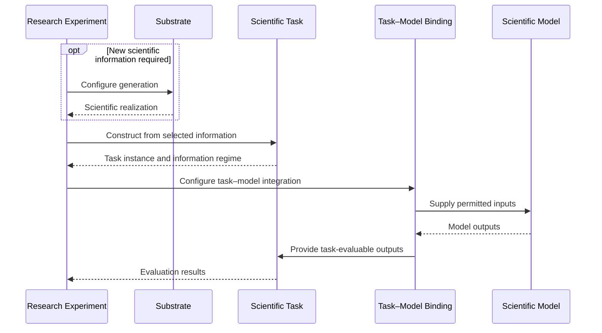

_Figure 3.1 illustrates conceptual scientific responsibilities, not prescribed Python interfaces or package dependencies. Existing artifacts may replace generation. Learning execution and repeated interactions are omitted for clarity._

The diagram does not prescribe a universal execution pipeline. Scientific components retain their independent responsibilities, and experiments coordinate their use according to the selected research procedure.

The identified components retain their individual architectural maturity. FlatWorld remains a candidate substrate, complete model placement in `ehp-research` remains provisional, and the identified experiments remain proposed investigations. Inclusion in this overview does not establish implementation completion or scientific validation.

Sections 4–10 develop the capabilities and their concrete research applications. Section 2 governs software ownership and dependencies, while Sections 11 retain authority over the detailed scientific interoperability contracts.

---

## 4. Scientific artifacts and external resources

EHP scientific components consume and produce information that may be retained and reused independently of its original source or generation procedure.
Artifact access and persistence are distinct from scientific interpretation. Established filesystem and data-access libraries provide the underlying operations, while EHP scientific components determine the meaning, validity, and applicability of the information they consume.

### 4.1 Scientific artifact capabilities

EHP reuses scientific information and generation capabilities from independently maintained sources.

External generators and published datasets provide information that EHP Research integrates according to the scientific requirements of its substrates and tasks. Generated or acquired information may be retained and consumed independently of the procedures originally used to obtain it.

Established libraries provide resource acquisition, access, serialization, and persistence. Scientific interpretation, validation, and applicability remain the responsibility of the relevant EHP components and interoperability contracts.

#### 4.1.1 Scientific artifacts and identity

A scientific artifact is identifiable information that can be interpreted independently of its original production procedure. It may consist of an individual resource or multiple associated resources.

Three concerns remain distinct:

| Concern        | Meaning                                                                                          |
| -------------- | ------------------------------------------------------------------------------------------------ |
| Location       | Where a resource can be accessed                                                                 |
| Identity       | Which scientific realization, dataset, or source revision is identified                          |
| Interpretation | The representation, metadata, and scientific declarations required to understand the information |

A resource location does not establish scientific identity. The same information may be available at different locations, while the contents at a particular location may change.

External source identity and EHP realization identity are also distinct. Multiple realizations may originate from the same generator and source revision while containing different scientific information.

**Figure 4.1 — Scientific source, realization, and location relationships**

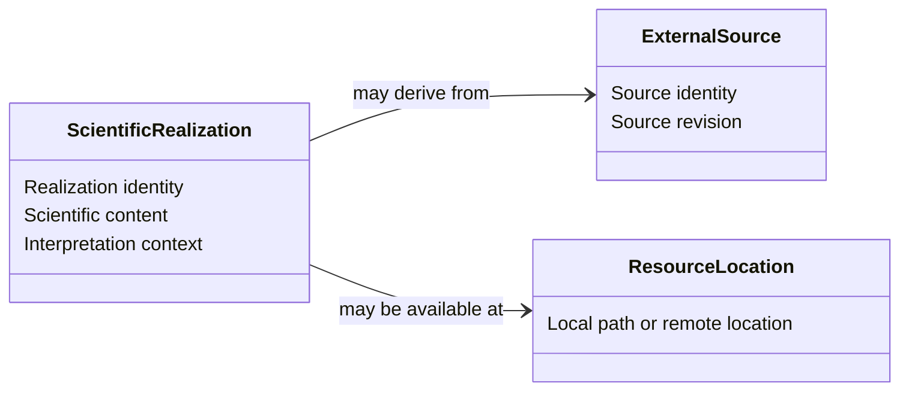

_Figure 4.1 represents conceptual relationships, not Python classes or mandatory software interfaces. A realization may depend on multiple source inputs, and its resources may be available at multiple locations. The diagram does not prescribe a universal artifact model._

Scientific artifacts retain the identities and interpretation context required by their applicable contracts. Sections 11 and 15 define the authoritative position-interoperability representations, declarations, and resource-reference requirements.

#### 4.1.2 Acquisition, generation, and independent consumption

EHP distinguishes preparing scientific information from consuming information that is already available.

**Preparation** obtains or creates scientific information through external acquisition, procedural generation, conversion, or other explicitly selected operations.

**Consumption** resolves and reads existing information using its applicable representation and interpretation context.

Scientific consumers do not need to execute the original generator when an independently interpretable, compatible realization is already available.

For example, Arena can consume a persisted spatial topology without invoking the procedural generator used by Dungeon. Similarly, MazeHard can consume a retained benchmark dataset without downloading it again.

**Figure 4.2 — Scientific artifact preparation and independent consumption**

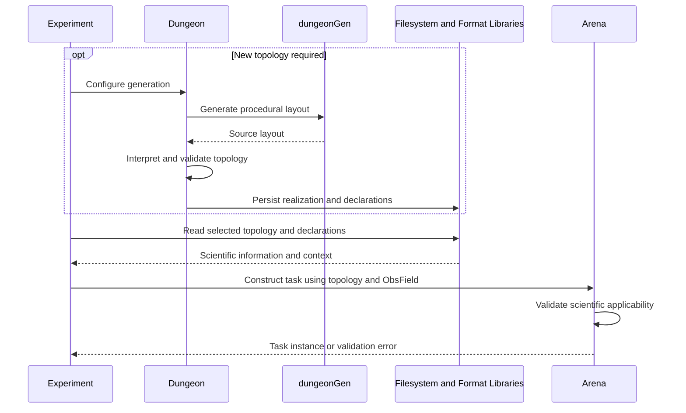

_Figure 4.2 illustrates scientific responsibilities rather than prescribed Python methods. Existing topology artifacts may be consumed without executing the preparation sequence. Arena's observation-field generation and selection are omitted for clarity. Filesystem and format libraries represent established technical facilities, not a new EHP service._

Consumption may involve local or remote I/O. Missing scientific information is not implicitly acquired from its original provider or regenerated unless the applicable procedure explicitly authorizes that behavior.

External information does not necessarily require conversion. Existing representations may be consumed directly when they satisfy the scientific requirements. Otherwise, the responsible research component establishes the necessary interpretation or transformation.

Substrates retain responsibility for their generated information. Tasks determine the scientific applicability of the information they consume. Experiments select and coordinate the required resources and preparation procedures.

#### 4.1.3 Persistence, provenance, and reproducibility

Persistence enables scientific information to be reused across executions and investigations.

Retained artifacts preserve their applicable scientific identities, declarations, and provenance independently of their storage locations.

Four related concerns remain distinct:

| Concern         | Meaning                                                                                                       |
| --------------- | ------------------------------------------------------------------------------------------------------------- |
| Retention       | Preservation of selected scientific artifacts for subsequent consumption                                      |
| Caching         | Reuse of previously accessed or computed information as an operational optimization                           |
| Provenance      | Identification of an artifact's sources, inputs, transformations, and production conditions                   |
| Reproducibility | Ability to repeat a scientific procedure under specified conditions and assess the equivalence of its results |

Provenance may include external source revisions, input artifact identities, generation configurations, randomness conditions, transformation procedures, and applicable software revisions.

These records support reproducibility but do not independently establish deterministic or scientifically equivalent reproduction.

Caching is distinct from retention. A library cache may accelerate repeated access without guaranteeing long-term availability.

Source-native information may be retained when required for conversion verification or reproducibility, but is not universally required alongside every derived realization.

Section 2 defines persistent data organization and provenance responsibilities. Section 10 establishes experiment-level reproducibility and recording requirements.

#### 4.1.4 Established technologies and implementation boundaries

EHP uses established libraries for resource access and persistence.

| Capability                         | Established foundation                                             | Architectural position                                |
| ---------------------------------- | ------------------------------------------------------------------ | ----------------------------------------------------- |
| Local resource access              | Python `pathlib` and standard I/O                                  | Initial filesystem foundation                         |
| Local and remote filesystem access | [fsspec](https://filesystem-spec.readthedocs.io/)                  | Recommended when heterogeneous storage is required    |
| External dataset acquisition       | Provider-supported libraries, including Hugging Face Hub           | Selected by the applicable research integration       |
| Graph serialization                | NetworkX and GraphML                                               | Selected scientific representation                    |
| Tabular serialization              | PyArrow and Parquet                                                | Selected scientific representation                    |
| Multi-resource packaging           | [Data Package 2.0](https://datapackage.org/standard/data-package/) | Selected for applicable portable scientific artifacts |

These libraries provide technical capabilities without defining the scientific meaning or applicability of their contents.

Software responsibilities follow the established architecture:

| Boundary              | Responsibility                                                                                     |
| --------------------- | -------------------------------------------------------------------------------------------------- |
| Established libraries | Resource access, acquisition, serialization, caching, and persistence                              |
| `ehp-sn`              | Independently reusable supporting mechanisms when demonstrated requirements justify implementation |
| `ehp-research`        | External-source integration, scientific interpretation, conversion, generation, and validation     |
| `experiments/`        | Resource selection, preparation coordination, scientific composition, and experiment recording     |

Reusable packages receive required resources through explicit inputs or applicable distributed package resources rather than implicit repository-root paths.

An external generator may be required by its research integration without becoming a necessary dependency of consumers of the resulting scientific information.

The approved `position-interop/1.0` profile retains its local relative resource-path convention for portable Data Packages. General storage capabilities do not modify that normative contract.

No universal EHP artifact manager, source registry, storage service, or mandatory artifact abstraction is required.

### 4.2 External resources in EHP Research

EHP Research uses independently maintained scientific generators and datasets as inputs to its scientific components.

These external resources retain their original implementations, representations, and provenance. EHP components determine how their information is converted, interpreted, and validated for the intended scientific purpose.

The identified integrations are:

| EHP consumer        | External resource            | Role                                 | Status                            |
| ------------------- | ---------------------------- | ------------------------------------ | --------------------------------- |
| Dungeon             | `dungeonGen`                 | Procedural dungeon-layout generation | Identified initial source         |
| Topology generation | `maze-nd`                    | Higher-dimensional maze generation   | Candidate; integration unresolved |
| MazeHard            | Sapient `maze-30x30-hard-1k` | Published structured maze problems   | Identified benchmark              |

#### 4.2.1 External procedural generators

**`dungeonGen`**

Repository: <https://github.com/slycrel/dungeonGen>

`dungeonGen` is the identified initial procedural generation source for Dungeon.

It provides dungeon and maze layouts containing spatial features such as rooms, corridors, walls, and passages.

Dungeon consumes applicable procedural information and converts it into the spatial topology required by EHP's scientific representation.

The external generator supplies layout-generation behavior. Dungeon remains responsible for interpreting the source layout, constructing spatial connectivity, and validating its resulting scientific information.

The exact upstream revision, invocation, accepted output representation, conversion behavior, and reproducibility conditions require verification for the first integration.

**`maze-nd`**

Repository: <https://github.com/dthuff/maze-nd>

`maze-nd` is an independently maintained Python package for generating n-dimensional mazes.

It is an identified candidate for supplying higher-dimensional maze information to a compatible EHP spatial-topology integration.

Its applicability depends on the scientific requirements of the intended topology substrate or task.

The concrete integration, supported domain families, source revision, conversion requirements, and applicable generation conditions remain unresolved.

Neither external generator defines EHP's shared spatial-topology interoperability contract. That contract remains established by Sections 11.

#### 4.2.2 Published scientific datasets

**Sapient MazeHard**

Dataset: <https://huggingface.co/datasets/sapientinc/maze-30x30-hard-1k>

The Sapient MazeHard dataset supplies published structured maze problems used in HRM-related research.

Identified dataset fields include:

| Field      | Identified role                       |
| ---------- | ------------------------------------- |
| `question` | Encoded maze problem                  |
| `answer`   | Corresponding solution representation |
| `rating`   | Dataset-provided problem rating       |
| `source`   | Dataset-provided source information   |

MazeHard consumes the dataset according to its scientific problem and solution semantics.

Dataset acquisition may use established Hugging Face Hub or Datasets functionality. Hugging Face Hub supports revision-specific snapshot acquisition and local-only resolution, allowing explicit preparation to be distinguished from subsequent consumption of already available resources.

The task remains responsible for interpreting the records, constructing applicable examples, and evaluating solutions.

The selected dataset revision, partitioning, exact record encoding, solution equivalence, and correctness criteria require verification against the published benchmark and reference implementation.

#### 4.2.3 Relationship to persistent scientific data

Externally acquired resources and EHP-generated realizations follow the data-lifecycle organization established in Section 2.

Original external datasets may be retained in `data/external/`. Original EHP-generated substrate realizations belong to `data/raw/`. Derived information and prepared task corpora use `data/interim/` and `data/processed/` as applicable.

These directories describe repository data organization. They do not establish scientific identity, impose mandatory processing stages, or determine the interpretation of a resource.

Independently installed reusable packages do not require these repository-root directories to exist. Their required resources are supplied through explicit inputs or applicable distributed package resources.

Scientific identity, representation, interpretation, and validation remain governed by the applicable scientific contracts and consuming components.

---

## 5. Scientific substrates

EHP substrates generate reusable descriptions of domain structures and properties that scientific tasks use to construct problems.

Substrate outputs follow shared scientific data contracts that define their representation, identity, and interpretation. These contracts allow independently developed substrates to produce compatible outputs and tasks to consume them without depending on the generating implementations.

`ehp-sn` provides reusable software definitions, structures, and supporting tools for these contracts, building on established libraries and representations. `ehp-research` implements the concrete generation procedures and their scientific constraints.

Substrate outputs can be persisted and reused by compatible tasks without executing their originating generators.

**Figure 5.1 — Substrate interoperability**

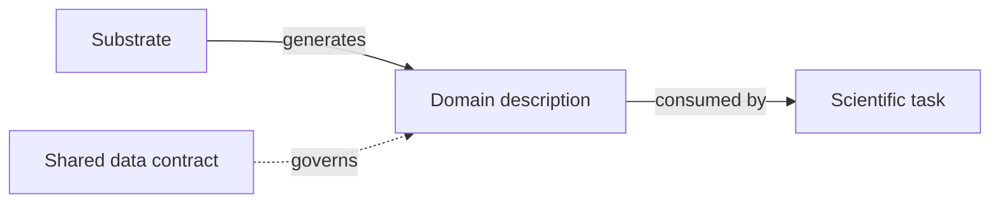

_Figure 5.1 illustrates the relationship between substrate producers, contract-governed domain descriptions, and consuming tasks. It does not prescribe software interfaces or execution order._

### 5.1 Shared scientific data contracts

EHP uses shared data contracts to exchange domain descriptions between independently developed scientific components.

A contract defines what a resource represents, how it is structured and identified, and which guarantees consumers can rely on. It allows producers and consumers to be developed and tested independently, without requiring knowledge of one another's implementations.

`ehp-sn` provides reusable definitions and supporting operations for these contracts, building on established scientific libraries. Concrete generation algorithms and task-specific scientific behavior remain outside this shared contract layer.

Sections 11 and 15 contain the authoritative interoperability specifications. This section establishes the contract architecture, its principal resource types, and their software responsibilities.

#### 5.1.1 Contract architecture

EHP distinguishes two kinds of shared data contracts:

- **Supporting contracts** define identities and declarations used to interpret domain descriptions.
- **Substrate output contracts** define reusable domain structures or properties that independent producers can generate and consumers can interpret.

The currently identified contracts are:

| Contract                    | Role               | Representation                        | Essential guarantee                                                                               |
| --------------------------- | ------------------ | ------------------------------------- | ------------------------------------------------------------------------------------------------- |
| IndexedDomain               | Supporting         | JSON / JSON Schema                    | Positions have unambiguous, domain-scoped identities                                              |
| ObservationVocabulary       | Supporting         | JSON declaration                      | Categorical observations have declared identities and membership                                  |
| SpatialTopology             | Substrate output   | NetworkX `Graph` / `DiGraph`; GraphML | Vertices reference declared positions and edges represent spatial connections                     |
| CategoricalObservationField | Substrate output   | PyArrow `Table`; Parquet              | Every declared position has exactly one valid observation assignment                              |
| DirectedSemanticGraph       | Provisional output | NetworkX `DiGraph`; GraphML           | Directed relationships between identifiable semantic states; identity semantics remain unresolved |

These contracts describe distinct kinds of resources. They do not require a universal scientific data structure or common Python class hierarchy.

**Figure 5.2 — Shared contract relationships**

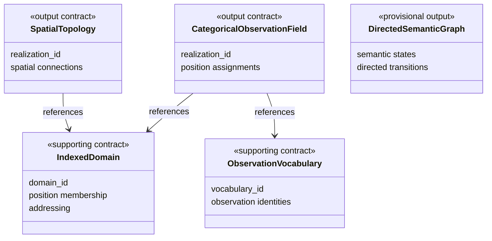

_Figure 5.2 shows the resource types and their required declaration references. These are scientific contracts, not mandatory Python classes. DirectedSemanticGraph remains independent because its semantic identity relationships have not yet been established._

Each contract defines its own data model, representation, identities, and conformance requirements. The underlying library provides the native structure; the EHP contract adds the scientific guarantees needed for interoperability.

Additional contracts may be introduced when independently reusable scientific representations are justified. Existing contracts should not be generalized merely to accommodate unrelated scientific properties.

#### 5.1.2 Shared identities and declarations

Supporting contracts establish the identities required to interpret and relate independently produced domain descriptions.

**IndexedDomain**

An IndexedDomain defines a finite position universe and its addressing conventions.

A position reference consists of:

$$
\operatorname{PositionRef}=(D,p)
$$

where $D$ is the identified domain and $p$ is the persisted position identifier within that domain.

The approved `position-interop/1.0` profile supports count-only, rectangular, finite hexagonal-cell, and irregular finite domains.

Newly identified domains use RFC 9562 UUIDv4 identifiers, persisted as lowercase UUID URNs.

Three concepts must remain distinct:

| Concept              | Meaning                                                                  |
| -------------------- | ------------------------------------------------------------------------ |
| Domain configuration | Requested position membership and addressing characteristics             |
| Identified domain    | A particular finite position universe with a stable `domain_id`          |
| Resource realization | Particular topology or observation content with its own `realization_id` |

A domain identity is not derived from its configuration. Two independently identified domains may have identical geometry while remaining distinct resources.

Conversely, different topology or observation realizations may reference the same identified domain.

A domain may be established before resource generation, established when a procedure determines its position universe, or reused from an existing declaration. Its identity belongs to the declaration, not to a particular experiment or generator.

**ObservationVocabulary**

An ObservationVocabulary declares the permitted categorical observation identities.

Its `vocabulary_id` is independent of any observation-field realization.

Observation identifiers are interpreted relative to their vocabulary. Equal observation strings in different vocabularies do not automatically establish equivalent scientific meaning.

**Independent realizations over one domain**

A single identified domain can support multiple, independently produced resource realizations.

**Figure 5.3 — Shared domain identity and independent realizations**

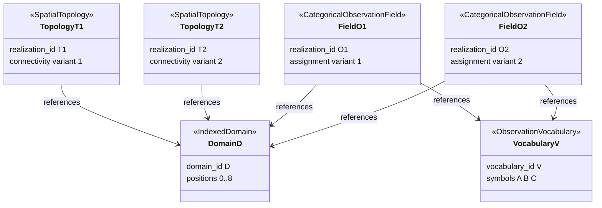

_Figure 5.3 illustrates four distinct realizations referencing the same identified domain. The two topologies may contain different spatial connections, while the observation fields may contain different assignments. The shared domain establishes position identity, not equality of realization contents._

**Resource references**

Scientific identities are distinct from filesystem locations.

A consumer must be able to resolve the declarations needed to interpret a resource, either through explicitly supplied context or an applicable artifact package.

Resources referencing the same consistent domain declaration can identify corresponding positions through equal persisted position identifiers.

Resources referencing different domains require explicit correspondence when their positions must be related. The approved position-correspondence representation and its constraints are specified in Section 15.

#### 5.1.3 Substrate output contracts

Each substrate output contract defines one independently interpretable kind of domain description.

Their common requirements concern the meaning and validity of the resulting resources, independently of the procedures used to generate them.

**SpatialTopology**

A SpatialTopology represents traversable positions and their spatial connections.

Its data model is:

$$
T=(V_T,E_T),\qquad V_T\subseteq I
$$

where $I$ is the referenced domain, $V_T$ contains traversable positions, and $E_T$ contains spatial connections.

| Contract aspect | Requirement                                                                        |
| --------------- | ---------------------------------------------------------------------------------- |
| Representation  | NetworkX `Graph` or `DiGraph`                                                      |
| Persistence     | GraphML                                                                            |
| Graph metadata  | `domain_id`, `realization_id`, `ehp_profile_version`                               |
| Node identity   | Persisted string identifier belonging to the referenced domain                     |
| Edges           | Explicit undirected connections or directed transitions                            |
| Conformance     | Valid graph type, required metadata, domain membership, and preserved connectivity |

The selected graph types do not support parallel edges. Further graph constraints follow the applicable normative specification.

The contract does not prescribe a particular grid, connectivity pattern, generation algorithm, or task-specific movement rule.

**CategoricalObservationField**

A CategoricalObservationField represents a total assignment of categorical observations to positions:

$$
\Phi:I\rightarrow Obs
$$

where $I$ is the referenced domain and $Obs$ is the referenced observation vocabulary.

| Contract aspect  | Requirement                                                                                          |
| ---------------- | ---------------------------------------------------------------------------------------------------- |
| Representation   | Apache Arrow `Table`                                                                                 |
| Persistence      | Parquet                                                                                              |
| `position_id`    | Non-null `pa.string()`                                                                               |
| `observation_id` | Non-null `pa.string()`                                                                               |
| Schema metadata  | `domain_id`, `vocabulary_id`, `realization_id`, `ehp_profile_version`                                |
| Conformance      | Unique and complete position coverage, valid domain and vocabulary membership, consistent references |

Every declared position must occur exactly once. Different positions may share an observation identity.

The field has no intrinsic adjacency relation. Its assignments cover the declared domain, including positions that may be absent from a particular spatial topology's traversable graph.

Arrow provides the tabular structure and types. The EHP contract additionally establishes uniqueness, complete coverage, and membership requirements.

The contract does not prescribe observation distributions, sampling procedures, or randomness protocols.

**Illustrative contract data**

Consider an IndexedDomain containing nine positions with zero-based row-major addressing.

The following example shows the same positions from two different resource perspectives.

| Spatial position | Observation |
| ---------------- | ----------- |
| `"0"`            | `"A"`       |
| `"1"`            | `"B"`       |
| `"2"`            | `"C"`       |
| `"3"`            | `"A"`       |
| `"4"`            | `"B"`       |
| `"5"`            | `"C"`       |
| `"6"`            | `"B"`       |
| `"7"`            | `"A"`       |
| `"8"`            | `"C"`       |

**Figure 5.4 — Position domain, topology membership, and observations**

|           | x = 0   | x = 1             | x = 2   |
| --------- | ------- | ----------------- | ------- |
| **y = 0** | `0` · A | `1` · B           | `2` · C |
| **y = 1** | `3` · A | `4` · B · blocked | `5` · C |
| **y = 2** | `6` · B | `7` · A           | `8` · C |

_Figure 5.4 illustrates a rectangular position domain and its observation assignments, with position `"4"` omitted from a selected topology's traversable vertex set. The rectangular layout represents the domain's addressing, not a requirement that every adjacent pair is connected by a topology edge. The categorical field still assigns an observation to position `"4"` because its contract covers the complete domain._

This example demonstrates that **position identity, traversability, and observation assignment are separate properties**. A contract-conforming topology and observation field can reference the same domain without combining their representations.

**DirectedSemanticGraph**

DirectedSemanticGraph is the provisional shared contract for identifiable semantic states and directed transitions.

Its initial data model is:

$$
G_s=(V_s,E_s),\qquad E_s\subseteq V_s\times V_s
$$

| Contract aspect      | Current position                      |
| -------------------- | ------------------------------------- |
| Representation       | NetworkX `DiGraph`                    |
| Persistence          | GraphML                               |
| Vertices             | Identifiable semantic states          |
| Edges                | Directed semantic transitions         |
| Structural guarantee | Directed graph without parallel edges |
| Scientific identity  | Not yet fully specified               |
| Semantic conformance | Requires further definition           |

The contract does not automatically impose acyclicity, a single terminal vertex, or terminal reachability. Those properties may belong to particular generation families.

Two scientific questions remain unresolved: whether vertices identify independent semantic states or members of an observation vocabulary, and which transition semantics must be guaranteed by every conforming graph.

A common graph representation alone cannot resolve these questions.

DirectedSemanticGraph therefore remains provisional until its scientific identity and interpretation guarantees are sufficiently defined.

#### 5.1.4 Conformance and independent testing

Shared contracts establish independently testable guarantees.

EHP separates three validation responsibilities:

| Boundary        | Responsibility                                                                      |
| --------------- | ----------------------------------------------------------------------------------- |
| Shared contract | Verify representation, identity, references, and common scientific constraints      |
| Substrate       | Verify generation-specific scientific requirements and produce conforming resources |
| Consuming task  | Verify that selected resources satisfy the requirements of the scientific problem   |

A conforming resource is not necessarily applicable to every task. Similarly, generated data is not interoperable merely because its scientific content appears plausible.

**Figure 5.5 — Independent verification through shared contracts**

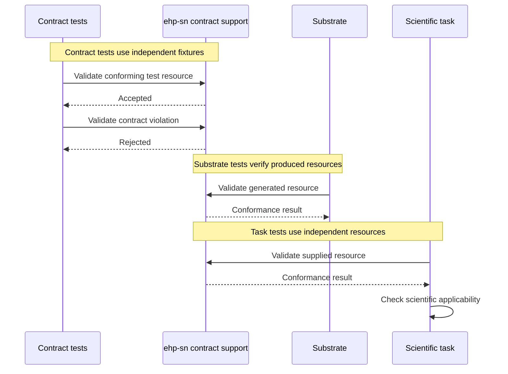

_Figure 5.5 illustrates independent test responsibilities, not a mandatory runtime execution sequence. The task may use manually constructed conforming resources without running a substrate, while the substrate can verify its outputs without executing the task._

**Contract conformance tests**

Each approved contract should support:

| Test category              | Required behavior                                                                            |
| -------------------------- | -------------------------------------------------------------------------------------------- |
| Positive conformance       | Accept independently constructed resources satisfying the contract                           |
| Negative conformance       | Reject representation, identity, membership, or consistency violations                       |
| Interchange                | Preserve required structure, identities, and interpretation across serialization and loading |
| Cross-resource consistency | Validate references against the applicable resolved declarations                             |

For example, SpatialTopology tests should accept a manually constructed conforming NetworkX graph and reject one containing undeclared position identifiers.

CategoricalObservationField tests should accept a complete Arrow assignment and reject missing positions, duplicate assignments, or observation identifiers outside the declared vocabulary.

A substrate's own tests verify that its generation algorithm produces conforming outputs and satisfies its generation-specific requirements.

A task's tests consume independently constructed contract-conforming fixtures without depending on the generator.

This establishes the intended separation: **contracts are tested independently, producers are tested against contracts, and consumers are tested using contract-conforming inputs.**

#### 5.1.5 Reusable contract support in `ehp-sn`

`ehp-sn` provides the shared software definitions and operations required to construct, interpret, and validate EHP's scientific data contracts.

| Capability                    | Reusable support                                                                      |
| ----------------------------- | ------------------------------------------------------------------------------------- |
| Contract definitions          | Approved schemas, required attributes, metadata conventions, and identity definitions |
| Domain and vocabulary support | Declaration handling, membership, addressing, and identity consistency                |
| Representations               | Native NetworkX, PyArrow, and JSON structures                                         |
| Interchange                   | Loading and serialization through established libraries and formats                   |
| Conformance                   | Reusable validation of contract-specific structural and scientific guarantees         |
| Resource references           | Resolution and consistency checks for related declarations                            |

These are capability targets, not assertions that all corresponding operations have already been implemented.

Established libraries remain responsible for general-purpose operations. `ehp-sn` implements additional EHP-specific behavior only when needed for reusable contract support.

A spatial topology can remain an ordinary NetworkX graph, and an observation field can remain an ordinary PyArrow table. Conformance can be established through schemas, declarations, and validation operations without introducing mandatory wrapper classes.

`ehp-sn` does not own scientific generation algorithms, generator-specific constraints, task dataset construction, evaluation, or experiment orchestration.

It also does not require a universal substrate superclass, central resource registry, custom serialization framework, or common container type for unrelated resources.

The normative definitions remain in Sections 11 and 15, independently of their Python implementation.

The architectural requirement is that independent scientific components can exchange conforming domain descriptions through precise, reusable, and independently testable contracts.

### 5.2 Substrates in EHP Research

`ehp-research` implements concrete scientific substrates that generate domain descriptions conforming to the shared data contracts introduced in Section 5.1.

Each substrate defines its own generation inputs, algorithms, scientific constraints, and validation requirements. Its output remains independently interpretable through the applicable contract, without requiring the consuming component to execute or depend on the generator.

The current scientific substrates are:

| Substrate | Scientific responsibility                                    | Output contract                     | Status     |
| --------- | ------------------------------------------------------------ | ----------------------------------- | ---------- |
| DagFlow   | Generate directed semantic-state graphs                      | DirectedSemanticGraph (provisional) | Identified |
| Dungeon   | Generate spatial topology from procedural layouts            | SpatialTopology                     | Identified |
| ObsField  | Generate categorical observation assignments                 | CategoricalObservationField         | Identified |
| FlatWorld | Generate regular spatial topologies independently of Dungeon | SpatialTopology                     | Candidate  |

The identified status establishes the scientific role of a substrate, not that its implementation or generation protocol is complete.

Substrates may use shared supporting declarations such as IndexedDomain and ObservationVocabulary. They may also use other scientific resources during generation when their procedures require them.

These are data dependencies, not dependencies on the implementations that produced those resources.

**Figure 5.6 — Substrate generation and shared output contracts**

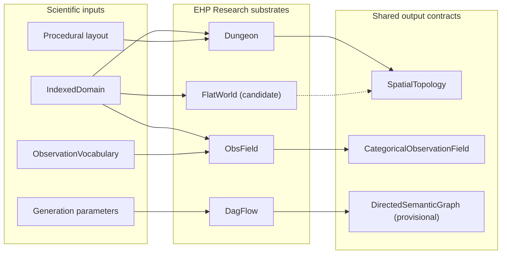

_Figure 5.6 shows the principal generation relationships, not mandatory function signatures or a complete inventory of optional inputs. Generation parameters and randomness conditions are specific to each substrate. FlatWorld and the complete semantic-graph contract remain provisional._

The following descriptions focus on each generator's scientific responsibility and the properties its implementation must establish beyond the shared contract.

#### 5.2.1 DagFlow — Semantic state-graph generation

**Scientific purpose**

DagFlow generates finite directed acyclic graphs representing admissible transitions between identifiable semantic states.

These graphs provide controlled relational structures for scientific problems that require directed dependencies or prospective semantic transitions.

A semantic state may describe a condition, prerequisite, or stage in a scientific problem. For example, a state transition could represent progress from lacking a prerequisite to having satisfied it.

DagFlow establishes the generated graph structure. It does not determine how every scientific task interprets its vertices or what a model must predict.

**Generation inputs**

The identified generation parameters are:

| Parameter              | Scientific role                                  |
| ---------------------- | ------------------------------------------------ |
| Vertex count           | Controls the number of generated semantic states |
| Extra-edge probability | Controls additional directed-edge generation     |
| Random seed            | Provides a randomness input                      |

These parameters identify the intended generation capability. Their exact interpretation depends on the generation algorithm, which remains to be specified and verified.

In particular, the distribution used for constructing edges and any guaranteed reproducibility behavior are not yet established.

**Generated structure**

DagFlow produces a directed graph:

$$
D=(V,E)
$$

subject to the following scientific constraints:

- The graph is finite and directed.
- Its vertices have identifiable states.
- The graph is acyclic.
- Self-loops and parallel edges are excluded.
- Exactly one terminal vertex exists.
- Every vertex has a directed path to that terminal vertex.

**Figure 5.7 — Example DagFlow realization**

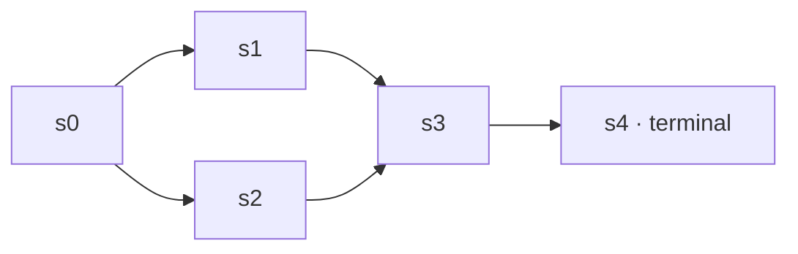

_Figure 5.7 illustrates a valid structural example: five vertices, one terminal vertex, no cycles, and terminal reachability from every vertex. The labels identify abstract semantic states, not necessarily members of an observation vocabulary._

The graph admits alternative paths toward the terminal. Multiple incoming edges indicate alternative admissible predecessors; they do not automatically mean that all predecessors must be satisfied.

That distinction follows from the meaning of a directed transition relation. Conjunctive prerequisite semantics would require an additional explicit scientific definition.

**Output and interoperability**

DagFlow uses NetworkX `DiGraph` in memory and GraphML for persistence.

Its output must preserve vertex identities, directed edges, and the scientific attributes required by its applicable interpretation.

The shared DirectedSemanticGraph contract remains provisional. DagFlow can establish its own graph-family validity, but that alone does not settle the universal semantic identity requirements of the shared contract.

For example, a consuming scientific problem may interpret graph vertices as observation identities:

$$
D_{\mathrm{obs}}=(Obs,E_{\mathrm{obs}})
$$

That correspondence is a consumer-specific interpretation until the shared semantic-graph contract establishes otherwise.

DagFlow should not implicitly require all future consumers to treat its vertex identities as observation vocabulary members.

**Scientific validation and testing**

DagFlow must independently verify:

| Test area       | Required property                                                    |
| --------------- | -------------------------------------------------------------------- |
| Graph structure | Valid directed graph without unsupported parallel edges              |
| Acyclicity      | No directed cycles                                                   |
| Terminal state  | Exactly one vertex has no outgoing edges                             |
| Reachability    | Every vertex can reach the terminal                                  |
| Configuration   | Generated graph satisfies the applicable generation parameters       |
| Reproducibility | Verified against the guarantees of the selected generation algorithm |

The graph-family tests do not require RouteBind or Prospect.

Conversely, those tasks should be able to consume independently constructed graph fixtures without executing DagFlow.

The outstanding scientific decisions concern the precise generation algorithm, semantic vertex identity, and the relationship between generated semantic states and externally declared observation identities.

#### 5.2.2 Dungeon — Spatial-topology generation

**Scientific purpose**

Dungeon generates reusable spatial topology from procedural dungeon or maze layouts.

Its initial scientific scope is two-dimensional layouts containing traversable and blocked regions, including rooms, corridors, and passages.

Dungeon converts procedural geometry and connectivity into an identified spatial graph that can be interpreted independently of the original generator.

**Generation inputs**

Dungeon may use an externally produced procedural layout or invoke an applicable procedural generator, together with its generation and conversion configuration.

The identified initial external source is `dungeonGen`, described in Section 4.

The integration must establish how the selected source's geometry and connectivity are translated into EHP's SpatialTopology representation. The exact source interface and conversion behavior remain to be verified.

Relevant generation information includes:

| Input                              | Use                                                       |
| ---------------------------------- | --------------------------------------------------------- |
| Procedural layout                  | Supplies the generated spatial arrangement                |
| Domain declaration, when available | Establishes the intended position universe and addressing |
| Traversability rules               | Determine which positions belong to the traversable graph |
| Connectivity interpretation        | Determines spatial edges from the layout                  |
| Conversion configuration           | Controls applicable source-to-topology interpretation     |

Dungeon may use an existing IndexedDomain when the ambient position universe is known in advance.

If the position universe is determined by procedural generation, Dungeon may establish the resulting domain using the approved shared domain contract.

In both cases, the resulting topology must accurately reference the domain it represents.

**Generated structure**

Dungeon produces a spatial topology:

$$
T=(G'_{\mathrm{free}},E'_{\mathrm{spatial}})
$$

where:

- $G'_{\mathrm{free}}$ is the set of traversable positions.
- $E'_{\mathrm{spatial}}$ is the relation of admissible spatial connections.

The traversable positions belong to the identified ambient domain $I$:

$$
G'_{\mathrm{free}}\subseteq I
$$

The ambient domain may include blocked positions that are absent from the topology graph.

**Figure 5.8 — Procedural layout converted into topology**

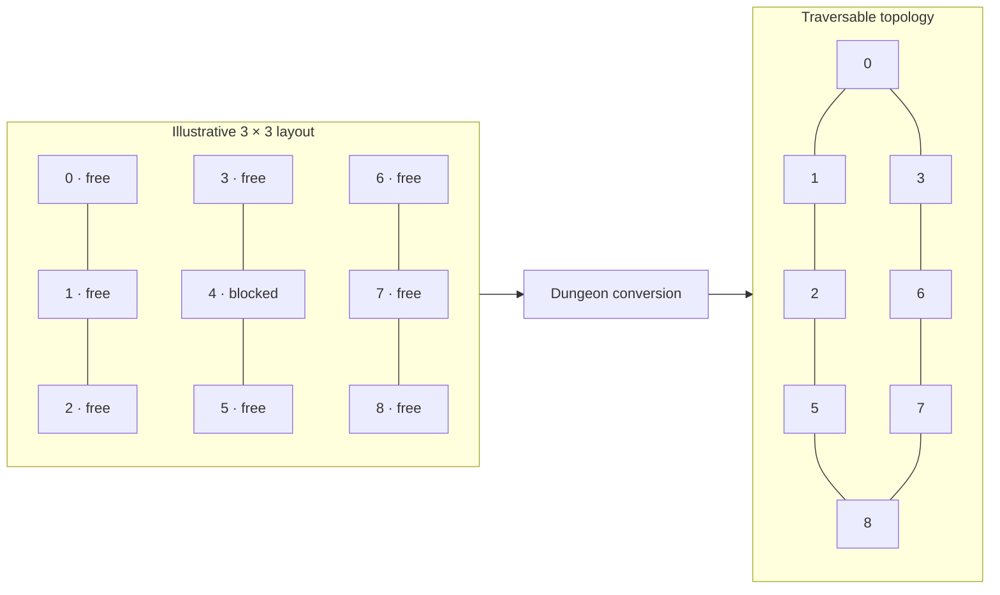

_Figure 5.8 illustrates the distinction between the ambient layout and a resulting traversable graph. The layout-side lines are diagrammatic arrangement aids, not declared traversable edges. The final graph excludes blocked position 4. The actual conversion must derive edges from the procedural layout's connectivity rules._

**Generation and conversion responsibilities**

Dungeon is responsible for interpreting the source and constructing the resulting scientific topology.

The identified conversion concerns are:

| Responsibility          | Required interpretation                                                            |
| ----------------------- | ---------------------------------------------------------------------------------- |
| Position identification | Map the source layout to declared position identities                              |
| Traversability          | Determine which positions are traversable                                          |
| Adjacency               | Construct spatial connections from the source layout                               |
| Domain consistency      | Ensure generated positions agree with the referenced ambient domain                |
| Spatial attributes      | Retain attributes required by the selected scientific representation               |
| Connected components    | Determine and preserve connectivity without imposing unsupported task restrictions |

The exact conversion algorithm, treatment of source-specific layout features, and preservation of optional region information require specification.

A source's physical geometry and the topology's graph edges must not be conflated. Adjacent coordinates do not necessarily imply a traversable connection.

**Output and interoperability**

Dungeon produces the shared SpatialTopology representation:

| Concern               | Representation                                                  |
| --------------------- | --------------------------------------------------------------- |
| In-memory topology    | NetworkX `Graph` or `DiGraph`                                   |
| Persistence           | GraphML                                                         |
| Node identity         | Domain-scoped position identifiers                              |
| Spatial connectivity  | Graph edges                                                     |
| Scientific references | Domain identity, realization identity, interoperability profile |

The topology may retain additional scientific attributes where justified, but it does not need to reproduce the entire procedural source representation.

An independently developed consumer should be able to interpret the topology through its graph and domain declaration without running `dungeonGen`.

**Scientific validation and testing**

Dungeon must verify both contract conformance and the correctness of its conversion.

| Test area           | Required property                                                                      |
| ------------------- | -------------------------------------------------------------------------------------- |
| Domain identity     | Generated nodes belong to the referenced domain                                        |
| Traversability      | Included graph vertices correspond to traversable source positions                     |
| Connectivity        | Graph edges agree with the source's admissible connections                             |
| Source consistency  | Blocked or excluded regions are interpreted according to the selected conversion rules |
| Persistence         | Required topology content survives GraphML interchange                                 |
| Generation behavior | Applicable procedural parameters and scientific constraints are respected              |

These tests are independent of Arena, RouteBind, and Prospect.

Whether a topology is connected, supports a particular movement regime, or satisfies another task-specific property is not automatically a Dungeon generation requirement.

#### 5.2.3 ObsField — Categorical observation-assignment generation

**Scientific purpose**

ObsField generates categorical observation assignments over independently identified finite domains.

Unlike Dungeon, it does not generate spatial connectivity. Its principal output is a mapping from positions to observation identities:

$$
\Phi:I\rightarrow Obs
$$

where $I$ is the referenced IndexedDomain and $Obs$ is the referenced ObservationVocabulary.

The domain may be spatially interpreted or purely indexed. ObsField does not require a topology to generate observations unless the selected assignment procedure explicitly depends on one.

**Generation inputs**

The initial categorical generation capability uses:

| Input                                 | Scientific role                                            |
| ------------------------------------- | ---------------------------------------------------------- |
| IndexedDomain                         | Establishes the positions receiving observations           |
| ObservationVocabulary                 | Establishes valid categorical observation identities       |
| Assignment protocol                   | Selects the generation procedure                           |
| Distribution or assignment parameters | Specify how observations are selected                      |
| Randomness configuration              | Controls applicable stochastic generation                  |
| Optional conditioning information     | Supplies additional information for conditioned procedures |

Identified generation families include:

| Family                 | Generation behavior                                         |
| ---------------------- | ----------------------------------------------------------- |
| Uniform categorical    | Sample observation identities with equal probabilities      |
| Nonuniform categorical | Sample according to a specified categorical distribution    |
| Balanced assignment    | Constrain observation frequencies                           |
| Region-conditioned     | Condition assignments on declared region information        |
| Structure-conditioned  | Condition assignments on an additional scientific structure |

These are candidate generation families, not a claim that all have been implemented or fully specified.

A conditioned procedure may use a spatial topology or region description during generation. The resulting categorical observation field still contains only position-to-observation assignments under the common output contract.

**Generated structure**

ObsField assigns exactly one valid observation identity to every declared position.

The assignment is total:

$$
\forall p\in I,\quad \Phi(p)\in Obs
$$

Different positions may receive equal observation identities:

$$
p\ne q
\quad\text{and}\quad
\Phi(p)=\Phi(q)
$$

Thus, equal observations do not imply equal positions.

**Figure 5.9 — Categorical observations over an indexed domain**

Consider a rectangular domain with nine identified positions and vocabulary:

$$
Obs=\{A,B,C\}
$$

The following is one possible realization:

| Position | x = 0   | x = 1   | x = 2   |
| -------- | ------- | ------- | ------- |
| y = 0    | `0` → A | `1` → B | `2` → C |
| y = 1    | `3` → A | `4` → B | `5` → C |
| y = 2    | `6` → B | `7` → A | `8` → C |

Its corresponding Arrow table is:

| `position_id` | `observation_id` |
| ------------- | ---------------- |
| `"0"`         | `"A"`            |
| `"1"`         | `"B"`            |
| `"2"`         | `"C"`            |
| `"3"`         | `"A"`            |
| `"4"`         | `"B"`            |
| `"5"`         | `"C"`            |
| `"6"`         | `"B"`            |
| `"7"`         | `"A"`            |
| `"8"`         | `"C"`            |

_Figure 5.9 illustrates one categorical realization. The rectangular arrangement visualizes the domain's addressing. It does not add adjacency to the Arrow table. Every declared position receives an observation, irrespective of whether a separately generated topology would classify that position as traversable._

**Initial assignment protocol**

The initial identified protocol is:

`categorical-random/v1`

It generates one categorical assignment per declared position using the configured distribution and randomness conditions.

For a uniform categorical distribution with vocabulary cardinality $K$:

$$
P(\Phi(p)=o)=\frac{1}{K}
$$

for every position $p\in I$ and observation identity $o\in Obs$.

The protocol's scientific inputs include the identified domain, vocabulary, distribution parameters, base seed, and realization index.

Its implementation must establish the specified assignment behavior without changing the shared output representation.

**Reproducibility**

The initial protocol requires record-addressable deterministic generation.

For a fixed set of scientific generation inputs and a specified implementation, each position's assignment must remain invariant under changes to execution scheduling.

In particular, generation must not change the resulting realization merely because of:

- Worker count.
- Processing order.
- Temporary storage location.

Increasing the number of requested realizations must preserve the identities and content of previously defined realizations.

This requirement is stronger than simply initializing a random-number generator with a seed.

The exact random-stream derivation and assignment algorithm must be specified and tested against the protocol. NumPy provides appropriate numerical and random-generation facilities, but does not automatically guarantee schedule-independent results for arbitrary implementations.

The referenced domain identity must remain stable when reproducing an existing realization. Independently creating a new UUID for an equivalent domain would establish a different identified scientific input.

**Output and interoperability**

ObsField produces a CategoricalObservationField conforming to the shared Arrow/Parquet contract.

| Concern                | Representation                                        |
| ---------------------- | ----------------------------------------------------- |
| In-memory data         | Apache Arrow `Table`                                  |
| Persistent data        | Apache Parquet                                        |
| Position identities    | Non-null `pa.string()`                                |
| Observation identities | Non-null `pa.string()`                                |
| Scientific references  | Domain, vocabulary, realization, and profile metadata |

ObsField may use NumPy arrays or other internal numerical structures during generation. These implementation details do not change the interchange contract.

Additional computational libraries should be introduced only where the selected assignment algorithms demonstrate a need for them.

**Scientific validation and testing**

ObsField must satisfy the common categorical-field contract and its chosen generation protocol.

| Test area               | Required property                                                             |
| ----------------------- | ----------------------------------------------------------------------------- |
| Coverage                | Exactly one assignment exists for every declared position                     |
| Membership              | All observations belong to the declared vocabulary                            |
| Identity                | Domain, vocabulary, and realization references remain consistent              |
| Interchange             | Arrow schema, metadata, and assignments survive Parquet persistence           |
| Distribution            | Generated assignments follow the selected protocol's statistical requirements |
| Determinism             | Fixed scientific inputs reproduce the same realization                        |
| Scheduling independence | Worker count and generation order do not change the realization               |
| Realization stability   | Extending an existing realization set preserves previously identified outputs |

Tests for statistical generation properties must use methods appropriate to the selected distribution and sample size. An individual random realization is not required to contain exactly equal category frequencies merely because its generating distribution is uniform.

ObsField's tests do not require Dungeon, Arena, RouteBind, or Prospect.

When a conditioned procedure consumes another scientific resource, its tests must additionally verify that the conditioning information is interpreted correctly.

#### 5.2.4 FlatWorld — Regular spatial-topology generation candidate

**Scientific purpose**

FlatWorld is a candidate substrate for producing regular spatial topologies independently of Dungeon.

Its potential scope includes rectangular and finite hexagonal-cell environments.

FlatWorld would provide an alternative topology-generation implementation while using the same SpatialTopology contract.

It would not introduce a new shared topology representation.

**Potential generation capabilities**

| Topology family     | Intended spatial structure                                            |
| ------------------- | --------------------------------------------------------------------- |
| Rectangular grid    | Positions connected according to a specified rectangular neighborhood |
| Hexagonal-cell grid | Positions connected according to a specified hexagonal neighborhood   |

Candidate movement families include four-neighbor rectangular connectivity and six-neighbor hexagonal connectivity.

The precise supported families, treatment of boundaries, obstacles, and directed transitions must be established before implementation.

**Output and interoperability**

FlatWorld would produce a NetworkX `Graph` or `DiGraph` referencing an identified domain, using GraphML for persistence.

Its output would satisfy the same shared SpatialTopology contract as Dungeon's output.

This allows independent topology producers without introducing producer-specific representations into consuming tasks.

**Open scientific requirements**

FlatWorld remains a candidate until the following are defined:

| Concern         | Outstanding decision                                   |
| --------------- | ------------------------------------------------------ |
| Scope           | Supported regular topology families                    |
| Inputs          | Required domain declarations and generation parameters |
| Connectivity    | Exact adjacency and boundary rules                     |
| Obstacles       | Whether and how blocked positions are generated        |
| Randomness      | Whether stochastic generation is supported             |
| Validation      | Family-specific scientific invariants                  |
| Reproducibility | Applicable generation guarantees                       |

FlatWorld does not justify a separate substrate framework or a generalized topology-generation interface beyond the already selected shared data contract.

#### 5.2.5 Generation responsibilities and verification

All identified substrates use the same architectural separation between shared contract conformance and generation-specific scientific correctness.

| Responsibility       | Shared contract support (`ehp-sn`)                       | Concrete substrate (`ehp-research`)                             |
| -------------------- | -------------------------------------------------------- | --------------------------------------------------------------- |
| Representation       | Defines and supports approved native structures          | Produces data using those structures                            |
| Scientific identity  | Provides shared declarations and consistency checks      | Establishes or references the identities relevant to its output |
| Generation algorithm | Not responsible                                          | Selects and implements the scientific procedure                 |
| Output validation    | Checks shared contract conformance                       | Checks generation-specific scientific constraints               |
| Randomness           | May use established supporting mechanisms where reusable | Defines and verifies the protocol's randomness guarantees       |
| Interchange          | Provides reusable support where necessary                | Produces independently consumable realizations                  |

A substrate's correctness requires both a conforming output and satisfaction of its own scientific generation specification.

**Figure 5.10 — Independent validation of substrate generation**

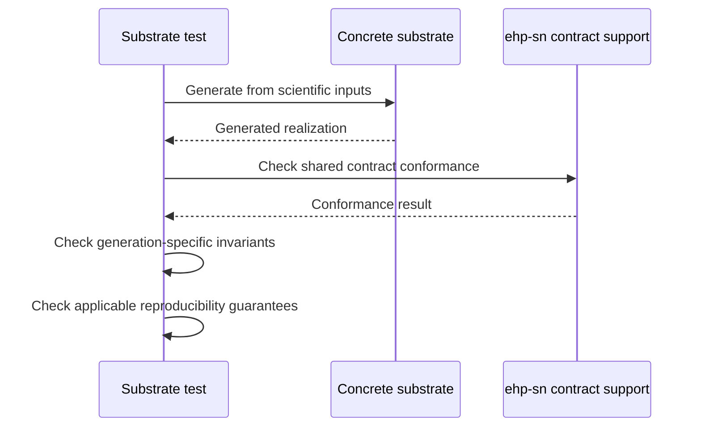

_Figure 5.10 illustrates independent testing responsibilities. It does not prescribe that generation must invoke a particular validator at runtime, and no consuming task is needed to verify substrate generation._

A complete substrate test strategy should include independently constructed valid and invalid contract fixtures, scientific tests of the generation algorithm, and output interchange tests.

The concrete scientific implementations must not redefine or weaken the shared contract requirements to accommodate their own generation behavior.

Likewise, generator-specific constraints must not be promoted into shared contracts unless they are established requirements of the reusable scientific representation.

These boundaries allow concrete substrates to evolve independently while retaining the data contracts needed for scientific interoperability.

---

## 6. Scientific tasks

A task defines a scientific problem over compatible substrate information or external datasets.

It determines construction inputs, scientific applicability, instance semantics, permitted model information, expected outputs, and evaluation.

### 6.1 Task input applicability

| Task      | Spatial topology   | Observation field  | Semantic graph     | External dataset |
| --------- | ------------------ | ------------------ | ------------------ | ---------------- |
| Arena     | Required           | Required           | —                  | —                |
| RouteBind | Intended           | Intended           | Intended           | —                |
| Prospect  | Construction input | Construction input | Construction input | —                |
| MazeHard  | —                  | —                  | —                  | Required         |

Scientific inputs are validated according to the requirements of each task.

### 6.2 Arena — sequential spatial experience

#### Scientific purpose

Arena constructs sequential spatial experiences for investigating environment-specific relational acquisition, observation prediction, and memory-based recovery.

Its initial model applications include TEM and TEM-t.

#### Inputs

Arena consumes:

1. A spatial-topology realization.
2. A compatible categorical observation-field realization.
3. Task configuration defining experience-generation conditions.

The topology supplies traversable positions and valid spatial transitions.

ObsField supplies observation assignments.

Arena establishes the required position correspondence and validates scientific compatibility.

#### Spatial applicability

Arena's intended initial spatial families are:

- Two-dimensional square grids with four-neighbor connectivity (`grid4`).
- Two-dimensional hexagonal-cell grids with six-neighbor connectivity (`grid6`).

Applicable configurations may impose more specific restrictions.

The supported domains can contain irregular blocked regions, passages, rooms, and corridors, provided their movement relations satisfy the configured spatial family.

A `grid6` environment uses hexagonal-cell adjacency. Its finite domain is represented using axial coordinates and explicit boundaries.

The exact action vocabulary and topology applicability conditions remain to be specified.

#### Trajectory generation

Arena generates trajectories:

$$
(g'_0,\ldots,g'_{T-1})
$$

over traversable positions.

The experienced observation at time \(t\) is:

$$
o_t=\phi(g'\_t)
$$

Movement actions or transition signals describe progression through the spatial topology.

Arena determines:

- Start selection.
- Walk protocol.
- Episode length.
- Episode termination.
- Applicable randomness.
- Experience-generation constraints.

#### Revisit semantics

A physical revisit occurs when the current position has previously appeared in the trajectory:

$$
\operatorname{revisit}(t)
\iff
\exists j<t:\;g'\_j=g'\_t
$$

Observation equality is insufficient to establish a physical revisit because observation identities can repeat at different positions.

#### Episode information

Arena produces persistent episodic experience.

One logical episode represents one complete generated trajectory.

| Information                   | Purpose                                         | Visibility             |
| ----------------------------- | ----------------------------------------------- | ---------------------- |
| Episode identity              | Identifies the experience                       | Metadata               |
| Environment identity          | Associates the episode with its environment     | Metadata               |
| Observation sequence          | Experienced observations                        | Public replay / target |
| Action or transition sequence | Movement information                            | Public replay          |
| Episode boundary              | Controls episode initialization and state reset | Public control         |
| Position trajectory           | Verifies physical experience                    | Privileged             |
| Revisit truth                 | Supports physical-revisit evaluation            | Privileged             |

A trajectory containing \(T\) visited positions contains \(T\) observations and \(T-1\) inter-position movements.

The representation of an initialization action and its sequence alignment remain binding-specific requirements.

The persisted corpus may retain shared environment information to allow independent episode validation and replay.

#### Information regime

Ordinary model-facing Arena replay provides permitted observations, movement information, and episode-control information.

Decoded physical positions, complete topology, wall maps, and physical-revisit truth are retained for construction, validation, and evaluation.

The current observation also serves as a task-level prediction target.

Bindings define the exact temporal information available to each model prediction pathway, including whether the current observation is withheld from a particular prediction.

#### Evaluation

The primary behavioral metric is revisit-conditioned observation-prediction accuracy:

$$
A*{\mathrm{obs}}^{\mathrm{rev}}
=
\frac{N*{\mathrm{correct,rev}}}{N\_{\mathrm{rev}}}
$$

The result is undefined when no revisit targets are available.

Additional behavioral metrics include:

- Observation-prediction accuracy across all steps.
- First-visit observation-prediction accuracy.

Model-specific posterior, sensory-recall, and path-integration metrics are defined by applicable TEM or TEM-t evaluations.

### 6.3 RouteBind — explicit-structure semantic–spatial reasoning

#### Scientific purpose

RouteBind evaluates semantic–spatial route construction when spatial topology and observation–position bindings are explicitly available.

It isolates route computation from the acquisition and retrieval of environment-specific spatial memory.

#### Construction inputs

RouteBind combines:

- Spatial topology.
- Indexed observation assignments.
- Semantic-state graph.
- Start and goal specifications.
- Task configuration.

The task validates identity correspondence, topology applicability, observation vocabulary compatibility, and semantic constraints.

#### Model-visible information

The model receives:

- Explicit spatial structure.
- Observation–position bindings.
- Applicable start and goal information.

The semantic-state graph remains hidden while constraining valid solutions.

#### Scientific behavior

RouteBind requires joint reasoning over:

- Spatial connectivity.
- Semantic admissibility.
- Multiple locations carrying the same observation.
- Alternative semantic waypoint sequences.
- Candidate physical trajectories.
- Complete valid routes.

A valid solution must satisfy both physical reachability and admissible semantic progression.

#### Outputs and evaluation

The reference problem includes prospective trajectory and waypoint fields over the decoded spatial domain.

The task defines valid route support and correspondence between predicted fields and acceptable solutions.

The exact EHP corpus schema, first supported semantic and spatial graph families, target construction, and full route-evaluation procedure remain to be finalized.

### 6.4 Prospect — memory-conditioned prospective navigation

#### Scientific purpose

Prospect evaluates prospective semantic–spatial navigation using acquired environment-specific relational memory.

The task couples an acquisition phase with subsequent prospective route queries.

#### Construction inputs

Prospect uses:

- Spatial topology.
- Observation assignments.
- Hidden semantic DAG.
- Acquisition conditions.
- Start and goal queries.

The ambient decoded domain is:

$$
G'
$$

Its traversable positions are:

$$
G'\_{\mathrm{free}}\subseteq G'
$$

The physical transition relation is:

$$
E'\_{\mathrm{spatial}}
\subseteq
G'\_{\mathrm{free}}\times G'\_{\mathrm{free}}
$$

The hidden semantic graph is:

$$
D*{\mathrm{obs}}=(Obs,E*{\mathrm{obs}})
$$

The composed observation assignment is:

$$
\phi:G'\_{\mathrm{free}}\rightarrow Obs
$$

The task validates correspondence among these scientific inputs.

#### Acquisition phase

The acquisition phase generates or provides sequential experience from an environment.

An acquisition process produces environment-specific memory:

$$
M_e=A(\xi_e)
$$

where \(A\) denotes the abstract acquisition procedure and \(\xi_e\) represents the environment information available to that procedure under its acquisition protocol.

The task–model binding determines the actual model-visible experience used to acquire memory.

Acquired memory may use model-specific recurrent, associative, or learned representations.

Each memory resource is associated with its originating environment.

Memory is frozen for its corresponding prospective queries.

#### Query phase

A decoded query identifies:

$$
q'=(g'_{\mathrm{start}},o_{\mathrm{goal}})
$$

where:

- \(g'\_{\mathrm{start}}\) is a traversable start position.
- \(o\_{\mathrm{goal}}\) is the requested observation identity.

A model-facing query has architecture-specific representation:

$$
q=(g*{\mathrm{start}},x*{\mathrm{goal}},M\_{\mathrm{spatial}})
$$

The model receives the permitted start/goal cues and acquired memory.

The query information regime withholds direct access to:

- Complete spatial topology.
- Observation–position assignments.
- Hidden semantic constraints.
- Oracle routes.
- Evaluation target fields.

#### Joint semantic–spatial state

Prospect defines an oracle route state:

$$
\xi=(g',o)
\in G'\_{\mathrm{free}}\times Obs
$$

The state combines:

- Current decoded physical position.
- Currently accepted semantic observation.

The accepted semantic observation can differ from the observation currently present at the physical position.

#### Physical transitions

A physical transition changes location while preserving semantic state:

$$
((g',o),(\tilde g',o))\in R*{\mathrm{phys}}
\iff
(g',\tilde g')\in E'*{\mathrm{spatial}}
$$

#### Semantic transitions

Semantic acceptance changes semantic state while preserving location:

$$
((g',o),(g',\tilde o))\in R*{\mathrm{sem}}
\iff
\tilde o=\phi(g')
\land
(o,\tilde o)\in E*{\mathrm{obs}}
$$

#### Combined transition relation

The joint route relation is:

$$
E*{\mathrm{route}}
=
R*{\mathrm{phys}}\cup R\_{\mathrm{sem}}
$$

A successful route follows admissible physical and semantic transitions.

Multiple semantic predecessors represent alternative admissible progression paths.

#### Solution and target semantics

Prospect evaluates valid accepting routes over the joint semantic–spatial state space.

The reference target construction produces:

- A trajectory field \(f\_{\mathrm{traj}}^\*\).
- A waypoint field \(f\_{\mathrm{wp}}^\*\).

Both assign route-related values over decoded spatial positions.

Eligible routes contribute according to the selected cost and support semantics.

The reference formulation uses:

- Unit physical-transition cost.
- Zero semantic-acceptance cost.
- Cost-dependent route weighting.
- Spatial and semantic depth attenuation.

Target values lie in:

$$
[0,1]
$$

Zero indicates positions receiving no valid-route support under the selected target-construction parameters.

#### Corpus validity

Standard Prospect instances require at least one valid accepting route.

Topology, observation assignment, semantic constraints, and query conditions must jointly satisfy this requirement.

All queries associated with one environment belong to the same dataset split.

Each query uses memory acquired from its corresponding environment.

#### Evaluation

Evaluation concerns:

- Field-prediction quality.
- Physical route validity.
- Semantic route validity.
- Joint route success.
- Route costs and quality.
- Dependence on acquired memory.
- Information leakage.
- Oracle and target consistency.

The complete implementation of target generation, acquisition, and evaluation requires verification against the reference scientific formulation.

### 6.5 MazeHard — structured maze reasoning

#### Scientific purpose

MazeHard evaluates structured maze-solving capability using Sapient's published benchmark.

#### Inputs

MazeHard consumes structured maze-problem records.

Identified fields include:

- `question`
- `answer`
- `rating`
- `source`

#### Behavior

MazeHard interprets maze representations and required solutions using the published benchmark semantics.

The model receives the permitted question representation and produces an applicable answer.

The evaluator checks correctness according to the benchmark's solution criteria.

#### Open requirements

The following remain subject to reference verification:

- Exact question and answer encoding.
- Dataset revision.
- Dataset partitioning.
- Solution equivalence.
- Multiple valid solutions.
- Path validity and optimality.
- Evaluation implementation.

---

## 7. Scientific models and computational components

### 7.1 Model and mechanism distinctions

| Concept                       | Meaning                                                             |
| ----------------------------- | ------------------------------------------------------------------- |
| Computational mechanism       | Independently applicable scientific or numerical operation          |
| Scientific model architecture | Complete computational system implementing a scientific formulation |
| Configured model instance     | Model architecture with particular configuration and parameters     |
| Recurrent state               | Activations evolving during sequential or iterative computation     |
| Associative memory            | Model-specific stored and retrieved information                     |
| Trainable parameters          | Values modified through learning                                    |
| Learning procedure            | Objectives, feedback, and update operations                         |
| Optimizer state               | Auxiliary state associated with parameter optimization              |
| Trained model artifact        | Persisted learned values and reconstruction information             |

Complete scientific architectures can reuse computational mechanisms while retaining model-specific scientific behavior.

### 7.2 TEM — Tolman–Eichenbaum Machine

TEM investigates relational memory, structural generalization, and cognitive-map-like representations.

Its scientific computation involves:

- Sensory representations.
- Action-conditioned structural transitions.
- Entorhinal-like structural codes.
- Hippocampal-like conjunctive representations.
- Associative memory.
- Recurrent computation.
- Observation prediction.
- Predictive and variational learning.

Identified model-specific variables include:

- Sensory representation \(x\).
- Structural representation \(g\).
- Conjunctive representation \(p\).

These are model-internal scientific quantities rather than universal EHP data contracts.

TEM uses associative memory to support environment-specific structural–sensory binding.

Relevant prediction pathways include:

- Posterior reconstruction.
- Sensory-cued recall.
- Structural-prior/path-integration prediction.

The precise implementation, learning equations, state lifetimes, and reusable mechanism boundaries require verification from the scientific reference and implementation.

### 7.3 TEM-t

TEM-t is a Transformer-related analogue of TEM for investigating relational and episodic memory mechanisms.

Its scientific architecture includes attention-related and memory-related computation associated with structured representations.

The precise:

- Attention operations.
- Recurrent computation.
- Memory access.
- State representation.
- Learning objectives.
- Training behavior.

must be established from its reference publication and implementation.

Mechanism reuse with TEM is determined by actual computational equivalence.

### 7.4 HRM — Hierarchical Reasoning Model

HRM investigates hierarchical recurrent reasoning through computations operating at different timescales.

Its scientific formulation includes:

- Hierarchical recurrent dynamics.
- Internal iterative refinement.
- Distinct computational timescales.
- Adaptive computation and halting.
- Learning associated with computation control.

Reinforcement learning governing internal computation or halting is conceptually distinct from reinforcement learning controlling actions in an external navigation environment.

HRM is the principal reference model for MazeHard and the RouteBind investigation.

The exact recurrence, supervision, adaptive computation, and training behavior require reference implementation verification.

### 7.5 HRM-RL

HRM-RL denotes an experiment-level investigation of an additional reinforcement-learning hypothesis involving HRM.

The hypothesis, reward or learning signals, possible environment interaction, and controlled comparison conditions remain to be defined.

Its current designation does not establish a separate model architecture.

### 7.6 Reusable mechanisms in `ehp-sn`

Potentially reusable computational mechanisms include:

| Mechanism                         | Scientific or computational concern                  |
| --------------------------------- | ---------------------------------------------------- |
| Attention                         | Selection and integration of represented information |
| Recurrent computation             | Iterative and state-dependent processing             |
| Associative storage and retrieval | Content-addressable and cue-driven memory            |
| Learned transformations           | Trainable mappings between representations           |
| MEC-associated mechanisms         | Structural and spatial coding                        |
| LEC-associated mechanisms         | Sensory and contextual representations               |
| HPC-associated mechanisms         | Conjunctive and episodic memory computations         |

Biological labels and computational operations describe different abstraction levels.

A mechanism is assigned to `ehp-sn` when it has established independent computational semantics and demonstrable reuse.

PyTorch and suitable existing library implementations remain the computational foundations.

---

## 8. Learning data and environment capabilities

EHP distinguishes persistent datasets from executable interaction environments.

A task may produce an offline dataset, provide an interactive environment, or support both capabilities.

### 8.1 Capability catalogue

| Capability          | Meaning                                               | Identified consumers                          | Candidate technology                  |
| ------------------- | ----------------------------------------------------- | --------------------------------------------- | ------------------------------------- |
| Structured Dataset  | Persistent examples, targets, and metadata            | MazeHard; possible RouteBind/Prospect corpora | Hugging Face Datasets, Arrow, PyTorch |
| Episodic Dataset    | Temporally ordered experience with episode boundaries | Arena and applicable sequential models        | Minari, RLDS                          |
| Environment Runtime | Executable interaction with task dynamics             | Applicable online-learning tasks              | Gymnasium                             |

These capabilities have distinct information and execution semantics.

### 8.2 Structured datasets

A structured dataset stores scientific examples and their associated information.

Records may contain:

- Problem representation.
- Target representation.
- Example identity.
- Metadata.
- References to shared scientific context.

The task determines the logical schema and validity conditions.

Apache Arrow and Hugging Face Datasets provide candidate established implementations.

### 8.3 Episodic datasets

An episodic dataset stores temporally ordered experience.

A logical episode contains:

- Observation sequence.
- Movement actions or transitions.
- Episode identity.
- Episode boundaries.
- Applicable termination information.
- Additional task-defined information.

Rewards and privileged evaluation truth are included when scientifically applicable.

Arena's persistent output belongs to this category.

The data remains usable without re-executing the original generator.

Minari and RLDS are candidate conventions to evaluate against Arena's actual temporal and information semantics.

### 8.4 Environment Runtime

An Environment Runtime supports online interaction with task dynamics.

Applicable capabilities include:

- Reset or initialization.
- Action submission.
- Observation generation.
- Transition execution.
- Reward or feedback.
- Termination and truncation.

Gymnasium is the candidate interface.

Interactive runtime capability is introduced where a scientific learning or evaluation procedure requires environment interaction.

### 8.5 Task–model data exchange

Tasks define scientifically meaningful information.

Task–model bindings convert this information into applicable computational representations.

Examples include:

- Observation identities to one-hot vectors or embeddings.
- Discrete actions to action encodings.
- Sequences to temporal tensors.
- Variable-length episodes to batched and masked tensors.
- Model output tensors to task-evaluable predictions.

Bindings preserve the task-defined information regime.

### 8.6 Dataset partitioning

Tasks and experiments define scientifically relevant novelty conditions.

Potential split dimensions include:

- Topology realization.
- Observation-field realization.
- Topology–observation combination.
- Episode.
- Query.
- Semantic graph.
- Composed environment.

The grouping policy must preserve the intended independence of evaluation examples.

For Prospect, all queries from one environment remain in the same dataset split.

---

## 9. Learning procedures

A learning procedure defines how a scientific model learns from applicable information.

It specifies objectives, learning signals, parameter-update behavior, and relevant optimization conditions.

### 9.1 Learning families

| Learning family                | Scientific role                                           |
| ------------------------------ | --------------------------------------------------------- |
| Predictive learning            | Learn to predict future or withheld information           |
| Supervised learning            | Learn from explicit targets                               |
| Reinforcement learning         | Learn behavior or computation from reward-related signals |
| Offline reinforcement learning | Learn from recorded interaction data                      |
| Direct Feedback Alignment      | Apply alternative feedback pathways for parameter updates |
| Hybrid learning                | Combine multiple objectives or update mechanisms          |

A model can combine multiple learning procedures.

### 9.2 Learning-state distinctions

**Parameter learning** updates trainable model parameters.

**Recurrent evolution** modifies internal activations during computation.

**Associative-memory operations** store, retrieve, or update model-specific memory.

**Optimizer updates** maintain optimizer-associated state and modify trainable parameters using the selected learning rule.

These processes may interact within a scientific model but have distinct semantics.

### 9.3 Software ownership

Model-specific learning rules remain associated with their scientific model definitions.

Generic optimizers and learning utilities are reused from established libraries.

Independently reusable learning mechanisms may be assigned to `ehp-sn` when supported by actual scientific reuse requirements.

Experiments select and configure the learning procedures used in each investigation.

### 9.4 Computational foundation

PyTorch is the adopted foundation for neural computation and gradient-based optimization.

Additional frameworks have the following status:

| Framework         | Intended role                       | Status   |
| ----------------- | ----------------------------------- | -------- |
| PyTorch           | Model computation and optimization  | Adopted  |
| TorchRL           | Reinforcement-learning capabilities | Evaluate |
| PyTorch Lightning | Training lifecycle                  | Optional |

Framework selection follows the learning procedure's actual requirements.

---

## 10. Experiment composition

Experiments are executable scientific investigations combining EHP capabilities.

### 10.1 Responsibilities

An experiment selects and configures:

- Substrate generation or existing realizations.
- Compatible scientific task inputs.
- Task definitions and configuration.
- Scientific model architecture.
- Model parameters and initialization.
- Dataset or Environment Runtime.
- Learning procedure.
- Evaluation protocol.
- Reproducibility conditions.
- Result recording.

Experiments coordinate generation where independently produced artifacts must share an applicable domain or scientific relationship.

For example, an experiment may select a spatial domain and configure a topology realization and an observation-field realization referencing that domain.

The task validates their correspondence and scientific applicability.

### 10.2 Experiment catalogue

| Experiment        | Investigation                                          | Status                    |
| ----------------- | ------------------------------------------------------ | ------------------------- |
| `arena-tem`       | TEM learning from Arena experience                     | Proposed                  |
| `arena-tem-t`     | TEM-t learning from Arena experience                   | Proposed                  |
| `mazehard-hrm`    | HRM structured maze reasoning                          | Proposed                  |
| `mazehard-hrm-rl` | Additional HRM-related learning hypothesis on MazeHard | Proposed; hypothesis open |

RouteBind and Prospect support additional prospective navigation investigations.

Their experiment configurations are determined by the applicable scientific protocols.

### 10.3 Reproducibility

A reproducible experiment records applicable:

- Data identities.
- Domain and realization references.
- Substrate and task configurations.
- Random seeds.
- Source revisions.
- Software dependencies.
- Model architecture and parameters.
- Learning conditions.
- Checkpoints.
- Evaluation configuration.
- Metrics.
- Experimental results.

MLflow is the selected experiment-tracking direction.

PyTorch-native checkpoints are the selected model-artifact direction.

Scientific comparisons require controlled hypotheses and comparable experimental conditions.

### 10.4 Artifacts and data relationships

An experiment may reuse persisted scientific realizations or produce new ones.

The provenance of a composed environment identifies its contributing topology, observation field, and applicable semantic graph.

Task corpora identify their generating task configuration and source realizations.

Experiment records connect those scientific resources with model configuration, learning procedure, and evaluation results.

---

## 11. Scientific and technical interoperability contracts

EHP uses established external representations as the foundation for information exchange.

Each contract defines the information required for independent consumption and its essential scientific semantics.

A shared contract does not inherently require a custom Python class or software framework.

### 11.1 Contract catalogue

| Contract                       | Shared information                                            | Technology / status                                                           |
| ------------------------------ | ------------------------------------------------------------- | ----------------------------------------------------------------------------- |
| Directed Graph                 | Identifiable vertices and directed transitions                | NetworkX `DiGraph`, GraphML — selected                                        |
| Semantic State Graph           | Task-interpreted semantic states and admissible transitions   | Directed graph representation                                                 |
| Spatial Topology               | Traversable positions and connectivity                        | NetworkX `Graph`/`DiGraph`, GraphML — selected direction                      |
| Position Identity              | Stable, domain-scoped location identifiers                    | Persisted strings — selected                                                  |
| Domain Identifier              | Stable identity of a finite indexed domain                    | UUIDv4 URN (RFC 9562) — selected                                              |
| Indexed Domain                 | Finite location identities and applicable domain declarations | JSON/JSON Schema — selected                                                   |
| Position Correspondence        | Relationships among location identities                       | Shared domain reference or explicit Arrow/Parquet mapping relation — selected |
| Indexed Observation Assignment | Positions associated with observation values                  | Apache Arrow, Parquet — selected                                              |
| Categorical Observation Field  | Categorical assignments and vocabulary/domain declarations    | Arrow/Parquet with string observation IDs — selected                          |
| Artifact Package               | Realization metadata and resource references                  | Data Package 2.0 — selected                                                   |
| Structured Dataset             | Examples, targets, and metadata                               | HF Datasets/Arrow/PyTorch — evaluate                                          |
| Episodic Dataset               | Ordered experience and episode boundaries                     | Minari/RLDS — evaluate                                                        |
| Environment Runtime            | Executable task interaction                                   | Gymnasium — evaluate                                                          |
| Computational Module           | Reusable model computation                                    | PyTorch — adopted                                                             |
| Model Input/Output             | Model-facing representations and predictions                  | Task-specific PyTorch bindings — open                                         |
| Model State                    | Recurrent and memory information                              | Model-specific                                                                |
| Learning Procedure             | Objectives, feedback, and updates                             | PyTorch and applicable libraries                                              |
| Model Artifact                 | Learned values and reconstruction information                 | PyTorch checkpoints — selected direction                                      |
| Experiment Record              | Configuration, provenance, metrics, results                   | MLflow — selected direction                                                   |

### 11.2 Directed graph contract

The shared directed graph is:

$$
D=(V,E)
$$

where:

- \(V\) is a finite set of identifiable vertices.
- \(E\subseteq V\times V\) is the directed edge relation.

NetworkX `DiGraph` is the selected in-memory representation.

GraphML is the selected persistence format.

Producers and tasks may impose scientific constraints on the general directed graph.

DagFlow generates a single-terminal DAG family.

The shared representation accommodates other independent directed graph producers where scientifically applicable.

GraphML serialization must preserve the identities and attributes required by the consuming tasks.

Semantic graph vertices are interpreted according to their producer and task contract. When a task defines graph vertices as observation identities, the task validates correspondence with the observation vocabulary; a GraphML node ID does not itself establish that semantic interpretation.

### 11.3 Spatial topology contract

A spatial topology identifies traversable positions and admissible physical transitions.

Let:

$$
T=(V_T,E_T)
$$

where:

- \(V_T\) contains identifiable traversable positions.
- \(E_T\) describes admissible connectivity or directed transitions.

NetworkX `Graph` or `DiGraph` represents this information.

GraphML provides persistent interchange.

The topology can describe:

- Regular spatial connectivity.
- Irregular spatial connectivity.
- Directed transitions.
- Undirected connections.
- Finite spatial structures of applicable dimensionality.

Geometric attributes and domain declarations provide additional information where required.

A task determines action semantics and scientific applicability.

Topology vertices reference positions in the declared domain. A topology representing traversable positions may contain a strict subset of the ambient domain, while its associated ObsField realization covers the full declared domain.

### 11.4 Position identity contract

#### Position identity

Persisted interoperable position identifiers are strings.

Each position is identified within a declared domain:

$$
\operatorname{PositionRef}=(D,p)
$$

where:

- \(D\) is the domain identity.
- \(p\) is the persisted position identifier.

This notation expresses the logical composite identity; it does not prescribe a Python class.

Integer indices may be used internally for numerical computation.

The correspondence between computational indices and persisted position identities must be unambiguous.

#### Domain identity

Each indexed domain has an independently assigned, stable identity.

The domain identity is persisted.

Loading or deserializing a domain preserves its declared identity rather than generating a replacement.

A domain identity identifies a particular interpretation of a finite position set.

The position membership and identity semantics associated with that domain must remain stable.

**Issuance and serialization:** Generate an RFC 9562 UUIDv4 when creating a new identified domain and persist its canonical lowercase UUID URN, for example:

```text
urn:uuid:9f1f57ba-9bc2-4e73-a7d8-1afc866a90f8
```

A copied or reloaded declaration retains the existing ID. An independently identified domain receives a different ID even if its positions and geometry happen to be equal. A repeatable generation procedure must retain or reconstruct the previously issued domain identity when reproducing an identified realization; generating a fresh UUID on each replay would change its identity.

A domain ID permanently identifies its finite position membership, persisted position IDs and addressing/coordinate correspondence where declared. Topology connectivity, blocked-position classifications and observation assignments belong to separate realizations. Additional descriptive metadata does not change domain identity. Two declarations bearing one ID must agree on these identity-defining properties.

#### Domain versus realization

A domain identifies the location-index space.

A realization identifies particular generated scientific information.

Multiple topology or observation-field realizations may reference the same domain.

Such realizations can have different scientific content while sharing position identities.

For example, two topology realizations over one ambient domain can differ in blocked regions or connectivity.

An observation-field realization may independently assign observations over that domain.

#### Shared domain correspondence

Direct position identity requires an explicit common domain reference.

For topology and observation information referencing the same declared domain, equal position identifiers refer to the same indexed locations.

A shared number of positions or equal labels without domain identity is insufficient.

A domain ID identifies a domain but is not itself a resource locator. The declaration is resolved through a supplied context or package-resource reference; an unresolved or conflicting declaration is rejected rather than inferred from geometry.

### 11.5 Indexed domain contract

An indexed domain is a finite collection of identifiable locations.

Its declaration provides the information necessary to interpret the corresponding position identifiers.

Geometry is included only when needed by the domain and its scientific consumers.

**Serialization:** Represent the declaration as JSON and validate its structural rules with JSON Schema Draft 2020-12. JSON Schema supplies the validation language; the family-specific scientific semantics and identity constraints belong to EHP's interoperability profile. An explicit EHP profile version is distinct from the JSON Schema draft and the artifact descriptor's standard version.

#### Abstract or count-only domains

A count-only or purely indexed domain defines finite position identities without requiring coordinates or connectivity.

A domain cardinality can describe the number of positions.

The position-identity and enumeration declarations establish which identifiers constitute the domain.

For the initial serialization profile, persisted IDs are **canonical zero-based decimal strings** `"0"` through `"N-1"` for a count of \(N\).

Tasks that require only indexed observations can consume such information directly.

#### Regular rectangular domains

A finite rectangular domain identifies:

- Spatial dimensions.
- Coordinate convention.
- Position enumeration.
- Applicable boundaries.
- Origin or orientation information where required.

NumPy supplies established index-conversion operations for multidimensional numerical representations.

The particular indexing order must be explicitly declared.

For the initial two-dimensional convention, `x` increases rightward, `y` increases downward, and the row-major mapping from coordinates to the zero-based integer index is:

$$
i=(y-y_0)W+(x-x_0)
$$

for width \(W\), origin \((x_0,y_0)\), and coordinates in the declared rectangular bounds. The persisted `position_id` is the canonical decimal string of \(i\). The origin \((x_0,y_0)\), width and height are declared explicitly.

#### Hexagonal-cell domains

A `grid6` domain uses axial coordinates.

A cell is described by:

$$
(q,r)
$$

with the equivalent cube coordinate satisfying:

$$
s=-q-r
$$

A finite hexagonal-cell domain declares its included positions and boundaries explicitly.

Its finite shape need not be a regular hexagonal outline.

The position identity and axial coordinate interpretation remain distinguishable: a persisted string identifier can refer to a cell whose scientific coordinates are \((q,r)\).

For finite hexagonal domains, **explicit membership records `(position_id, q, r)`** are the selected initial representation. Coordinate orientation and the exact finite membership determine the intended domain. The established six-neighbor axial offsets, under the stated orientation, are:

$$
(1,0),\ (0,1),\ (-1,1),\ (-1,0),\ (0,-1),\ (1,-1)
$$

The task determines which cell transitions are admissible under its spatial-family definition.

#### Irregular ambient domains

An irregular ambient domain explicitly identifies its complete finite position set.

Coordinates are optional.

The ambient domain may contain both traversable and blocked positions.

The traversable subset is determined by the applicable topology realization.

This permits observation assignments to exist over positions that are absent from the traversable topology graph.

#### Enumeration and computational indices

Scientific position identities are stable across persistence.

Computational enumeration may transform positions into integer indices for numerical algorithms.

Such transformations preserve an explicit or deterministically reconstructible correspondence to the persisted identities.

Iteration order or incidental graph construction order does not establish scientific position identity.

A complete domain declaration permits consumers to resolve a persisted `position_id` to its domain member. Where geometry exists, it also establishes the position-to-coordinate relationship without reconstructing it from graph iteration order.

### 11.6 Position correspondence

Tasks establish correspondence between independently supplied position references.

Let:

$$
V_T
$$

be the topology's traversable node set, and:

$$
I
$$

the observation-field domain.

The correspondence is:

$$
m:V_T\rightarrow I
$$

The task-composed observation assignment is:

$$
\phi(v)=\Phi(m(v))
$$

for applicable topology vertices \(v\).

#### Direct correspondence

If topology and observation assignments reference the same domain, position identities can correspond directly:

$$
m(v)=v
$$

The task validates:

- Shared domain reference.
- Position membership.
- Required observation coverage.
- Applicable spatial properties.
- Scientific constraints specific to the task.

For a topology with traversable vertices \(V_T\) and a complete ambient ObsField with domain \(I\), the ordinary same-domain case permits \(V_T\subseteq I\).

#### Explicit cross-domain correspondence

Different domains may be composed using an explicit correspondence mapping.

The mapping relates position references from the source domain to position references in the target domain.

An established tabular representation, such as an Arrow table, can represent the correspondence.

The shared profile expresses a position relation as an Arrow/Parquet table with non-null string `source_position_id` and `target_position_id` fields and explicit source/target domain references in resource metadata. Its general relation is:

$$
M\subseteq I_A\times I_B
$$

A task requiring a functional correspondence specializes the relation to a mapping over its required source positions. The consuming task determines required totality, injectivity, surjectivity, and preservation of geometric, adjacency, or other task-specific properties.

The task validates:

- Mapping completeness for required positions.
- Unique or otherwise well-defined correspondence.
- Valid source and target references.
- Applicable geometric consistency.
- Relevant topology and task-specific invariants.

The exact mapping cardinality and admissible transformations depend on the consuming task.

#### Compatibility validation

Scientific compatibility requires more than equal location counts or matching identifier strings.

For geometry-aware tasks, relevant requirements can include:

- Coordinate conventions.
- Spatial shape.
- Boundaries.
- Adjacency semantics.
- Traversability.
- Position coverage.

A count-only task may require only the corresponding indexed identities and observations.

Validation ownership remains with the consuming task.

### 11.7 Categorical observation-field contract

The categorical field is:

$$
\Phi:I\rightarrow Obs
$$

Its minimum tabular information is:

| Field            | Requirement                            |
| ---------------- | -------------------------------------- |
| `position_id`    | Non-null persisted string identifier   |
| `observation_id` | Non-null categorical vocabulary member |

One categorical realization supplies exactly one observation assignment for each position in its declared domain.

The contract requires:

- Unique position assignments.
- Declared domain reference.
- Complete coverage under the initial ObsField capability.
- Valid observation-vocabulary membership.
- Identifiable realization.
- Persistence of relevant scientific meaning.

Formally, for a declared domain \(I\):

$$
\{\texttt{position_id}\text{ in the table}\}=I,
\quad
|\text{rows}|=|I|
$$

and every value lies in the declared vocabulary.

The observation field does not intrinsically encode adjacency.

#### Categorical vocabulary

Each realization identifies its vocabulary.

The vocabulary declaration establishes the meaning of observation identities.

A task combining an observation field and semantic graph verifies their semantic identity compatibility.

**String observation IDs are selected** as stable interchange identifiers, while integer indices remain internal model encodings. A vocabulary declaration identifies its vocabulary and defines the finite set of valid string observation IDs. The content and declared meaning of that vocabulary remain stable under its identity.

#### Validation

The substrate validates its generated field.

The task validates cross-artifact compatibility and scientific applicability.

Apache Arrow schemas and PyArrow operations provide established facilities for typed representation and tabular validation. Arrow's structural validation does not itself establish uniqueness, complete domain coverage, or observation vocabulary membership; these are scientific checks using the declared domain and vocabulary.

### 11.8 GraphML and Parquet interoperability

#### GraphML

Spatial graph nodes use persisted string identifiers under the applicable domain reference. Under the selected NetworkX profile, the position ID is the graph's node identifier; it need not be duplicated as an attribute.

The spatial graph has a required graph-level `domain_id` reference under the selected metadata profile. GraphML's structural directedness represents directed versus undirected connectivity. The graph-level name `id` is not used for the domain reference because NetworkX treats it specially as a GraphML graph identifier.

Graph attributes and associated metadata convey scientifically necessary topology and domain information.

GraphML serialization preserves relevant identities, connectivity, and supported attributes. The portable initial profile is restricted to supported scalar GraphML attributes and a `Graph` or `DiGraph` graph class; the loader checks the resulting type and rejects unsupported parallel-edge semantics rather than changing the graph silently. GraphML graph/node/edge defaults, where used, require explicit interpretation by the consumer.

The round-trip criterion is preservation of the graph's scientific meaning, including node IDs, edge relation, directedness, domain reference and required attributes, rather than byte-for-byte XML identity.

#### Apache Arrow and Parquet

Categorical observation tables retain string position identifiers.

Arrow provides typed schemas.

Parquet provides persistent tabular interchange.

Applicable domain, vocabulary, and realization declarations remain recoverable from the artifact's associated metadata.

Arrow dictionary indices and computational tensor indices are encoding choices, not substitutes for stable scientific observation identities.

#### Round-trip requirements

Serialization and loading must preserve:

- Position identity.
- Domain identity.
- Graph connectivity.
- Observation assignments.
- Applicable domain declarations.
- Vocabulary references.
- Scientific realization identity.

The implementation must detect identifier collisions, missing references, metadata conflicts or incompatible conversions.

### 11.9 Artifact package descriptor

Multi-resource scientific realizations use a package descriptor.

The descriptor maintains realization-level information and resource references.

Applicable information includes:

- Realization identity.
- Resource inventory.
- Relevant domain references.
- Relevant vocabulary references.
- Generation specification.
- Source artifact references.
- Reproducibility information.

Individual resources retain their selected native formats.

**Data Package 2.0 (`datapackage.json`) is the selected descriptor specification for multi-resource artifacts.** Its resource inventory, paths, formats, and metadata provide the package organization. An EHP-specific, versioned scientific metadata profile must declare which resources contain domains, vocabularies, topologies, observation fields and optional position mappings, and how their IDs refer to one another.

A package resource reference resolves the declaration associated with a `domain_id` or `vocabulary_id`; the ID itself is not a locator. Duplicate declarations of the same identity must agree on identity-defining semantics. Package identity is distinct from the identities of the domain, vocabulary and realization.

Local relative resource paths are the selected initial resolution convention; resource paths must be validated before loading. Data Package integrity metadata such as resource hashes may be used for verification without defining a new hashing system.

Data Package's generic validity does not entail EHP scientific validity.

The package descriptor's scientific content is determined by the requirements of each realization rather than by generic packaging capabilities alone.

### 11.10 Dataset contracts

Structured and episodic datasets preserve task-defined scientific semantics independently of storage layout.

Relevant requirements include:

- Logical record identity.
- Required scientific fields.
- Applicable metadata.
- Source and realization references.
- Deterministic enumeration where required.
- Train/validation/test partitioning.
- Independent consumption after persistence.

Detailed schemas belong to the producing tasks and the applicable scientific consumers.

### 11.11 Task–model bindings

A task–model binding transforms scientific task information into a model-native representation.

Examples include:

- Categorical observation encoding.
- Action encoding.
- Temporal sequence alignment.
- Batching and masking.
- Target selection.
- Output decoding.
- Model-specific memory acquisition and use.

The binding preserves task-defined information visibility.

The resulting model-facing interface is determined by the task and model's scientific requirements.

### 11.12 Model artifacts

PyTorch-native checkpoints are the selected persistence direction for learned model state.

A model artifact includes or references sufficient reconstruction information to identify the intended architecture, configuration, and learned values.

ONNX remains optional for applicable inference interchange.

### 11.13 Experiment records

MLflow is the selected experiment-recording direction.

Experiment records associate scientific configurations, source identities, models, learning procedures, metrics, and outputs.

The concrete tracking and artifact organization conventions are established during experiment implementation.

---

## 12. Architecture graphs and component relationships

The following diagrams describe the current scientific and software architecture.

**Legend**

- Solid arrows represent established relationships or permitted dependencies.
- Dashed arrows represent optional, candidate, or provisional relationships.
- Arrow labels specify relationship semantics.

### Graph A — Software package dependencies

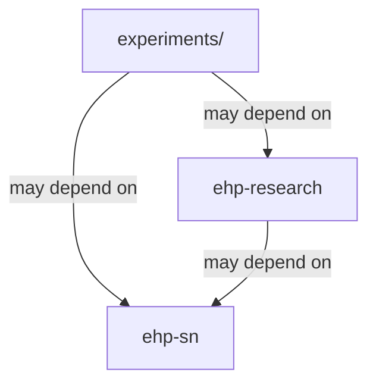

**Relationship:** Permitted Python import dependency.

All depicted dependencies are optional.

### Graph B — External resources and scientific substrates

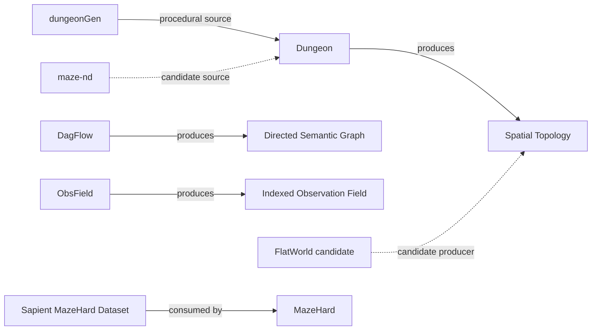

**Relationship:** External source consumption and generated scientific information.

Topology and observation-field realizations have independent identities and applicable domain references.

### Graph C — Scientific information and task dependencies

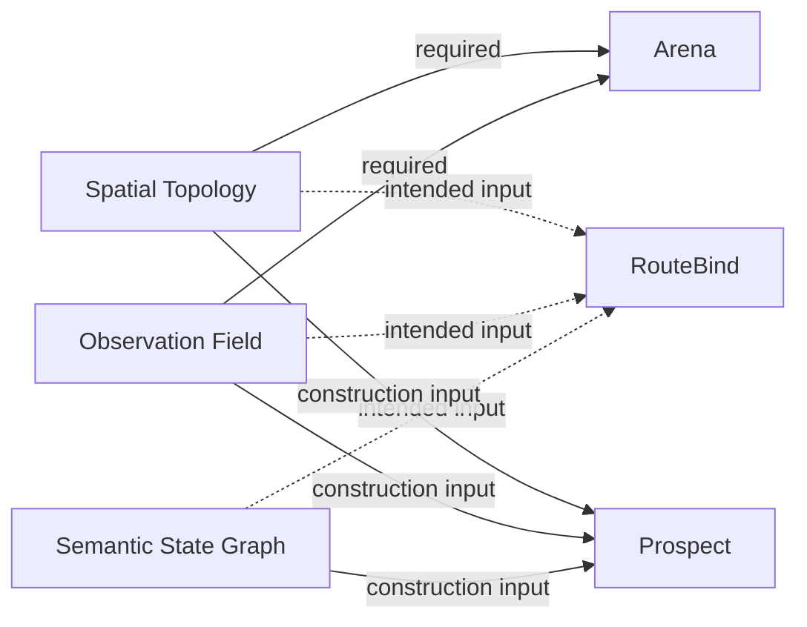

**Relationship:** Scientific information consumed by tasks.

Tasks establish position correspondence and scientific compatibility.

### Graph D — Tasks and learning-input capabilities

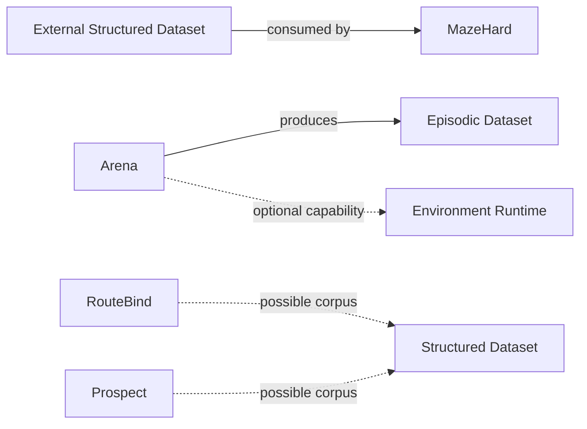

**Relationship:** Dataset consumption, production, and potential interactive task capability.

Dataset and environment interfaces are selected according to scientific requirements.

### Graph E — Models and reusable computation

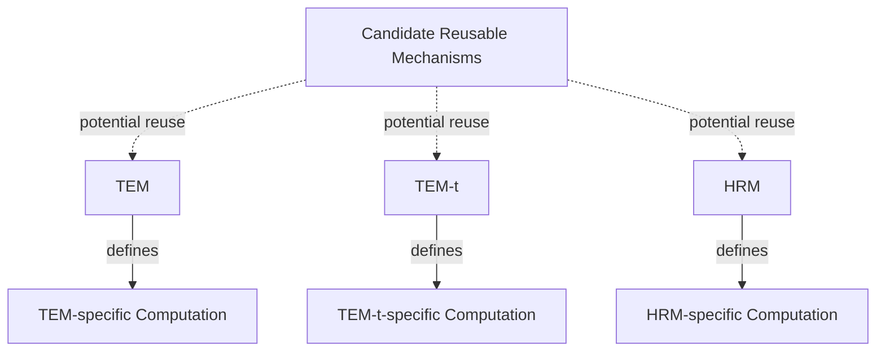

**Relationship:** Candidate computational mechanism reuse and model-specific computation.

Actual mechanism boundaries require reference-model verification.

### Graph F — Learning inputs and procedures

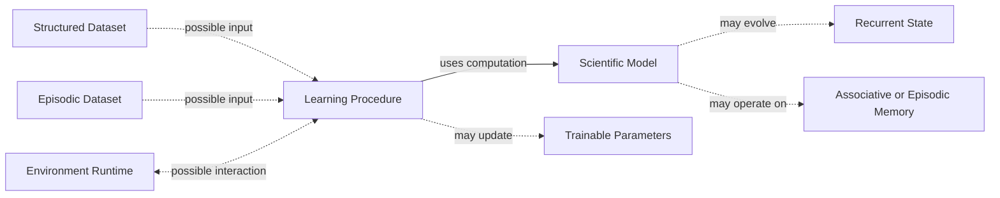

**Relationship:** Learning information, computational execution, parameter updates, and model state.

Optimizer state belongs to the learning procedure.

### Graph G — Research experiment composition

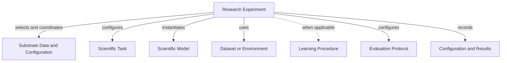

**Relationship:** Experiment selection, coordination, instantiation, evaluation, and recording.

---

## 13. Established technology choices and candidates

### 13.1 Technology catalogue

| Technology                         | Architectural role                                            | Position                 |
| ---------------------------------- | ------------------------------------------------------------- | ------------------------ |
| NumPy                              | Numerical computation and generation                          | Adopted                  |
| PyTorch                            | Neural computation and optimization                           | Adopted                  |
| NetworkX                           | Directed graphs and spatial connectivity                      | Selected                 |
| GraphML                            | Directed graph interchange and spatial graph persistence      | Selected                 |
| Apache Arrow                       | Indexed categorical assignments and typed tabular information | Selected                 |
| Apache Parquet                     | Persistent categorical observation assignments                | Selected                 |
| PyArrow                            | Arrow/Parquet operations                                      | Selected                 |
| RFC 9562 UUIDv4 URNs               | Stable decentralized domain identifiers                       | Selected                 |
| JSON and JSON Schema Draft 2020-12 | Finite domain declarations and structural validation          | Selected                 |
| TOML                               | Reusable scientific configuration                             | Established convention   |
| Xarray                             | Labeled multidimensional computation                          | Optional                 |
| Pandas                             | Tabular analysis                                              | Optional                 |
| Hugging Face Datasets              | Structured dataset access and processing                      | Evaluate                 |
| Apache Arrow datasets              | Structured dataset representation and access                  | Evaluate                 |
| PyTorch Dataset/DataLoader         | Model-facing data loading                                     | Evaluate                 |
| Minari                             | Episodic dataset persistence                                  | Evaluate                 |
| RLDS                               | Episodic dataset conventions                                  | Evaluate                 |
| Gymnasium                          | Interactive environment interface                             | Evaluate                 |
| TorchRL                            | Reinforcement-learning capabilities                           | Evaluate                 |
| PyTorch Lightning                  | Training lifecycle                                            | Optional                 |
| MLflow                             | Experiment tracking and recording                             | Selected direction       |
| DVC                                | Data and pipeline versioning                                  | Optional                 |
| Zarr / HDF5                        | Scientific array persistence                                  | Evaluate when required   |
| Croissant                          | Published dataset metadata                                    | Optional                 |
| Data Package 2.0                   | Multi-resource artifact descriptor specification              | Selected                 |
| Frictionless                       | Data Package description/validation tooling                   | Candidate implementation |
| PyTorch-native checkpoints         | Learned model artifacts                                       | Selected direction       |
| ONNX                               | Portable inference artifacts                                  | Optional                 |
| `pyproject.toml`                   | Python packaging                                              | Adopted                  |

### 13.2 Scientific representation policy

EHP uses established external representations wherever they satisfy the information requirements.

The selected core interchange forms are:

| Scientific information                | In memory                  | Persistent     |
| ------------------------------------- | -------------------------- | -------------- |
| Directed semantic graph               | NetworkX `DiGraph`         | GraphML        |
| Spatial topology                      | NetworkX `Graph`/`DiGraph` | GraphML        |
| Indexed categorical observation field | Apache Arrow `Table`       | Apache Parquet |

Application-level conventions specify the scientific identity and interpretation that these general-purpose formats do not define themselves.

### 13.3 Position-interoperability profile

The established interoperability conventions are:

- Persisted position identifiers are strings.
- Computational numerical indices are distinct from persisted identities.
- Domain identities are independently assigned and stable.
- Direct identity requires an explicit shared domain reference.
- Cross-domain composition uses explicit mappings.
- Irregular ambient domains enumerate their finite position sets.
- `grid6` domains use axial coordinates and explicit finite boundaries.
- Geometry is required according to scientific applicability.
- Multi-resource realizations use package descriptors.
- Task implementations validate cross-artifact scientific compatibility.

The approved interoperability profile uses UUIDv4 URNs for domain IDs, JSON/JSON Schema domain declarations, GraphML node IDs as spatial position IDs with graph-level `domain_id`, an Arrow/Parquet mapping relation for explicit correspondence, and Data Package 2.0 for portable packages.

### 13.4 Observation-field technology profile

The selected categorical observation-field implementation direction is:

**Apache Arrow Table → Apache Parquet**

PyArrow provides the in-memory and persistent operations.

NumPy provides numerical generation and index-related computation.

Xarray can support generation procedures requiring labeled multidimensional operations.

The categorical field remains an indexed assignment regardless of the numerical method used to generate it.

The physical representation uses non-nullable Arrow UTF-8 `position_id` and `observation_id` fields. Schema metadata preserves the required identity references; packaged interchange resolves the corresponding domain and vocabulary declarations.

### 13.5 Computational implementation policy

PyTorch provides the neural computation foundation.

Existing library operations and modules are reused where their semantics satisfy the scientific model.

Reusable EHP mechanisms are introduced only when genuine cross-model computational reuse is established.

### 13.6 Performance policy

Interoperability correctness and scientific semantics determine the initial representation and identity requirements.

Corpus-scale performance characteristics are evaluated using representative EHP workloads.

Performance-driven identifier encodings, storage layouts, and optimizations remain deferred until supported by measurements.

---

## 14. Open scientific and architectural questions and pending verification

The following questions affect completeness of the current architecture or concrete implementation decisions.

### 14.1 Substrate scientific requirements

| Component | Open requirement                                                                        | Evidence required                                         |
| --------- | --------------------------------------------------------------------------------------- | --------------------------------------------------------- |
| DagFlow   | Exact generation algorithm, extra-edge sampling, determinism                            | Generator implementation and Prospect generation protocol |
| Dungeon   | Upstream revision, layout conversion, connectivity, blocked-region and region semantics | Source implementation and generated examples              |
| FlatWorld | Supported topology families and generation parameters                                   | Concrete scientific task requirements                     |
| ObsField  | Additional assignment protocols and their scientific constraints                        | Observation-generation research requirements              |

### 14.2 Position-interoperability specification

> todo

### 14.3 Task scientific requirements

| Task      | Open requirement                                           | Evidence required                           |
| --------- | ---------------------------------------------------------- | ------------------------------------------- |
| Arena     | Exact `grid4`/`grid6` topology applicability               | Arena scientific requirements               |
| Arena     | Action vocabulary, transition and initialization semantics | Arena–TEM and Arena–TEM-t integrations      |
| Arena     | Walk protocols, episode lengths, `STAY` behavior           | Concrete corpus profiles                    |
| Arena     | Episode persistence schema and split policies              | Dataset consumers and scientific evaluation |
| RouteBind | Complete input and output schema                           | Task reference formulation                  |
| RouteBind | Supported topology and semantic graph subsets              | Scientific task requirements                |
| RouteBind | Trajectory/waypoint target construction and evaluation     | Reference targets and evaluator             |
| Prospect  | Acquisition protocol and memory construction               | Scientific reference implementation         |
| Prospect  | Memory/query pairing and target generation                 | Thesis and benchmark formulation            |
| Prospect  | Full route validity and evaluation                         | Reference evaluator                         |
| MazeHard  | Exact dataset revision, encodings, and partitions          | Dataset and reference code                  |
| MazeHard  | Solution equivalence and correctness criteria              | Published benchmark evaluator               |

### 14.4 Scientific model requirements

| Model  | Open requirement                                                        | Evidence required                        |
| ------ | ----------------------------------------------------------------------- | ---------------------------------------- |
| TEM    | Recurrent, associative, structural, sensory, and learning decomposition | Publication and reference implementation |
| TEM-t  | Attention, memory, recurrence, and training computation                 | Publication and reference implementation |
| HRM    | Hierarchical recurrence, adaptive computation, halting, and training    | Publication and reference implementation |
| HRM-RL | Scientific hypothesis, learning signals, and comparison conditions      | Experiment definition                    |

### 14.5 Reusable computational mechanisms

The `ehp-sn` mechanism inventory depends on verifying:

- Computational operations.
- Parameter ownership.
- Model-state requirements.
- Memory-state lifetimes.
- Learning interactions.
- Semantic equivalence across models.
- Existing external implementations.

The evidence consists of reference equations, model code, and actual cross-model reuse requirements.

### 14.6 Learning ownership and interfaces

The separation between model-specific and reusable learning mechanisms requires evidence from:

- Learning objectives.
- Update equations.
- Feedback pathways.
- Optimizer interactions.
- Recurrent-state behavior.
- Associative-memory updates.
- Online/offline learning requirements.

Concrete dataset and Environment Runtime interfaces must follow the scientific learning procedure.

### 14.7 Model–task integration

Outstanding integration requirements include:

- Observation encoding.
- Action encoding.
- Temporal alignment.
- Batching.
- Sequence masking.
- Prediction decoding.
- Model-state initialization and reset.
- Privileged-information exclusion.
- Memory acquisition and reuse.
- Task-specific evaluation outputs.

The first identified integrations are:

- Arena–TEM.
- Arena–TEM-t.
- MazeHard–HRM.
- Prospective semantic–spatial reasoning tasks.

### 14.8 Experimental reproducibility

Concrete experiment families must establish:

- Scientific data and source identity.
- Randomness and reproducibility conditions.
- Controlled comparison settings.
- Dataset partitions and novelty conditions.
- Metrics.
- Repeated evaluation and uncertainty.
- Checkpoint compatibility.
- Experiment-record completeness.

MLflow and PyTorch-native checkpoints provide the selected implementation foundations.

### 14.9 Corpus-scale performance

Representative workloads are required before selecting performance-oriented optimizations.

Relevant measurements include:

- Graph and observation-field loading.
- Position-correspondence construction.
- Cross-artifact validation.
- Episode and corpus generation.
- Serialization and retrieval.
- Memory consumption.

The benchmark workloads and acceptance thresholds remain open.

---
